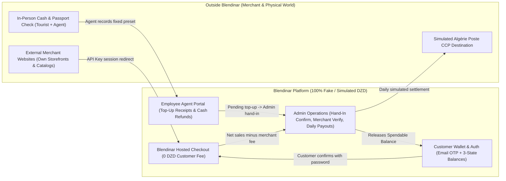
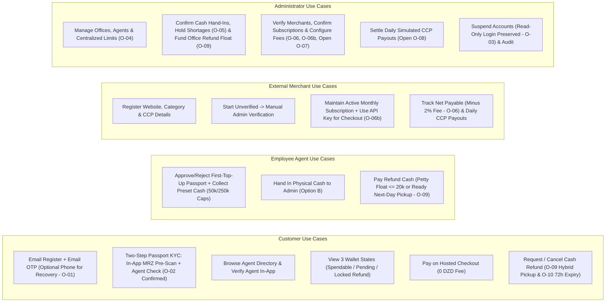
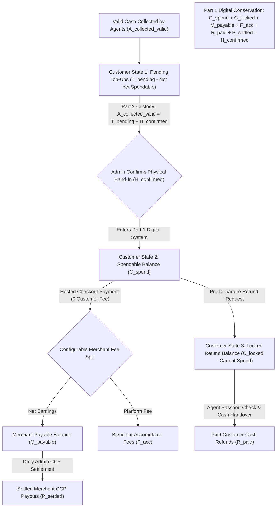
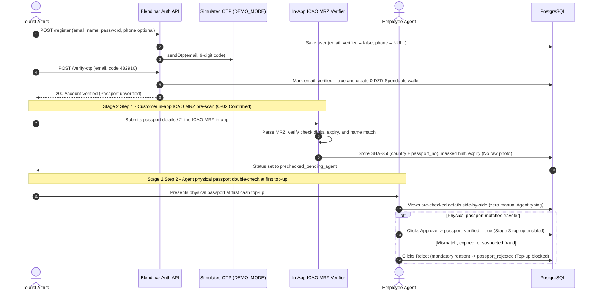
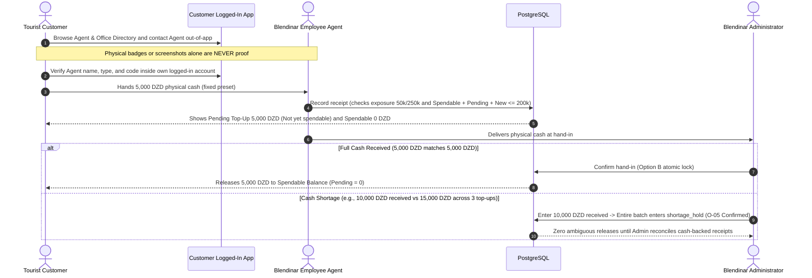
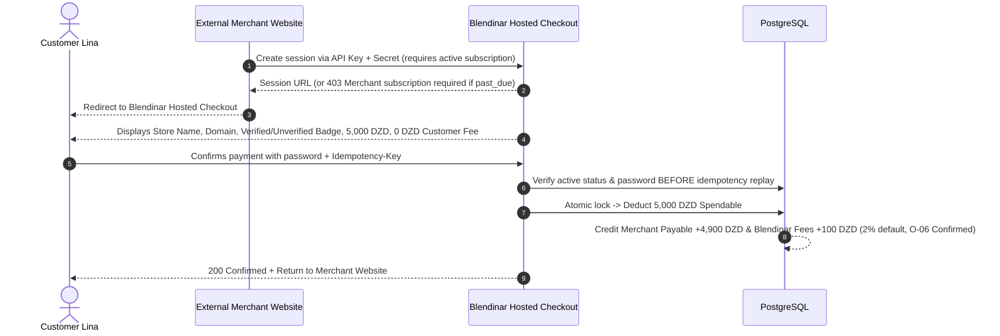
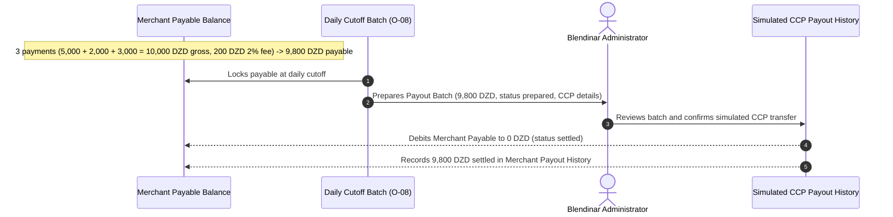
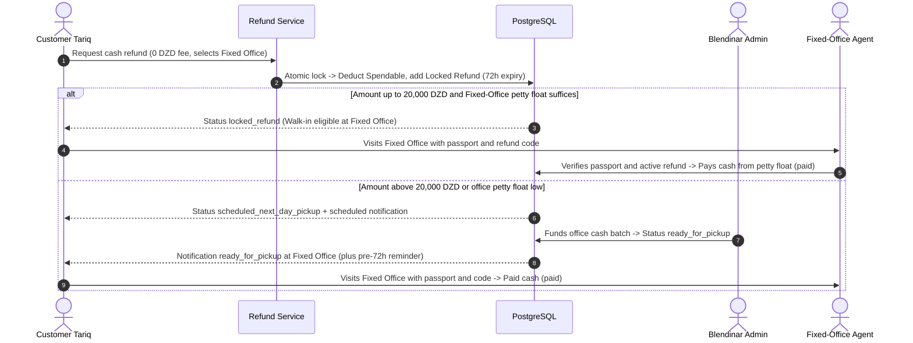
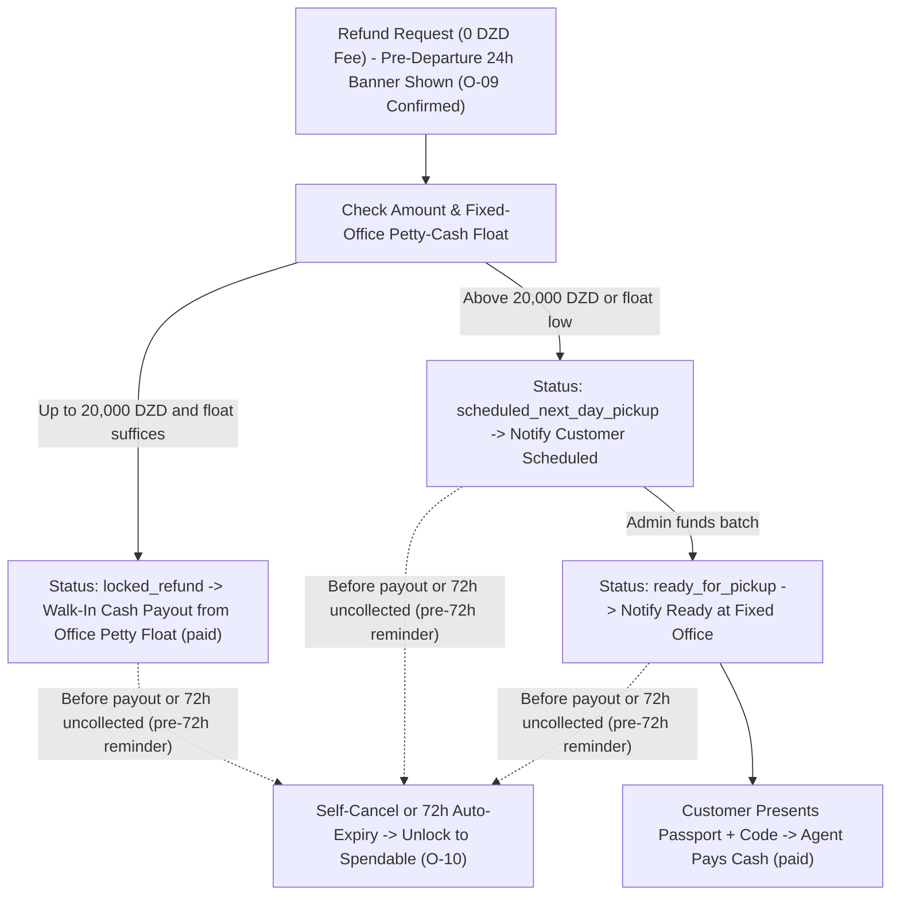

# Plan: Blendinar — Simulated Digital Wallet and Online Merchant Payment Platform

> **Important Simulated-Money & Regulatory Notice:**
> **All money in Blendinar is 100% fake and simulated.** Physical cash top-ups, agent cash hand-ins, merchant CCP payouts, and customer cash refunds exist solely inside this educational/portfolio software demonstration. Blendinar is **not** a real bank, licensed payment service provider, or money transmitter, and is not affiliated with BaridiMob, Algérie Poste (CCP), or any existing payment startup.
> **Regulatory Status (`Unverified`):** Legal, central-bank, anti-money laundering (AML), KYC legal sufficiency, and personal-data protection compliance obligations are **Unverified** and require independent legal review before any real-world operation.

---

## Decision Status Labels Used in This Plan

Every rule, scope decision, and assumption in this plan uses one of the following classifications so Lyna (the platform owner) and the engineering team never confuse confirmed rules with open questions or defaults:

- **Confirmed:** Explicitly decided and approved by Lyna.
- **Delegated:** Lyna asked the product/engineering team to decide (can be adjusted anytime).
- **Proposed:** Recommended default (including earlier Cohort `Assumed` items retained as proposed defaults) — **awaiting Lyna's confirmation; not yet Confirmed**.
- **Open:** Unresolved product or operational decision (`O-01` through `O-12`) that blocks affected implementation until Lyna decides.
- **Future:** Explicitly excluded from Blendinar v1 and deferred to a later version.
- **Unverified:** Business, market, legal, or regulatory assumption not yet verified in the real world.
- **Superseded (Historical):** Earlier Cohort Baseline v0 rule kept for historical traceability and replaced by a Blendinar v1 rule.

---

## Current Codebase Baseline vs. Blendinar v1 Target Scope

- **Cohort Baseline v0 (Currently Implemented in `src/`):** The repository currently contains the submitted AI Dev Tools Zoomcamp 2026 baseline (`3` roles: `customer`, `merchant`, `admin`; phone-number registration + simulated SMS OTP; shop-float cash top-ups; 6-character 5-minute payment codes; **10 test files / 137 automated tests** under `tests/`; Docker Compose + CI; and a starter placeholder card in `src/client/App.jsx`).
- **Blendinar v1 Target (Governed by This Plan):** Evolving on an approved development branch (`next-product`) into a 4-role simulated wallet and online merchant hosted-checkout platform with email-first auth (`+` optional phone), passport-only KYC, Option B employee-agent cash top-up hand-ins, external merchant hosted checkout with configurable merchant fees, daily simulated CCP payouts, pre-departure customer cash refunds, account suspension, and full React portals.

---

## 1. Problem & Product Concept

People visiting or living in Algeria who earn or hold physical cash — especially tourists and foreigners who do not have BaridiMob or Algérie Poste (CCP) accounts — cannot easily pay online on local Algerian websites.

- **What Blendinar Is (`Confirmed`):** A simulated digital wallet and online-payment service focused specifically on the **online payment step**.
- **Merchant Ownership (`Confirmed`):** Merchants keep their own external websites (e-commerce stores, booking pages, etc.), and Blendinar provides the **hosted payment experience** (hosted checkout). Blendinar is **not** an e-commerce website builder (**Confirmed**).
- **Target Audience (`Confirmed` / `Unverified`):**
  - Primary audience: **tourists and foreigners living in Algeria** (**Confirmed**) who cannot conveniently use BaridiMob or CCP online.
  - Secondary hypothesis — local Algerians who lack BaridiMob/CCP accounts (**Unverified — Assumption `D-08`:** market demand not yet validated; do not assume confirmed).
- **Why v1 Audience Is Narrower (`Confirmed`):** Blendinar v1 identity verification is **passport-only** (**Confirmed**). National ID cards and automated passport scanning are **Future** (**Confirmed**).



---

## 2. Why This Project Exists & Demonstration Merchant

- **Portfolio & Engineering Goal:** Evolved from the AI Dev Tools Zoomcamp 2026 final project to demonstrate production-grade financial data modeling, atomic PostgreSQL concurrency control, scoped idempotency, real-DB automated testing, and disciplined agentic engineering.
- **Demonstration Merchant (`Confirmed`):** Lyna's existing external e-commerce website will be connected as a **demonstration merchant** once Blendinar's merchant onboarding and hosted checkout APIs are ready.

---

## 3. Users, Actors & Roles (Revises `R2`)

> **Historical Cohort Baseline v0 (`R2`, Superseded by `R2-B`):** Earlier Cohort v0 defined 3 roles only (`customer`, `merchant`, `admin`) where local physical shops credited customers out of an admin-loaded shop balance.

### `R2-B` — Four Roles in Blendinar v1 (`Confirmed`)

Blendinar v1 defines **4 distinct roles** (`customer`, `agent`, `merchant`, `admin`):

1. **Customer**
   - Sign up with **email** and password using a simulated 6-digit email OTP (`phone` is optional; if optionally added and verified, supports backup account recovery OTP per `O-01`).
   - Complete **two-step hybrid passport verification** before their first cash top-up (**Confirmed** `O-02` workaround — Step 1: customer submits in-app simulated 2-line ICAO MRZ pre-scan, storing unique SHA-256 `(issuing_country, passport_number)` hash and masked/expiry metadata with zero raw photos -> `prechecked_pending_agent`; Step 2: employee Agent physically double-checks the passport side-by-side at first top-up without manual typing and clicks Approve/Reject).
   - Browse the in-app **Agent & Office Directory**, contact an agent outside the app, hand over physical DZD cash for a **fixed preset top-up amount**, and verify the agent's identity and pending top-up directly inside their own logged-in Blendinar account.
   - Track three strictly separated balance states: **Spendable Balance**, **Pending Top-Ups (Not Yet Spendable)**, and **Locked Refund Balance**.
   - Pay external online merchants via **Blendinar's hosted checkout** (`0 DZD` customer fee), confirming with their password.
   - Request a **cash refund** (`0 DZD` fee) of unused Spendable Balance before departing Algeria (`<= 20,000 DZD` walk-in petty float at Fixed Offices while available, or `> 20,000 DZD` / low float scheduled next-day office pickup per **`O-09 Confirmed`**; cancellable anytime before payout and auto-expires after 72 hours per `O-10`).
   - View personal chronological transaction history (retained in **Read-Only Mode** even if suspended per `O-03`).

2. **Agent (Blendinar Employee)**
   - Internal Blendinar employee — **not** an independent third-party shop — operating in one of two categories (**Confirmed**):
     - **Fixed-Location Office ("Partner Point"):** A permanent Blendinar-staffed counter/office (`250,000 DZD` un-handed-in cash exposure cap per `O-04`, plus an Admin-funded petty-cash refund float for walk-in refunds up to `20,000 DZD` per **`O-09 Confirmed`**).
     - **Individual Agent:** An authorized Blendinar field/appointment employee (`50,000 DZD` un-handed-in cash exposure cap per `O-04`).
   - At a customer's first top-up, physically check the customer's passport against the customer's pre-checked MRZ summary shown side-by-side (**zero manual Agent typing**) and click **Approve** or **Reject (mandatory reason)** (`O-02 Confirmed`).
   - Collect physical DZD cash for a fixed top-up preset (from `passport_verified` customers) and record a **Pending Top-Up** (subject to the Agent's Cash Exposure Limit — **not** a prepaid float).
   - Physically hand in collected cash to Blendinar Admin so Admin can confirm the hand-in and release customer Spendable Balances (**Option B**).
   - Inspect customer's physical passport at cash refund pickup, verify active refund record (`locked_refund` at Fixed Office petty float `<= 20,000 DZD` or `ready_for_pickup` next-day pickup), disburse physical DZD cash, and mark refunds `paid`.
   - *Explicit Exclusion (`Confirmed`):* Agent salaries, bonuses, and commission calculations are **outside v1 scope**.

3. **Merchant (External Online Business)**
   - External business operating its own website that registers on Blendinar with required business name, website URL, category, CCP payout details, and optional Instagram/contact details (**Confirmed**).
   - Remains **Unverified** (`Unverified Merchant — lower transaction limits apply`) until manually reviewed and verified by Admin (`Verified Merchant`).
   - Maintains a separate monthly B2B **Platform Subscription** (`2,000 DZD/month` configurable default; `active | past_due | canceled` per **`O-06b`**) completely outside customer payment balances: `past_due` blocks creating **new** Hosted Checkout sessions (`403`) while already-earned payable balances still settle normally.
   - Receives Blendinar API credentials (API key + secret key) to integrate a Blendinar payment button redirecting shoppers to Blendinar's hosted checkout page.
   - Accrues net sales (`gross payment - configurable 2% transaction fee`) in its **Merchant Payable Balance**.
   - Receives **daily simulated CCP payouts** reviewed and confirmed by Admin, and inspects merchant sales, fee, subscription, and payout history.

4. **Administrator (Blendinar Operator)**
   - Registers/manages employee Agents and Fixed-Location Offices (including Fixed-Office refund petty-cash floats per `O-09`), sets Agent cash exposure caps, and reviews Agent directory records.
   - Confirms Agent physical cash hand-ins (releasing customer Pending Top-Ups to Spendable Balance) and records/investigates cash shortages or disputed hand-ins.
   - Manually reviews and verifies Merchants, confirms/manages monthly B2B merchant subscriptions (`O-06b`), reviews passport anomalies/disputes, and funds next-day scheduled refund pickups (`O-09`).
   - Configures centralized platform limits, subscription rate (`2,000 DZD/month` default), and `2%` transaction fee rules.
   - Reviews and confirms **daily simulated CCP payout batches** for merchants.
   - Suspends or bans abusing/fraudulent accounts (`active` -> `suspended`) while preserving existing balances and audit history.
   - Inspects platform-wide ledger records, flags, and the two-part financial conservation dashboard.
   - *Note:* A separate **Support-Agent** role remains **Future**.



---

## 4. Plain-English Glossary

- **Wallet:** A user's digital account record storing balances in whole integer centimes (`bigint`).
- **Spendable Balance:** Digital DZD in a customer's wallet from Admin-confirmed cash hand-ins that can currently be used to pay merchants or locked for a cash refund.
- **Pending Top-Up (Non-Spendable):** A cash top-up recorded by an Agent after collecting physical DZD cash, awaiting the Agent's physical cash hand-in and Admin confirmation. **Customers cannot spend or refund pending top-ups.**
- **Locked Refund Balance:** Customer Spendable Balance immediately set aside when the customer requests a pre-departure cash refund, preventing the customer from spending that same money online before picking up cash.
- **Agent Cash Exposure Limit:** A safety cap on how much un-handed-in cash an employee Agent may hold at once. **Explicitly NOT a prepaid float** — agents do not buy or hold pre-funded digital money.
- **Cash Hand-In & Admin Confirmation:** The operational step where an Agent delivers collected cash to Blendinar Admin and Admin confirms receipt in the system, releasing the linked Pending Top-Ups into customers' Spendable Balances (Option B).
- **Fixed-Location Office ("Partner Point") vs. Individual Agent:** A *Fixed-Location Office / Partner Point* is a Blendinar-staffed physical office; an *Individual Agent* is a verified mobile/appointment Blendinar employee.
- **Append-Only Ledger:** The permanent `transactions` table where money records are only ever added (`INSERT`), never edited (`UPDATE`) or deleted (`DELETE`).
- **Whole Dinars & Integer Centimes:** User inputs and screens display whole Algerian Dinars (`DZD` / `DA`), while PostgreSQL stores `dinars * 100` as exact whole integer centimes (`bigint`) to avoid decimal rounding errors.
- **Merchant Payable Balance:** Net sales earnings (`gross payment - merchant fee`) owed by Blendinar to a Merchant awaiting daily simulated CCP settlement.
- **Blendinar Accumulated Fees:** Total platform fees earned by Blendinar from successful merchant payments, accounted separately from merchant payables and customer funds.
- **Daily CCP Payout Batch:** A daily prepared settlement record summarizing each merchant's unpaid Merchant Payable Balance and registered CCP details for Admin review and simulated payout confirmation.
- **Scoped Idempotency Key:** A client-supplied unique request identifier scoped to `(user_id, endpoint, key)` so accidental double-clicks or retries execute at most once after auth/password and payload checks pass.

---

## 5. Rules and Decisions (`R1`–`R15`) + Financial Conservation Invariant

### 5.1 Preserved Historical Cohort Baseline Rules (`R1`–`R12`)

The original Cohort Baseline rules are preserved verbatim below, with Blendinar v1 replacements annotated cleanly:

- **`R1.` The customer's journey comes first. (`Delegated`)**
  Merchants get only the features the customer journey needs. *Why:* the customer journey is the core of the demo and is where simultaneous-use problems appear. Without shops no money can enter, so the minimum shop features are built. *(In Blendinar v1, this principle extends across customer, agent, merchant, and admin safety flows.)*

- **`R2.` Three roles only: customer, merchant, admin. (`Confirmed` — Historical Cohort v0)**
  `[Superseded by R2-B: Four roles in Blendinar v1 (customer, agent, merchant, admin)]`
  *Why (historical):* each extra role needs its own permissions to build and test. A support-agent role is in the backlog.

- **`R3.` One currency, the Algerian dinar (DZD). Input is whole dinars. Amounts are stored as whole centimes. (`Confirmed`)**
  *Why:* computers make small errors with decimal numbers, which add up to wrong totals. Whole numbers avoid that. Several currencies would need exchange rates, which is a separate project.

- **`R4.` A balance never goes below zero. (`Confirmed`)**
  A payment or transfer that would do so is rejected with a clear message. *Why:* it forces the app to check the balance and subtract in one step, which is the main safety rule against spending the same money twice. Overdraft is a credit feature and is in the backlog.

- **`R5.` Three limits, fixed in one configuration file (planned for a future version). (`Confirmed` — Historical Cohort v0)**
  `[Extended by R5-B: Centralized Admin-Configurable Limits for Blendinar v1]`
  - Maximum 50,000 DA per transaction.
  - Maximum 100,000 DA per customer per day.
  - Maximum balance of 200,000 DA per customer wallet.
  *Why (historical):* limits give testable rules and are a normal part of financial software. The values are invented for the demo. They are not claims about Algerian rules or about any provider. An admin screen to change them is in the backlog.

- **`R6.` No fees in version 1. (`Confirmed` — Historical Cohort v0)**
  `[Superseded by R6-B: Configurable Merchant Payment Fee; Zero Customer Fees in Blendinar v1]`
  *Why (historical):* a fee turns one payment into several history lines and needs a business decision (who pays, how much). The structure must allow fees to be added later.

- **`R7.` Sign-up uses a phone number and a password, with a simulated one-time code. No ID document check. (`Confirmed` — Historical Cohort v0)**
  `[Superseded by R7-B (Email + Simulated Email OTP; Phone Optional) & R7-C (Passport-Only KYC)]`
  The code is shown in the server log or a test screen instead of being sent by SMS. Sending sits behind a single function so a real SMS provider can replace it later. *Why for not sending SMS now:* it costs money per message, it can be abused on a public site, reviewers would need real phone numbers to try the app, and automated tests must run without sending anything. Real SMS and ID checks are in the backlog. This is a deliberate simplification of real practice.

- **`R8.` Cash top-up comes out of the shop's balance. (`Confirmed` — Historical Cohort v0)**
  `[Superseded by R8-B: Employee Agent Cash Collection & Option B Hand-In Release]`
  When a shop credits a customer with X DA, the shop balance goes down by X and the customer balance goes up by X. A top-up larger than the shop balance is rejected. The admin loads shop balances. *Why (historical):* the total money in the system then changes only when the admin loads a shop, so a test can check that the totals always add up. Otherwise a shop could credit wallets without ever receiving cash.

- **`R9.` A shop starts a payment and the customer confirms it with their password. (`Delegated` — Historical Cohort v0)**
  `[Superseded/Extended by R9-B: External Merchant Website + Blendinar-Hosted Checkout]`
  The shop enters the amount and gets a payment code. The customer types the code, sees the shop name and the exact amount, and confirms. Money moves only after confirmation. *Why (historical):* the customer sees what they pay before anything moves, and a shop cannot charge without approval. Scanning a QR code with the camera is in the backlog.

- **`R10.` A customer can send money to another customer by phone number (planned for a future version). (`Confirmed` — Historical Cohort v0; `Delegated` Resolved -> Strictly `Future` via `O-11`)**
  The app shows the registered name of the recipient before the sender confirms with their password. The money arrives immediately and the recipient approves nothing. *Why:* showing the name reduces the chance of sending to a mistyped number. The same rules as payments apply. *(Disposition resolved via `O-11` (`Delegated`): customer-to-customer peer transfers remain strictly **`Future`** and are excluded from Blendinar v1.)*

- **`R11.` History is never edited. Only an admin can reverse a transaction (reversals are planned for a future version). (`Confirmed`)**
  A reversal is a new transaction that moves the money back, and the original is marked as reversed. If the receiver has already spent the money, the reversal is rejected, because balances cannot go below zero. Customer or shop refund requests inside the app are in the backlog. *Why:* the history must always tell the truth about what happened.
  *(Note: In Blendinar v1, **Admin erroneous-transaction reversals (`R11`)** remain **Future**, and are distinct from **Customer Unused-Balance Cash Refunds (`R14`)**, which are in v1.)*

- **`R12.` Safety when things happen at the same moment. (`Delegated` — Extended by `R12-B`)**
  - Two payments that together exceed the balance: exactly one succeeds and the other is rejected for insufficient balance.
  - The same confirmation sent twice: the customer is charged once and the second attempt gets the same answer as the first.
  *Why:* these are the real many-users problems of money software. Both are proved by a test that sends many requests at once and then checks the balances.

---

### 5.2 Blendinar Revised & New Rules (`R2-B` through `R15`)

*(Note: Subsection 5.6 keeps the specification numbering for Financial Conservation; rules revisions from earlier brief sections 5.1–5.5 appear under R2-B through R15 above and below.)*

- **`R5-B.` Centralized Admin-Configurable Limits (`Confirmed` structure / `Delegated` resolved values / `Open O-07` merchant cap)**
  - **Fixed Top-Up Presets (`Delegated`):** Cash top-up requests use admin-configurable fixed presets: `[1,000; 2,000; 5,000; 10,000; 20,000]` DZD (custom arbitrary top-up amounts remain **Future**).
  - **Unverified Merchant Lower Cap (`Confirmed` rule / `Open O-07` values):** Unverified merchants face stricter transaction limits than verified merchants (exact caps remain **Open `O-07`**).
  - **Agent Cash Exposure Limits (`Delegated`):** **`50,000 DZD`** maximum un-handed-in cash for **Individual Agents** and **`250,000 DZD`** maximum un-handed-in cash for **Fixed-Location Offices ("Partner Points")** (reflecting stronger physical security and higher volume at fixed offices).
  - **Customer Spend & Balance Limits (`Delegated`):** `50,000 DZD` per transaction, `100,000 DZD` per day outgoing spend, and `200,000 DZD` maximum customer wallet balance — enforced at top-up recording time against `Spendable + Pending + NewTopUp <= 200,000 DZD` so Admin hand-in confirmation can never breach the wallet cap.

- **`R6-B.` Two-Stream Merchant Revenue (`2%` Transaction Fee + Separate Monthly B2B Subscription); Zero Customer Fees (`Confirmed` — `O-06` & `O-06b` resolved)**
  - **Stream 1 — Separate Monthly B2B Platform Subscription (`Confirmed` separation / `Delegated` resolved monthly cadence `O-06b`):** Merchants pay a recurring **Monthly Platform Subscription** (admin-configurable default **`2,000 DZD/month`**) tracked in `merchant_subscriptions` (`active` | `past_due` | `canceled`, managed/confirmed by Admin) — **completely separate** from customer payment balances and customer-backed wallet conservation (`Section 5.6`). If a merchant's subscription is `past_due`, creating **new** Hosted Checkout sessions is blocked (**`403 Merchant subscription required`**) and a renewal banner/notification is displayed, while already-earned **Merchant Payable Balances** still settle normally via daily CCP payout (never confiscated and never violating `CHECK (balance >= 0)`).
  - **Stream 2 — `2%` Per-Sale Transaction Fee (`Confirmed` `O-06`):** Completely separate from Stream 1, merchants pay a configurable transaction fee on each successful payment, defaulting to **`2%` (`200` basis points)** (admin-configurable in centralized settings).
  - Customers pay **`0 DZD` fee** on cash top-ups, online merchant payments, and unused-balance cash refunds in v1 (**Confirmed**).
  - Calculated strictly in integer centimes as `Math.round(amountCentimes * 200 / 10000)` (with configurable bps, minimum `1` centime whenever configured fee > 0, and rejecting any payment/rule where `feeAmount >= paymentAmount`).
  - On a successful payment of `grossAmount`, Blendinar credits the merchant's payable balance with `grossAmount - feeAmount` and records `feeAmount` separately in **Blendinar Accumulated Transaction Fees** (**Confirmed**).

- **`R7-B.` Email-Required Authentication + Simulated Email OTP; Optional Phone for Backup Recovery (`Confirmed` — `O-01` resolved)**
  - Registration and login require an **email address** and password, verified via a simulated 6-digit **email OTP** (**Confirmed**).
  - Phone number is **optional** (**Confirmed**): tourists without an Algerian SIM card register and use Blendinar with email only (blank phone strings normalize to `NULL` so uniqueness permits multiple phone-less users).
  - **Backup Account Recovery (`Confirmed` `O-01`):** If a customer optionally adds and verifies a phone number, they can request a 6-digit simulated recovery OTP to that phone (via `sendOtp` in `DEMO_MODE`) to recover account access or reset their password if they lose email access.
  - Email is chosen for accessibility and account communication (do **not** claim email is inherently more secure than SMS). Simulated OTP delivery stays behind `sendOtp` preserving `DEMO_MODE` (**Confirmed**).

- **`R7-C.` Passport-Only Two-Step Hybrid Verification (`Confirmed` workaround — `O-02` resolved)**
  - Identity verification in v1 accepts **passports only** (**Confirmed**). Real third-party camera OCR APIs and National ID cards remain **Future** (**Confirmed**), and real-world legal sufficiency remains **Unverified**.
  - **Two-Step Hybrid Verification (`Confirmed` `O-02`):** Combines customer self-service MRZ pre-entry with genuine in-person verification by an employee Agent — without forcing Agents to manually type passport numbers like security guards:
    - **Step 1 — Customer In-App ICAO MRZ Pre-Scan:** Before first top-up, the customer submits passport details / simulated 2-line **ICAO MRZ** in-app. The app executes standard **ICAO MRZ parsing + mathematical check-digit verification**, expiry date check, and name-match check; stores a unique **SHA-256 hash of `(issuing_country, passport_number)`** (`1` account per passport), masked passport hint, issuing country, and expiry (**never storing raw passport scan photos**); and sets verification status to **`prechecked_pending_agent`** (anomalies route to `pending_admin_review`).
    - **Step 2 — Agent Physical Double-Check at First Top-Up:** When the customer presents their physical passport at their first cash top-up, the Agent Portal displays the pre-checked details side-by-side (**zero manual passport typing by the Agent**). The Agent inspects the physical passport against the traveler and clicks **Approve** (`passport_verified = true`) or **Reject** (`passport_rejected`, mandatory reason).
  - The four stages remain strictly separated:
    1. **Stage 1 — Account registration & email OTP verification:** Creates verified email login with `0` Spendable Balance.
    2. **Stage 2 — Two-step hybrid passport verification:** Customer in-app ICAO MRZ pre-scan (`prechecked_pending_agent`) + Agent physical double-check at first top-up (`passport_verified = true` or `passport_rejected`).
    3. **Stage 3 — Cash top-up authorization:** Only customers approved in Step 2 (**`passport_verified = true`**, **Confirmed**) can complete a cash top-up.
    4. **Stage 4 — Real third-party camera OCR API integration:** **Future**.

- **`R8-B.` Employee Agent Cash Collection & Option B Hand-In Release (`Confirmed`)**
  - Cash top-ups are collected exclusively by Blendinar employee Agents (**Fixed-Location Offices / "Partner Points"** or **Individual Agents**) (**Confirmed**). A "Partner Point" is a Blendinar-staffed office, **not** an independent third-party merchant (**Confirmed**).
  - Customers discover agents/offices via an **in-app Directory** displaying office/agent names, roles, locations, opening hours, and contact info, and coordinate outside the app (**Confirmed**). Automated agent matching and in-app scheduling are **Future** (**Confirmed**).
  - **Customer Anti-Impersonation Verification (`Confirmed`):** Physical badges, uniforms, or screenshots are **never** proof. Customers verify an agent's registered identity, role type, verification identifier/code, and pending top-up record directly inside their **own logged-in Blendinar account**.
  - **Option B Release Flow & Shortage Batch Hold (`Confirmed` — `O-05` resolved):**
    1. Agent collects cash and records a fixed-preset top-up -> creates a **Pending Top-Up (Not Yet Spendable)** record (capped by the Agent's Cash Exposure Limit and `Spendable + Pending + NewTopUp <= 200,000 DZD`).
    2. Agent hands physical cash in to Blendinar Admin.
    3. Admin confirms the hand-in in the platform. If received cash is less than expected for the batch, the entire short batch enters **`shortage_hold`** with **zero** ambiguous top-ups released until Admin reconciles which customer receipts are cash-backed (`O-05` Confirmed).
    4. Only upon Admin hand-in confirmation of cash-backed receipts is each customer's **Spendable Balance** credited.
  - Top-up Option A (instant agent-float credit) and Option C (third-party settlement network) are **Future** (**Confirmed**).

- **`R9-B.` External Merchant Websites & Blendinar-Hosted Checkout (`Confirmed` / `Open O-07`)**
  - Merchants register their external business with: required business name, website URL, category, CCP payout details, and optional Instagram handle / contact info (**Confirmed**). Instagram-only merchants without a website and DM payment links are **Future** (**Confirmed**).
  - Merchants start **Unverified** (`Unverified Merchant — lower transaction limits apply`) until an Admin manually checks legitimacy and marks them **Verified** (**Confirmed**). Exact unverified vs. verified caps are **Open (`O-07`)**.
  - Registered merchants receive an API key + secret key (secret stored hashed at rest) to create checkout sessions and redirect buyers from their website's Blendinar payment button to **Blendinar's Hosted Checkout** (**Confirmed**).
  - Hosted Checkout displays the merchant's business name, registered website domain, manual verification badge (`Verified` vs `Unverified`), gross DZD price, and `0 DZD` customer fee notice, requiring customer authentication + password confirmation (**Confirmed**).

- **`R12-B.` Concurrency, Scoped Idempotency & Safe Integer Bounds (`Confirmed` / `Delegated`)**
  - All financial mutations execute atomically inside PostgreSQL transactions using `CHECK (balance >= 0)` and deterministic `SELECT ... FOR UPDATE` row locking sorted by ascending ID.
  - Scoped idempotency keys use `(user_id, endpoint, key)` so different users or endpoints do not collide; payload mismatch with a previously used key is rejected; **authentication, live account suspension check, and confirmation password verification MUST execute BEFORE returning any cached idempotent response** (**Confirmed** hardening over Cohort v0).
  - Reject `amountDinars > Math.floor(Number.MAX_SAFE_INTEGER / 100)` prior to `dinars * 100` centime conversion (**Confirmed**).

- **`R13.` Daily Merchant CCP Payouts (`Confirmed` / `Open O-08`)**
  - Once per daily settlement cycle, the system prepares a **Daily CCP Payout Batch** summarizing each eligible merchant's unpaid **Merchant Payable Balance**, gross sales, fees, net payout, and registered CCP account details (**Confirmed**).
  - Admin reviews the daily batch and confirms the **simulated** CCP transfer, settling the merchant's payable balance to `0` (for the batch) and recording immutable payout history (`prepared` -> `settled`) (**Confirmed**).
  - Payout records also support `failed`, `reversed`, `disputed`, and `delayed` states (**Confirmed**). Real bank/BaridiMob/CCP APIs are **Future** (**Confirmed**).
  - Daily cutoff hour/timezone, minimum payout threshold (if any), and automatic vs. Admin-triggered batch preparation are **Open (`O-08`)**.

- **`R14.` Customer Refunds of Unused Balance (`Confirmed` — `O-09` Option 4 Hybrid & `O-10` resolved)**
  - Before departing Algeria, a customer may request a cash refund of unused **Spendable Balance** at **`0 DZD` fee** (**Confirmed**).
  - Submitting a refund request **immediately and atomically deducts** the requested amount from Spendable Balance into **Locked Refund Balance** (protected by `SELECT ... FOR UPDATE` against concurrent payments) (**Confirmed**).
  - **Self-Cancellation & 72-Hour Auto-Expiry (`Confirmed` `O-10`):** Customers may cancel an uncollected refund (`locked_refund`, `scheduled_next_day_pickup`, or `ready_for_pickup`) anytime prior to payout, and uncollected requests automatically expire after **72 hours** (checked lazily and/or via sweep, with pre-expiry reminders), atomically unlocking funds back to Spendable Balance. Disputed cash-handover claims escalate to Admin review without erasing history.
  - **Hybrid Option 4 Post-Hand-In Cash Source (`Confirmed` `O-09`):**
    - **Walk-In Fixed-Office Petty Float (`<= 20,000 DZD`):** Designated Fixed-Location Offices ("Partner Points") hold a small Admin-funded petty-cash refund float to pay walk-in refunds up to **`20,000 DZD`** on the spot while float lasts (`locked_refund` -> `paid`).
    - **Next-Day Scheduled Office Pickup (`> 20,000 DZD` or Low Float):** Refunds above `20,000 DZD` (or whenever office petty float is insufficient) transition to **`scheduled_next_day_pickup` -> `ready_for_pickup`** funded by Admin treasury at the designated Fixed Office.
    - **Pre-Departure Planning Banner & Notifications:** Customer Wallet Dashboard and Refund screens display a persistent planning banner advising tourists to request refunds **at least 24 hours before departure** (`<= 20,000 DZD` walk-in vs. `> 20,000 DZD` next-day pickup), and customers receive notifications when scheduled, when **`ready_for_pickup` at `[Fixed Office]`**, and before **72h** expiry.
  - The customer visits the designated Fixed Office with their passport; the Agent verifies identity and refund code/status, hands over physical DZD cash, and records the refund as `paid` (**Confirmed**).

- **`R15.` Customer Account Status & Suspension (`Confirmed` — `O-03` resolved)**
  - Admin may suspend or ban abusing/fraudulent accounts (`active` -> `suspended`) (**Confirmed**).
  - **Read-Only Login & Balance Preservation (`Confirmed` `O-03`):** Suspended customers **can log in in Read-Only Mode** (`GET` profile, separated 3 balances, transaction history, and suspension reason/appeal notice) so it is transparent their money is preserved. Blendinar never deletes or confiscates funds.
  - **Live Enforcement & In-Flight Hold (`Confirmed` `O-03`):** `requireAuth` checks live `users.status` in PostgreSQL on authenticated requests so all financial or state-changing mutations (`POST` top-ups, payments, refunds, profile edits) fail immediately with `403 Account suspended`. In-flight pending top-ups and locked refunds stay held for Admin review.

---

### 5.6 Proposed Financial Conservation Invariant (`Proposed — Awaiting Lyna's Approval`)

> **Approval Required:** This updated two-part conservation invariant adapts `R8` / Check 13 from Cohort v0 to Blendinar's Option B cash top-ups, merchant fees, CCP payouts, and customer cash refunds. **It is `Proposed` and requires Lyna's explicit approval before implementation.**

In plain English:
- Under Option B, **spendable digital value enters the platform only when an Admin confirms an employee Agent's cash hand-in**.
- Once confirmed, every digital Dinar must remain accounted for across six buckets: customer spendable balances, customer locked-for-refund balances, unpaid merchant payable balances, Blendinar's accumulated transaction fee account (`2%` Stream 2), physical cash refunds already paid out to customers, and simulated CCP payouts already settled to merchants.
- Separately, **physical top-up cash collected by agents** (excluding invalid/voided receipts) must always equal **pending top-ups awaiting hand-in** plus **admin-confirmed hand-ins**.
- **Scope Boundary for B2B Merchant Subscriptions (`O-06b Confirmed`):** Separate **Stream 1 B2B merchant platform subscriptions (`merchant_subscriptions`)** sit completely outside the customer-funds conservation equations (`H_confirmed`), keeping Part 1 and Part 2 conservation exact (and ensuring subscriptions never touch `merchant_payable_balance` or cause negative balances).

All quantities below are measured in **integer centimes (`bigint`)**:

1. **Part 1 — Digital Value Conservation:**
   $$C_{\text{spend}} + C_{\text{locked}} + M_{\text{payable}} + F_{\text{acc}} + R_{\text{paid}} + P_{\text{settled}} = H_{\text{confirmed}}$$
   Where:
   - $C_{\text{spend}}$ = sum of all customer Spendable Balances
   - $C_{\text{locked}}$ = sum of all active customer Locked Refund Balances
   - $M_{\text{payable}}$ = sum of all unpaid Merchant Payable Balances
   - $F_{\text{acc}}$ = total Blendinar Accumulated Fees from completed payments
   - $R_{\text{paid}}$ = total physical cash refunds marked `paid` to customers
   - $P_{\text{settled}}$ = total daily merchant CCP payouts marked `settled`
   - $H_{\text{confirmed}}$ = total customer top-up value released via Admin-confirmed cash hand-ins

2. **Part 2 — Top-Up Cash Custody Conservation:**
   $$A_{\text{collected\_valid}} = T_{\text{pending}} + H_{\text{confirmed}}$$
   Where:
   - $A_{\text{collected\_valid}}$ = total valid cash top-up amounts collected and recorded by Agents
   - $T_{\text{pending}}$ = total top-up amounts still `pending_hand_in` / `shortage_hold` / `disputed` awaiting confirmation

3. **Unified Reconciliation Identity (combining Parts 1 & 2):**
   $$C_{\text{spend}} + C_{\text{locked}} + M_{\text{payable}} + F_{\text{acc}} + R_{\text{paid}} + P_{\text{settled}} + T_{\text{pending}} = A_{\text{collected\_valid}}$$

#### Worked 7-Step Numerical Trace (Amounts Shown in Whole DZD; Stored as `× 100` Centimes)
*(Uses the `Confirmed` default `2%` (`200` bps) merchant fee — `120 DZD` on a `6,000 DZD` payment.)*

| Step | Event | $C_{\text{spend}}$ | $C_{\text{locked}}$ | $M_{\text{payable}}$ | $F_{\text{acc}}$ | $R_{\text{paid}}$ | $P_{\text{settled}}$ | $H_{\text{confirmed}}$ | $T_{\text{pending}}$ | $A_{\text{collected\_valid}}$ | Part 1 Check | Part 2 Check |
| :--- | :--- | :---: | :---: | :---: | :---: | :---: | :---: | :---: | :---: | :---: | :---: | :---: |
| **0** | Initial empty system | 0 | 0 | 0 | 0 | 0 | 0 | **0** | 0 | **0** | `0 = 0` | `0 = 0 + 0` |
| **1** | Agent records `10,000` DZD cash top-up (pending) | 0 | 0 | 0 | 0 | 0 | 0 | **0** | 10,000 | **10,000** | `0 = 0` | `10,000 = 10,000 + 0` |
| **2** | Admin confirms `10,000` DZD cash hand-in | 10,000 | 0 | 0 | 0 | 0 | 0 | **10,000** | 0 | **10,000** | `10,000 = 10,000` | `10,000 = 0 + 10,000` |
| **3** | Customer pays `6,000` DZD (`0` cust fee, `120` placeholder fee) | 4,000 | 0 | 5,880 | 120 | 0 | 0 | **10,000** | 0 | **10,000** | `10,000 = 10,000` | `10,000 = 0 + 10,000` |
| **4** | Admin settles `5,880` DZD daily CCP payout to Merchant | 4,000 | 0 | 0 | 120 | 0 | 5,880 | **10,000** | 0 | **10,000** | `10,000 = 10,000` | `10,000 = 0 + 10,000` |
| **5** | Customer locks remaining `4,000` DZD for cash refund | 0 | 4,000 | 0 | 120 | 0 | 5,880 | **10,000** | 0 | **10,000** | `10,000 = 10,000` | `10,000 = 0 + 10,000` |
| **6** | Agent verifies passport & pays `4,000` DZD cash refund | 0 | 0 | 0 | 120 | 4,000 | 5,880 | **10,000** | 0 | **10,000** | `10,000 = 10,000` | `10,000 = 0 + 10,000` |



---

## 6. Detailed Feature Specifications & Mandatory Numerical Scenarios

### 6.1 Customer Registration, Email OTP & Account Lifecycle (`R7-B`)
- **What & Why:** Allows tourists and foreigners without Algerian SIM cards to sign up cleanly using an email address and password, verified via a simulated 6-digit email OTP (`DEMO_MODE`), with phone optional.
- **Who Uses It:** Unregistered visitors becoming `customer` accounts (and `merchant` registration via merchant onboarding).
- **User Actions:** Enter email, full name, password, and optional phone -> receive/enter 6-digit email OTP -> log in with email + password (`POST /api/auth/login` -> JWT).
- **System Shows & Records:** Stores hashed password (`bcrypt`), normalizes empty phone string to `NULL`, enforces unique non-null email (and unique non-null phone if provided), emits simulated OTP via `sendOtp` (exposed only outside production or when `DEMO_MODE=true`), and creates a `0 DZD` wallet on OTP verification.
- **Normal Flow (Scenario 1 — Registration, Email OTP & Two-Step Hybrid Passport Verification):**
  - Tourist "Amira" registers with `amira@example.com`, password, and no phone number -> receives simulated 6-digit email OTP `482910` -> verifies OTP -> account becomes email-verified with `0 DZD` Spendable Balance, `0 DZD` Pending, `0 DZD` Locked Refund. Before her first cash top-up (**Step 1**), Amira submits her passport details / simulated 2-line **ICAO MRZ** in-app -> MRZ check digits, expiry, and name match pass -> unique SHA-256 `(issuing_country, passport_number)` hash is stored (zero raw photo) and status becomes **`prechecked_pending_agent`**. At her first cash top-up (**Step 2**), the Agent Portal displays Amira's pre-checked summary side-by-side (**zero manual Agent typing**); the Agent compares Amira's physical passport and clicks **Approve** -> `passport_verified = true` (Stage 3 cash top-up unlocked, or **Reject** with mandatory reason -> `passport_rejected`). *(If Amira later optionally adds & verifies a phone number, she can use a simulated phone recovery OTP if she loses email access per `O-01`.)*
- **Failure & Edge Cases:** Duplicate verified email -> `409`; invalid email format or short password -> `400`; wrong/expired/used OTP -> `400`; self-registering as `admin` or `agent` -> `403`; re-registering an unverified email updates details and issues a fresh OTP; multiple phone-less users (`phone = NULL`) do not collide.
- **Out of Scope / Open:** Real email/SMS delivery (`Future` — pluggable behind `sendOtp`); optional phone backup recovery OTP is **`Confirmed` (`O-01`)**.



### 6.2 Passport Verification & Account Suspension (`R7-C`, `R15`)
- **What & Why:** Restricts v1 KYC to **2-step hybrid passport verification** (customer MRZ pre-scan + Agent physical double-check at first top-up without making Agents type passport numbers like security guards) and lets Admin suspend abusing accounts transparently without erasing balances or audit history.
- **Who Uses It:** Customers (Step 1 in-app MRZ pre-scan & Read-Only login if suspended), Agents (Step 2 one-click physical Approve/Reject at first top-up), Admins (review anomalies/disputes, suspend/reactivate accounts).
- **User Actions:** Customer submits passport / simulated 2-line ICAO MRZ in-app (`prechecked_pending_agent`), then presents physical passport to Agent at first top-up (`Approve` or `Reject` with reason; anomalies route to Admin review). Admin suspends/reactivates accounts with a documented reason.
- **System Shows & Records:** Tracks `passport_verified` and `verification_status` (`unverified_passport`, `prechecked_pending_agent`, `verified`, `passport_rejected`, `pending_admin_review`) separately from `email_verified` and top-up status; enforces `1` account per unique SHA-256 `(issuing_country, passport_number)` hash without storing raw passport scan photos; records `status` (`active` / `suspended`), reason, and timestamp. `requireAuth` checks live `users.status` in PostgreSQL on every authenticated request.
- **Normal Flow (Scenario 10 — Admin Suspends Account While Allowing Read-Only Access & Preserving Balance):**
  - Customer "Karim" has `2,000 DZD` Spendable Balance and 3 past transactions. Admin suspends Karim's account for suspicious activity. Karim can still log in in **Read-Only Mode** (`GET` profile, separated 3 balances, 3 history lines, and suspension reason/appeal notice), proving his `2,000 DZD` balance is intact. However, Karim's existing JWT immediately receives `403 Account suspended` on any `POST` financial or state-changing request (`1,000 DZD` checkout payment, `2,000 DZD` refund request, or profile edit). Any in-flight pending top-ups or locked refunds stay held for Admin review.
- **Failure & Edge Cases:** Invalid MRZ check digits, expired passport, or duplicate SHA-256 passport hash -> `400`/`409`; name mismatch/anomalies -> routed to `pending_admin_review`; Step 2 Reject without reason -> `400`; `unverified_passport`, `prechecked_pending_agent`, or `passport_rejected` customer attempting top-up -> blocked (`400`/`403`); suspended user attempting financial mutation or idempotency replay -> rejected `403` before replay.
- **Out of Scope / Open:** Real third-party camera OCR APIs & national ID (`Future`); real-world legal sufficiency (`Unverified`). `O-02` and `O-03` are **`Confirmed`**.

```mermaid
stateDiagram-v2
    state KYC_Lifecycle {
        [*] --> unverified_email : Registers with email + password
        unverified_email --> unverified_passport : Verifies simulated 6-digit email OTP
        unverified_passport --> prechecked_pending_agent : Valid Step 1 ICAO MRZ pre-scan + unique SHA-256 hash
        unverified_passport --> pending_admin_review : Anomaly or name mismatch
        prechecked_pending_agent --> passport_verified : Step 2 Agent physical check Approve (O-02 Confirmed)
        prechecked_pending_agent --> passport_rejected : Step 2 Agent physical check Reject with reason
        passport_rejected --> pending_admin_review : Customer re-check or Admin escalation
        pending_admin_review --> passport_verified : Admin approves review
    }

    state Account_Status {
        [*] --> active : Email verified
        active --> suspended : Admin suspends (Read-Only GET allowed; mutations 403; balances preserved - O-03)
        suspended --> active : Admin reactivates after review
    }
```

### 6.3 Employee Agents, Fixed-Location Offices, Directory & Trust Verification (`R8-B`)
- **What & Why:** Replaces local shop floats with Blendinar's own staff (`Fixed-Location Office / "Partner Point"` and `Individual Agent`) and gives tourists a safe way to find agents and avoid impersonators.
- **Who Uses It:** Admins (manage agents/offices), Customers (browse directory, verify agent in-app), Agents (view assigned office & cash exposure limit).
- **User Actions:** Customer opens the in-app Agent & Office Directory, filters/views Fixed-Location Offices and Individual Agents (address/area, opening hours, external contact method), meets the agent offline, and checks the Agent's registered identity and verification identifier inside their own logged-in Blendinar screen.
- **System Shows & Records:** Agent role category, office assignment, active status, verification code/identifier, public contact/location/hours, and current un-handed-in cash exposure vs. `Agent Cash Exposure Limit` (explicitly **not** a prepaid float). Displays explicit warning that physical badges, uniforms, or screenshots alone are never proof.
- **Failure & Edge Cases:** Agent exceeding their Cash Exposure Limit (`50,000 DZD` Individual / `250,000 DZD` Fixed-Location Office per `O-04`) cannot record new cash top-ups until handing in cash to Admin; suspended/inactive agent cannot record top-ups or refund payouts; wrong role calling agent endpoints -> `403`.
- **Out of Scope / Open:** Auto-matching & in-app appointment scheduling (`Future`); agent salaries/commissions (`Confirmed` out of scope); exposure caps (`50k`/`250k` DZD) resolved as `Delegated` (`O-04`).

### 6.4 Option B Cash Top-Ups, Admin Hand-In, Cash Shortages & Collusion Safeguards (`R8-B`, `R5-B`)
- **What & Why:** Prevents agents from inventing digital money out of thin air without delivering real cash to Blendinar.
- **Who Uses It:** Customers, employee Agents, and Admins.
- **User Actions & Normal Flow (Scenarios 2, 3 & 4):**
  - **Scenario 2 (Fixed Preset Selection):** Passport-verified customer selects a **`5,000 DZD`** cash top-up from the admin-configured fixed presets (`[1,000; 2,000; 5,000; 10,000; 20,000]` DZD per `O-04`) and hands `5,000 DZD` cash to an authorized Fixed-Location Office agent (`<= 250,000 DZD` exposure cap).
  - **Scenario 3 (Pending — Not Yet Spendable):** Agent records the `5,000 DZD` receipt (after checking `Spendable + Pending + 5,000 <= 200,000 DZD`). Customer's logged-in wallet immediately shows: **`Spendable Balance: 0 DZD`**, **`Pending Top-Ups: 5,000 DZD (Not yet spendable — recorded by Office Agent X)`**. Customer tries to pay `2,000 DZD` at a merchant -> rejected (`400 Insufficient spendable balance`).
  - **Scenario 4 (Admin Confirms Hand-In):** Agent delivers the `5,000 DZD` physical cash to Blendinar Admin. Admin confirms the hand-in in PostgreSQL -> atomically transitions the top-up from `pending_hand_in` to `confirmed`, adds `5,000 DZD` (`500,000` centimes) to Customer's Spendable Balance, reduces Agent's pending cash exposure by `5,000 DZD`, and appends a ledger entry. Customer now sees **`Spendable Balance: 5,000 DZD`** and **`Pending Top-Ups: 0 DZD`**.
- **Cash Shortage / Discrepancy Flow (Scenario 5 — `O-05 Confirmed`):**
  - Agent records 3 top-ups of `5,000 DZD` each (`15,000 DZD` total collected) but physically hands in only `10,000 DZD` to Admin. Admin enters actual cash received (`10,000 DZD`). System records a **`5,000 DZD` cash shortage**, places **the entire short batch into `shortage_hold`** with **zero** ambiguous top-ups released until Admin reconciles which customer receipts are cash-backed (preventing arbitrary favoritism or unbacked money creation), and raises an informational flag for Admin review.
- **Failure & Edge Cases:**
  - Non-preset amount (e.g., `3,500 DZD` or `500 DZD`) -> `400`.
  - Agent tries to confirm their own cash hand-in -> `403`.
  - Simultaneous double hand-in confirmation by two admins (`Promise.all`) -> row lock ensures exactly one confirms (`200`), the second fails cleanly (`400`/`409`), zero double-credit.
  - **Wallet Cap Prevention at Recording Time (`O-04 Delegated`):** Checking `Spendable + Pending + NewTopUp <= 200,000 DZD` when recording a new top-up ensures Admin hand-in release can never exceed the `200,000 DZD` wallet balance cap.
  - **Collusion & Fraud Safeguards (`Confirmed` boundary):** Software **cannot** observe physical cash changing hands outside the app. Automated checks (cash exposure caps, overdue hand-in alerts, shortage flags, and audit trails) are **informational flags for Admin review only — never automatic account bans**.
- **Out of Scope / Open:** Top-up Options A & C, custom amounts, international cards, bank/post deposits (`Future`). `O-04` (`Delegated`) and `O-05` (`Confirmed`) are resolved.



### 6.5 Merchant Onboarding, Monthly B2B Subscription, Manual Verification & Hosted Checkout Integration (`R6-B`, `R9-B`)
- **What & Why:** Lets external online businesses add Blendinar checkout to their existing websites, sustain platform costs cleanly across zero-sale days via a separate monthly B2B subscription (`O-06b`), and protect buyers with transparent verification cues.
- **Who Uses It:** Merchants, Admins, and Customers (viewing checkout trust badges).
- **User Actions & System Records:** Merchant signs up with business name, website URL, category, CCP payout details, optional Instagram handle/contact; starts `Unverified` with a **`merchant_subscriptions`** record (`monthly_fee_centimes` configurable default **`2,000 DZD/month`**, `status: active | past_due | canceled`, confirmed/managed by Admin per `O-06b`). Admin inspects website/details and toggles manual verification (`Verified Merchant`). System issues API key + secret key (hashed at rest) for creating hosted checkout sessions while `subscription_status === 'active'`.
- **Failure & Edge Cases:** Missing website URL or invalid URL (`http`/`https`) -> `400`; Instagram-only merchant without website -> rejected in v1 (`Future`); merchant with `past_due` or `canceled` subscription attempting to create **new** Hosted Checkout sessions -> **`403 Merchant subscription required`** with renewal banner/reminder (already-earned `Merchant Payable Balance` continues settling normally via daily CCP payouts); unverified merchant exceeding lower transaction cap -> `400`; rotated/revoked or invalid merchant API key -> `401`.
- **Out of Scope / Open:** Instagram-only merchants & DM payment links (`Future`); unverified vs. verified merchant caps and review SLA (`Open O-07`). (`O-06b` Two-Stream Merchant Subscription is resolved: `Confirmed` separation + `Delegated` monthly cadence.)

### 6.6 Merchant Payments & Configurable `2%` Transaction Fee Deduction (`R6-B`, `R9-B`, `R12-B`)
- **What & Why:** Enables customers to pay external merchants safely from Spendable Balance at `0 DZD` customer fee while Blendinar deducts **Stream 2**'s configurable **`2%` (`200` bps default per `O-06` Confirmed)** transaction fee from the merchant side — completely independent of Stream 1's B2B monthly subscription (`O-06b`).
- **Who Uses It:** Customers, Merchants, and Admins (fee configuration).
- **Normal Flow (Scenarios 6 & 7):**
  - **Scenario 6 (Hosted Checkout):** Verified active-subscription Merchant's external store creates a `5,000 DZD` checkout session and redirects customer "Lina" to Blendinar's Hosted Checkout page. Lina sees: Merchant name, website domain, **`Verified Merchant`** badge, **`5,000 DZD`** gross amount, and **`0 DZD` customer fee**, plus the simulated-money banner.
  - **Scenario 7 (Payment & `2%` Transaction Fee Split):** Lina confirms with her password (`5,000 DZD <=` her Spendable Balance). Inside one atomic `SELECT ... FOR UPDATE` transaction:
    - Lina's Spendable Balance decreases by **`5,000 DZD`** (`-500,000` centimes).
    - Configured `2%` merchant fee (`Math.round(500000 * 200 / 10000)`) = **`100 DZD`** (`10,000` centimes).
    - Merchant Payable Balance increases by **`4,900 DZD`** (`+490,000` centimes = `gross - fee`).
    - Blendinar Accumulated Transaction Fees increases by **`100 DZD`** (`+10,000` centimes).
    - Append-only ledger records the payment and fee allocation immutably; checkout session transitions `pending` -> `completed`.
- **Failure & Edge Cases:** Wrong password -> `401` (even when repeating an idempotency key!); insufficient Spendable Balance (including having only Pending Top-Ups or Locked Refund Balance) -> `400`; expired/already-used checkout session -> `400`; concurrent double-click / simultaneous checkout attempts (`Promise.all`) -> at most one succeeds; overflow amount `> Math.floor(Number.MAX_SAFE_INTEGER / 100)` -> `400`; `fee >= paymentAmount` rejected (`O-06` Confirmed).
- **Out of Scope / Open:** Customer-paid fees (`Confirmed` `0` in v1); P2P transfers (`Future` per `O-11 Delegated`). `O-06` (`2%` / `200` bps integer-centime rule) and `O-06b` (separate B2B monthly subscription) are resolved.



### 6.7 Daily Merchant CCP Payouts (`R13`)
- **What & Why:** Simulates daily settlement of merchants' net payable earnings to their Algerian CCP account.
- **Who Uses It:** Admins (review & confirm daily simulated payouts) and Merchants (view CCP payout history and settlement status).
- **Normal Flow (Scenario 8):**
  - Across one day, Verified Merchant completes 3 payments: `5,000 DZD`, `2,000 DZD`, and `3,000 DZD` (`10,000 DZD` gross; at the `2%` confirmed default fee = `200 DZD` total fees). Merchant Payable Balance stands at **`9,800 DZD`**.
  - After the daily cutoff, the system prepares a Daily CCP Payout Batch showing `9,800 DZD` payable to the merchant's registered CCP account (`status: prepared`).
  - Admin reviews the batch and confirms the simulated CCP transfer -> Merchant Payable Balance drops from `9,800 DZD` to **`0 DZD`**, payout batch status becomes **`settled`**, and Merchant Payout History records `9,800 DZD` settled. Even if the merchant's separate B2B subscription (`O-06b`) becomes `past_due`, already-earned payables continue settling normally and are never deducted or confiscated.
- **Failure & Edge Cases:** Double-run / concurrent daily cutoff preparation (`Promise.all`) -> idempotent per merchant/cutoff window, never creates duplicate payout for the same payable funds; zero-balance or below-threshold merchant excluded; payout failure/reversal/dispute transitions (`failed`, `reversed`, `disputed`, `delayed`) preserve accurate payable/audit state without silent money loss.
- **Out of Scope / Open:** Real Algérie Poste CCP / bank / BaridiMob APIs (`Future`); daily cutoff timezone, minimum threshold, and auto-vs-manual preparation trigger (`Open O-08`, non-blocking for `M1`–`M4`).



### 6.8 Pre-Departure Customer Cash Refunds & Hybrid Cash Source (`R14`, `O-09 Confirmed`, `O-10 Confirmed`)
- **What & Why:** Lets tourists cash out leftover unspent Dinars at `0 DZD` fee before leaving Algeria while preventing double-spending during pickup and ensuring Fixed Offices actually have physical cash under Option B.
- **Who Uses It:** Customers, Fixed-Office employee Agents, and Admins.
- **Normal Flow (Scenario 9 — Hybrid Petty Float + Next-Day Scheduled Pickup):**
  - Before departing Algeria, customer "Tariq" views his Customer Wallet Dashboard and Refund screen, both showing the persistent **Pre-Departure Refund Planning Banner** (*walk-in petty float up to `20,000 DZD` at Fixed Offices while supplies last; larger amounts or low float schedule next-day pickup — request >= 24h before departure*). Tariq has **`3,000 DZD`** remaining Spendable Balance (`0` fee).
  - Tariq submits a refund request for `3,000 DZD` selecting a Fixed-Location Office. Atomically inside a row-locked transaction, Spendable Balance drops from `3,000 DZD` to **`0 DZD`**, and **Locked Refund Balance** rises from `0 DZD` to **`3,000 DZD`**. Concurrently attempting to spend `3,000 DZD` at checkout fails cleanly (`400 Insufficient spendable balance`).
  - **Path A — Walk-In Fixed-Office Petty Float (`<= 20,000 DZD` when float suffices):** Status starts as `locked_refund`. Tariq visits the Fixed Office with his passport and refund code; the Agent verifies Tariq's passport and active record, hands over `3,000 DZD` physical cash from the office's Admin-funded petty-cash refund float, and marks the refund **`paid`** -> Locked Refund Balance drops to `0 DZD` and `R_paid` increases by `3,000 DZD`.
  - **Path B — Next-Day Scheduled Office Pickup (`> 20,000 DZD` or insufficient office float):** Status starts as **`scheduled_next_day_pickup`** and notifies Tariq. Once Admin funds the next-day cash batch for `[Fixed Office]`, status advances to **`ready_for_pickup`** and sends Tariq an in-app notification (`ready_for_pickup at [Fixed Office]`). Tariq visits `[Fixed Office]` with passport + code, collects cash, and Agent marks it **`paid`**.
  - **Self-Cancel & 72h Expiry Reminder (`O-10 Confirmed`):** If Tariq changes his mind before payout — or 72 hours elapse uncollected (with a pre-72h expiry reminder notification sent prior to cutoff) — he can self-cancel or it auto-expires after **72 hours**, atomically unlocking locked funds back to Spendable Balance.
- **Failure & Edge Cases:** Refund exceeding Spendable Balance or attempting to refund Pending Top-Ups -> `400`; payment-vs-refund `Promise.all` race -> only one succeeds; cancel-vs-payout `Promise.all` race -> row lock guarantees refund cannot be both cancelled back to Spendable Balance and marked `paid`; expired (`> 72h`) refund cannot be paid out; office petty float never goes negative (`CHECK >= 0`); disputed cash-handover claims route to Admin review.
- **Out of Scope / Open:** FX / international bank wire refunds (`Future`); post-hand-in cash source (`O-09 Confirmed` — Option 4 Hybrid); cancellation & 72-hour auto-expiry (`O-10 Confirmed`).





### 6.9 Administrator Operational Capabilities
- Manage employee Agents & Fixed-Location Offices (role type, exposure caps, active status, Fixed-Office refund petty-cash floats per `O-09`).
- Confirm Agent cash hand-ins (`Option B`), enter actual physical cash received, and inspect `shortage_hold` / `disputed` flags.
- Fund next-day scheduled refund pickups (`scheduled_next_day_pickup -> ready_for_pickup`), manually review/toggle Merchant `Verified` status, **confirm/manage monthly B2B `merchant_subscriptions` (`active | past_due | canceled`, `O-06b`)**, and review passport anomalies/rejections.
- Manage centralized limits, `2,000 DZD/month` subscription rate (`O-06b`), and `2%` merchant transaction fee configuration (`O-06`).
- Review and settle Daily Merchant CCP Payout Batches (and mark exception states).
- Suspend/ban accounts (`R15`) with zero deletion/confiscation of balances or ledger history.
- View platform audit logs and live Two-Part Conservation Dashboard. *(Admin accounts are seeded securely from environment-configured credentials — never hardcoded default passwords in docs or source.)*

### 6.10 Notifications, Persistent Banners, Confirmation Pop-Ups, Reminders & Cookies Policy (`Confirmed` Banners / `Proposed` v1 UX)
- **What & Why:** Keeps financial states unmistakable for tourists, agents, merchants, and admins without requiring external SMS/email providers or intrusive tracking pop-ups in v1.
- **Persistent Contextual Banners (`Confirmed`):**
  - **Global Simulated Money Banner:** Non-dismissible prototype notice on every view stating all Dinars are **100% fake / simulated** (`0` real bank/CCP transfers).
  - **Pre-Departure Refund Planning Banner (`O-09 Confirmed`):** Persistent banner on Customer Wallet Dashboard and Refund Request screens explaining `<= 20,000 DZD` walk-in Fixed-Office petty float vs. `> 20,000 DZD` / low-float next-day pickup and advising customers to request refunds **at least 24 hours before leaving Algeria**.
  - **Passport KYC Progress Banner (`O-02 Confirmed`):** Clearly reflects `unverified_passport` -> `prechecked_pending_agent` -> `passport_verified` -> `passport_rejected` (with rejection reason).
  - **Read-Only Suspended Account Banner (`O-03 Confirmed`):** Explains account suspension reason, shows preserved balances/history, and marks mutations disabled.
  - **Merchant Subscription Renewal Warning Banner (`O-06b Confirmed` / `Delegated`):** Persistent banner on the Merchant Portal when `merchant_subscriptions.status` is near renewal or `past_due`, warning that new Hosted Checkout creation is blocked (`403 Merchant subscription required`) until renewed while earned payables remain safe and settle normally.
- **In-App Notifications & Reminders (`Proposed` v1 Delivery via Bell/Feed + `DEMO_MODE` Simulated Email Logs):**
  - **Customer:** `pending_hand_in` receipt created (explicitly *Not Yet Spendable*), Cash Hand-In `confirmed` (*Spendable credited*), `shortage_hold` / `disputed` alert, Step 2 Agent passport Approve/Reject decision, Hosted Checkout payment receipt (`0 DZD` fee), refund `scheduled_next_day_pickup`, **`ready_for_pickup` at `[Fixed Office]`** (`O-09 Confirmed`), and **pre-72h expiry reminder** (e.g., 48h/24h before auto-expiry back to Spendable Balance per `O-10`).
  - **Agent:** Pre-checked customer arrival (`prechecked_pending_agent`), **`80%` Cash-Exposure Cap warning** reminding Agent to submit hand-in before new top-ups are blocked, hand-in `confirmed` / `shortage_hold` updates, and funded `ready_for_pickup` refund assignments.
  - **Merchant:** `Unverified` -> `Verified` status change, completed payment receipts (`gross - 2% transaction fee`), Daily CCP Payout `prepared` / `settled` / `failed` notices, and **Monthly B2B Subscription Renewal Reminder / `past_due` alerts (`O-06b` in-app + `DEMO_MODE` logs)**.
  - **Admin:** Live queue counters for pending Cash Hand-Ins, `shortage_hold` / `disputed` flags, Agent/Office petty-float replenishments, Merchant verification requests, **Monthly Merchant Subscription confirmations / `past_due` renewals (`O-06b`)**, Daily CCP Payout cutoffs, and passport anomaly/rejection reviews.
- **Critical Confirmation Pop-Ups / Modals (`Proposed` Guardrails):**
  - Hosted Checkout Payment Modal (Merchant badge + URL, gross DZD, `0 DZD` customer fee, live password input); Refund Request Lock Modal (immediate lock, 72h expiry, walk-in vs next-day pickup notice); Agent Step 2 Passport Approve/Reject Modal (zero manual passport typing, mandatory rejection reason); Agent Cash-Receipt Preset Modal; Admin Custody/Shortage/Suspension/CCP Settlement Modals; **Admin Merchant Subscription Renewal / Confirmation Modal (`O-06b`, confirming `2,000 DZD/month` configurable B2B renewal)**.
- **Cookies & Browser Storage Policy (`Proposed` — Minimal Essential-Only Standard):**
  - **Zero third-party ads, analytics, or tracking cookies** (no marketing cookie-consent banner pop-up).
  - **Strictly essential session/auth storage only** (`HttpOnly; SameSite=Lax; Secure` cookie paired with CSRF protection OR carefully scoped JWT bearer storage; exact browser storage/cookie choice finalized in `M1`/`M9` security review), accompanied by a lightweight footer note: *"Essential session storage only — no tracking cookies. Simulated DZD educational prototype."*

---

## 7. Acceptance Checks

Each check below must be provable by an automated real-DB test (`npm test`).

### 7.1 Historical Cohort Baseline Checks (`1`–`14` — Preserved)
*(Cohort Baseline v0 tests currently verify the baseline behaviors below across 10 test files / 137 tests; `[Superseded ...]` notes indicate where Blendinar v1 introduces updated checks in Section 7.2.)*

1. Signing up with a new phone number and the right code creates a customer with a zero balance. A wrong code does not. `[Superseded in Blendinar v1 by Check 15: Email + Simulated Email OTP; Phone Optional]`
2. A phone number already in use is rejected. `[Superseded in Blendinar v1 by Check 15: Unique Email; Optional Phone Uniqueness When Provided]`
3. A shop top-up of X lowers the shop balance by X, raises the customer balance by X and creates a history line for each. `[Superseded in Blendinar v1 by Checks 19–20: Option B Pending -> Admin Hand-In Release]`
4. A top-up larger than the shop balance is rejected and nothing changes. `[Superseded in Blendinar v1 by Checks 18 & 21: Agent Cash Exposure Limit & Hand-In Verification]`
5. A confirmed payment lowers the customer balance and raises the shop balance by the same amount. `[Extended in Blendinar v1 by Check 24: Merchant Gross - Fee Split]`
6. A wrong password moves no money. *(Preserved; strengthened by Check 26 so wrong password rejects BEFORE idempotency replay)*
7. A payment or transfer (transfers planned for a future version) larger than the balance is rejected and the balance is unchanged. *(Preserved; applies to Spendable Balance only)*
8. Amounts above 50,000 DA, a daily total above 100,000 DA, or a result above 200,000 DA in a customer wallet are rejected with a clear message (`Delegated` `O-04` resolved — enforced at recording time against `Spendable + Pending + NewTopUp`).
9. A transfer to an unknown phone number is rejected, and the confirmation screen shows the recipient's name (`Future` — resolved via `O-11 Delegated`, excluded from v1).
10. Two simultaneous payments of 800 DA from a balance of 1,000 DA: exactly one succeeds and the final balance is 200 DA. *(Preserved + extended in Check 25)*
11. The same confirmation sent twice with the same request identifier charges once and returns the same result. `[Extended in Blendinar v1 by Check 26: Scoped Idempotency + Payload & Auth-Before-Replay]`
12. An admin reversal moves the money back and marks the original. It fails if the receiver cannot cover it (`Future` — distinct from v1 Customer Refunds in Checks 30–31).
13. After any sequence of operations, the sum of all customer and shop balances equals the total the admin has loaded. `[Extended in Blendinar v1 by Check 34: Two-Part Financial Conservation Invariant]`
14. A non-admin cannot use admin actions, and a customer cannot see another customer's history. `[Extended in Blendinar v1 by Check 33: 4-Role RBAC Isolation]`

### 7.2 Blendinar v1 Acceptance Checks (`15`–`34`)

15. **Email Auth, Optional Phone & Backup Recovery (`R7-B`, `O-01 Confirmed`):** Registering with a valid email, password, and no phone (`null`/omitted) sends a simulated email OTP via `sendOtp`, verifies to a `0` Spendable Balance wallet, permits multiple phone-less accounts without `NULL` collision, and rejects duplicate emails or malformed inputs; if an optional phone is added and verified, a 6-digit simulated recovery OTP supports account recovery / password reset.
16. **`DEMO_MODE` OTP Isolation (`R7-B`):** Simulated OTP logs and retrieval endpoints are hidden (`404` / not logged) when `NODE_ENV === 'production'` and `DEMO_MODE !== 'true'`, and exposed only in non-production or when `DEMO_MODE=true`.
17. **Two-Step Hybrid ICAO MRZ Passport Gate (`R7-C`, `O-02 Confirmed`):** Passport-verification state stays separate from email OTP; Step 1 customer 2-line ICAO MRZ submission passes mathematical check-digits, expiry, name match, and unique SHA-256 `(issuing_country, passport_number)` hash (`409` on duplicate passport, zero raw photos stored -> `prechecked_pending_agent`, anomalies -> `pending_admin_review`); Step 2 Agent physical double-check displays pre-checked summary side-by-side (zero manual Agent typing) and sets `passport_verified = true` on Approve or `passport_rejected` (with mandatory reason) on Reject; unapproved customers cannot complete a cash top-up.
18. **Agent Directory, `50k`/`250k` Exposure Limits & In-App Verification (`R5-B`, `R8-B`, `O-04 Delegated`):** Customers can browse the Agent & Office Directory and verify a registered agent's name, role type, and verification identifier inside their logged-in account; top-ups pushing an Individual Agent over `50,000 DZD` or a Fixed-Location Office over `250,000 DZD` un-handed-in exposure (or customer `Spendable + Pending + NewTopUp > 200,000 DZD`) are rejected cleanly.
19. **Fixed Preset Top-Up & Pending Non-Spendable State (`R5-B`, `R8-B`):** Recording a preset cash top-up (`5,000 DZD`) creates a `pending_hand_in` record visible to the customer with the registered Agent's details while keeping Spendable Balance at `0 DZD`; non-preset amounts or attempting a `2,000 DZD` payment against pending funds fail cleanly (`400`).
20. **Option B Admin Hand-In Release & Double-Confirm Concurrency (`R8-B`, `R12-B`):** Admin hand-in confirmation atomically moves `5,000 DZD` to Spendable Balance and clears pending status; two simultaneous `Promise.all` admin confirmation calls confirm **once** only and credit Spendable Balance **once**.
21. **Hand-In Cash Shortage Batch Hold (`R8-B`, `O-05 Confirmed`):** Recording `10,000 DZD` physical cash handed in against `15,000 DZD` collected across 3 top-ups places the **entire short batch into `shortage_hold`** with **zero** ambiguous top-ups released until Admin reconciles cash-backed receipts.
22. **Merchant Onboarding, B2B Subscription Gate & Verification Cap (`R6-B`, `R9-B`, `O-06b`, `Open O-07`):** Merchants must supply a valid website URL and CCP payout details (rejecting missing/Instagram-only URLs); newly registered merchants show `Unverified Merchant` and enforce stricter transaction limits until Admin manually marks them `Verified Merchant`. Merchants hold a separate `merchant_subscriptions` record (`2,000 DZD/month` configurable default); when `past_due` or `canceled`, creating new Hosted Checkout sessions returns `403 Merchant subscription required` while already-earned `Merchant Payable Balances` still settle normally.
23. **Hosted Checkout Trust & Display (`R9-B`):** Hosted checkout displays Merchant name, website domain, verification badge (`Verified Merchant` vs `Unverified Merchant — lower transaction limits apply`), gross DZD amount, and `0 DZD` customer fee.
24. **Payment `2%` Transaction Fee Split, Rounding & Two-Stream Isolation (`R6-B`, `O-06 Confirmed`, `O-06b Confirmed`):** Confirming a `5,000 DZD` payment deducts `5,000 DZD` from Customer Spendable Balance (`0` customer fee), credits Merchant Payable Balance with `4,900 DZD` (`5,000 - 2%` via `Math.round(amountCentimes * 200 / 10000)` with minimum `1` centime when fee > 0), credits Blendinar Accumulated Transaction Fees with `100 DZD`, appends immutable ledger rows, rejects invalid rules where `fee >= paymentAmount`, and keeps separate B2B `merchant_subscriptions` completely outside customer/payable balances and Section 5.6 conservation (`H_confirmed`).
25. **Checkout Session & Simultaneous Payment Concurrency (`R12-B`):** Concurrent `Promise.all` confirmations of the same checkout session or two payments exceeding Spendable Balance succeed at most once; the loser fails with `400`/`409` and zero negative balance.
26. **Scoped Idempotency, Payload Mismatch & Auth-Before-Replay (`R12-B`):** Reusing the same idempotency key string across different users or different endpoints does not collide; reusing a key with mismatched payload fails (`400`/`409`/`422`); replaying a valid key with an invalid JWT, suspended account, or **wrong password** returns `401`/`403` and **never** replays the cached `200` receipt.
27. **Integer Centimes, Overflow Boundary & Atomic Rollback (`R3`, `R12-B`):** Decimals, zero, negative values, and `amountDinars > Math.floor(Number.MAX_SAFE_INTEGER / 100)` are rejected (`400`) before `* 100`; injecting `_testFailureAfterBalanceUpdate` across top-up hand-in, payment/fee split, daily payout settlement, and refund lock/payout rolls back cleanly with zero DB changes (and is disabled when `NODE_ENV === 'production'`).
28. **Daily CCP Payout Preparation, Cutoff Double-Run Race & Settlement (`R13`, `Open O-08`):** Daily batch preparation computes `gross - fees` per eligible merchant; concurrent `Promise.all` batch/settlement runs settle at most once; Admin settlement clears batch payable balance and records `settled` payout history (continuing to settle earned payables even if `merchant_subscriptions` is `past_due`).
29. **Daily CCP Payout Exception States (`R13`):** Simulated payout `failed`, `reversed`, `disputed`, and `delayed` transitions preserve accurate Merchant Payable Balances and immutable audit records without losing or duplicating money.
30. **Refund Immediate Lock & Payment-vs-Refund Concurrency (`R14`):** Requesting a `3,000 DZD` refund immediately locks `3,000 DZD` from Spendable Balance into Locked Refund Balance (`0` fee); concurrent `Promise.all` checkout payment + refund lock on `3,000 DZD` spendable lets exactly one succeed.
31. **Hybrid Refund Cash Payout, Next-Day Pickup, Self-Cancel, 72h Expiry & Race (`R14`, `O-09 Confirmed`, `O-10 Confirmed`):** Walk-in refunds `<= 20,000 DZD` at Fixed Offices with sufficient petty float settle cleanly from `refund_petty_float_balance` (`CHECK >= 0`); refunds `> 20,000 DZD` or low float schedule `scheduled_next_day_pickup -> ready_for_pickup` when Admin funds the office (sending notification); customer self-cancellation or 72-hour auto-expiry (after pre-72h reminder) atomically returns locked funds to Spendable Balance; Agent marking an active `locked_refund` / `ready_for_pickup` `paid` clears Locked Refund Balance to `0` and increments `R_paid`; concurrent cancellation vs. agent cash payout (`Promise.all`) allows at most one outcome.
32. **Live Account Suspension with Read-Only Access & Balance Preservation (`R15`, `O-03 Confirmed`):** Suspending a customer with `2,000 DZD` Spendable Balance allows **Read-Only login** (`GET` profile, separated 3 balances, history, reason) while `requireAuth` immediately rejects all financial/state-changing mutations on existing JWTs (`403 Account suspended`), holding in-flight items for Admin review and preserving balances/ledger untouched.
33. **4-Role RBAC & Resource Isolation (`R2-B`):** Unauthorized (`401`) and wrong-role/cross-user (`403`) requests are blocked cleanly across `customer`, `agent`, `merchant`, and `admin` routes.
34. **Two-Part Financial Conservation Invariant (`Proposed` Section 5.6):** After any mixed sequential and `Promise.all` concurrent suite of top-ups, hand-ins, shortages, payments with merchant fees, daily CCP payouts, and cash refunds, both PostgreSQL invariants hold identically in centimes (while separate B2B `merchant_subscriptions` sit outside customer-funds conservation):
    - $C_{\text{spend}} + C_{\text{locked}} + M_{\text{payable}} + F_{\text{acc}} + R_{\text{paid}} + P_{\text{settled}} = H_{\text{confirmed}}$
    - $A_{\text{collected\_valid}} = T_{\text{pending}} + H_{\text{confirmed}}$

---

## 8. Blendinar v1 Milestone Roadmap & Mandatory Stop Points

> **Historical Cohort Baseline v0 Build Order (Reference):** Cohort v0 executed 15 baseline tasks (tasks 1–7 plus partial Tasks 9 & 15 completed; tasks 8, 10, 11, 12, 13, 14, and public deployment deferred to future versions). Blendinar v1 follows the 9-milestone plan below on an approved branch (`next-product`).

1. **M1 — Foundation, Security & Specification Alignment (`Tasks 16–18`):** Scoped idempotency `(user_id, endpoint, key)` + payload hash + auth-before-replay + overflow guard (`Task 16`), `next-product` CI (`Task 17`), admin/JWT secret hardening, clean replacement of legacy shop-float code per `O-12` (`Confirmed`), and simulated-money branding (`Task 18`).
2. **M2 — Customer Identity & Account Foundation (`Tasks 19–21`):** Email-first auth + simulated email OTP + optional verified-phone backup recovery (`Task 19`, `O-01 Confirmed`), two-step hybrid passport verification (Step 1 in-app ICAO MRZ pre-scan + Step 2 Agent physical double-check at first top-up) (`Task 20`, `O-02 Confirmed`), and live `requireAuth` suspension with Read-Only login preserving balances/history (`Task 21`, `O-03 Confirmed`).
3. **M3 — Agent & Office Foundation (`Tasks 22–23`):** Employee `agent` role, Fixed-Location Offices (`250,000 DZD` cap) vs. Individual Agents (`50,000 DZD` cap) (`Task 22`, `O-04 Delegated`), and customer Agent Directory + in-app verification (`Task 23`).
4. **M4 — Cash Top-Up & Hand-In Flow (Option B) (`Tasks 24–26`) — `[MANDATORY MILESTONE STOP POINT — Lyna Review & Demo Approval]`:** Fixed presets (`[1k, 2k, 5k, 10k, 20k]`) & pending non-spendable top-ups (`Task 24`, `O-04 Delegated`), Admin hand-in confirmation & Option B release (`Task 25`, awaiting formal sign-off on Section 5.6 conservation), and `shortage_hold` batch holds & informational risk flags (`Task 26`, `O-05 Confirmed`). *(Note: `Open O-08` does not block `M1`–`M4`.)*
5. **M5 — Merchant Foundation, Subscriptions & Website Integration (`Tasks 12/27–28`):** External merchant website/CCP onboarding, manual verification, and separate `2,000 DZD/month` B2B `merchant_subscriptions` (`Task 12 / Task 27`, `O-06b` resolved, `Open O-07` caps in Task 8), API keys/hashed secret, and active-subscription-gated Hosted Checkout session creation (`Task 28`).
6. **M6 — Customer Payment Flow & Transaction Fees (`Task 29`, `Task 8`) — `[MANDATORY MILESTONE STOP POINT — Lyna Review & Demo Approval]`:** Hosted Checkout payment confirmation, Stream 2 `2%` (`200` bps) configurable transaction fee & `0` customer fee (`Task 29`, `O-06 Confirmed`; cleanly separated from Stream 1 B2B subscriptions per `O-06b`), and centralized configurable limits (`Task 8`, `O-04 Delegated` / `Open O-07`).
7. **M7 — Daily Merchant CCP Payouts (`Task 30`) — `[MANDATORY MILESTONE STOP POINT — Lyna Review & Demo Approval]`:** Daily payout batch preparation (settling already-earned payables regardless of `past_due` subscription state per `O-06b`), Admin simulated CCP settlement & `failed`/`reversed`/`disputed`/`delayed` states (`Task 30`, `Open O-08`).
8. **M8 — Customer Refunds of Unused Balance (`Tasks 31–32`) — `[MANDATORY MILESTONE STOP POINT — Lyna Review & Demo Approval]`:** Pre-departure refund request, immediate atomic lock, self-cancel & 72h auto-expiry + pre-72h reminders (`Task 31`, `O-10 Confirmed`), and Hybrid Option 4 Agent passport verification, walk-in Fixed-Office petty float (`<= 20,000 DZD`) vs. Admin-funded next-day pickup (`> 20,000 DZD` -> `scheduled_next_day_pickup -> ready_for_pickup`) & reconciliation (`Task 32`, `O-09 Confirmed`).
9. **M9 — Administration, Portals, Demonstration Merchant & Verification (`Tasks 33–34, 13–14, 35`) — `[MANDATORY MILESTONE STOP POINTS per Major Frontend Area]`:** Admin config/risk/two-part conservation audit APIs (`Task 33`, awaiting Section 5.6 sign-off), 50-request stress & conservation suite (`Task 34`), Customer & Hosted Checkout UI including persistent banners, in-app bell/feed notifications, confirmation modals & zero-tracking-cookie policy per Section 6.10 & `_docs/design-system.md` (`Task 13`), Agent/Merchant/Admin Portals including subscription status/renewal views (`Task 14`), and Demo E-Commerce Website integration (`Task 35`).

---

## 9. Future Features (`Future` — Explicitly Excluded from Blendinar v1)

The following items are **explicitly excluded from Blendinar v1**:

1. **Custom / arbitrary top-up amounts** outside admin-configured fixed presets (**Future**).
2. **Automated passport scanning / OCR verification** (**Future** — do not assume free, easy, or supporting Algerian passports).
3. **National ID card verification** beyond passports (**Future**).
4. **Instagram-only merchants** (without a website) and **DM payment links** (**Future**).
5. **Automated customer-to-agent matching** (**Future**).
6. **In-app appointment scheduling** with agents (**Future**).
7. **International bank card top-ups** (**Future**).
8. **Customer bank or post cash deposits** directly to Blendinar (**Future**).
9. **Top-up Option A (agent prepaid float)** and **Option C (third-party settlement network)** (**Future**).
10. **Agent commissions, bonuses, payroll, or salary management** (**Confirmed** outside v1).
11. **Real bank, BaridiMob, or Algérie Poste CCP API integrations** (for payouts or top-ups) (**Future**).
12. **Multi-currency wallets, FX conversion, or international/post-departure bank refunds** (**Future**).
13. **Customer-to-customer peer transfers (`R10`, resolved via `O-11 Delegated` as strictly `Future`), Admin erroneous-transaction reversals (`R11`), Support-agent role, and Arabic/French UI localization** (**Future**).
14. **AI Assistant / AI Milestone:** **Explicitly Dropped** (not postponed to future scope).

---

## 10. Product Decisions Register (`O-01`–`O-12`) & Unverified Assumptions

> **Stop Rule:** No engineer may invent answers for any **`Open`** decision below (`O-07`, `O-08`, or formal approval of **Section 5.6**). Groomed tasks touching remaining `Open` IDs must pause at the Lyna Approval Gate before implementation. *(Note: `O-08` does **not** block Milestones `M1`–`M4`.)*

### 10.1 Confirmed & Delegated Decisions (Resolved)

| ID | Status | Topic & Resolved Decision |
| :--- | :---: | :--- |
| **`O-01`** | **`Confirmed`** | **Optional Phone Backup Recovery:** Phone remains strictly optional at registration (`NULL`-normalized). If a customer optionally adds and verifies a phone number, they can request a 6-digit simulated recovery OTP (`sendOtp` in `DEMO_MODE`) to recover account access or reset their password if email access is lost. |
| **`O-02`** | **`Confirmed` (Workaround)** | **Two-Step Hybrid Passport Verification (In-App MRZ Pre-Scan + Agent Physical Double-Check):** Combines speed and genuine physical checks without making Agents manually type passport numbers like security guards. **Step 1:** Before first top-up, customer submits simulated 2-line ICAO MRZ in-app -> parser validates check digits, expiry, name match, unique SHA-256 `(issuing_country, passport_number)` (`1` account per passport), and stores masked hint/country/expiry (**zero raw photos**) -> `prechecked_pending_agent` (anomalies -> `pending_admin_review`). **Step 2:** At first top-up, Agent sees pre-checked summary side-by-side (**zero manual typing**), compares physical passport, and clicks **Approve** (`passport_verified = true`) or **Reject** (`passport_rejected`, mandatory reason). Real camera OCR & National IDs remain `Future`; legal sufficiency remains `Unverified`. |
| **`O-03`** | **`Confirmed`** | **Suspended Account Read-Only Login & In-Flight Hold:** Suspended customers can log in in **Read-Only Mode** (`GET` profile, 3 separated balances, transaction history, suspension reason/appeal notice). All financial/state-changing mutations fail immediately (`403`) via `requireAuth` live `users.status` check. In-flight pending top-ups & locked refunds stay held for Admin review; balances & ledger history are never erased. |
| **`O-04`** | **`Delegated` (Resolved)** | **Limits, Presets & Agent Exposure Caps:** Fixed top-up presets `[1,000; 2,000; 5,000; 10,000; 20,000]` DZD; customer caps `50,000 DZD`/tx, `100,000 DZD`/day outgoing spend, `200,000 DZD` max balance enforced at top-up recording time against `Spendable + Pending + NewTopUp <= 200,000 DZD`; Agent Cash Exposure Limits of **`50,000 DZD`** for Individual Agents and **`250,000 DZD`** for Fixed-Location Offices (higher physical security and volume). |
| **`O-05`** | **`Confirmed`** | **Cash Shortage Batch Hold (`shortage_hold`):** When an Agent hands in less cash than expected for a batch (e.g., `10,000` vs `15,000 DZD`), the entire short batch enters `shortage_hold` with **zero** ambiguous top-ups released until Admin explicitly reconciles which receipts are cash-backed (preventing favoritism or unbacked money creation). |
| **`O-06`** | **`Confirmed`** | **Merchant Transaction Fee = `2%` (`200` bps Default — Stream 2):** Configurable merchant per-sale fee defaults to `2%` (`200` bps) on successful payments (`0 DZD` customer fee), computed strictly in integer centimes (`Math.round(amountCentimes * 200 / 10000)`, minimum `1` centime when fee > 0, rejecting `fee >= paymentAmount`). |
| **`O-06b`** | **`Confirmed` Separation / `Delegated` Cadence** | **Two-Stream Merchant Revenue — Separate Monthly B2B Subscription (`2,000 DZD/month` Default — Stream 1):** Alongside the separate `2%` per-sale fee (`O-06`), merchants pay a recurring **Monthly Platform Subscription** (admin-configurable **`2,000 DZD/month`** default; `merchant_subscriptions`: `active \| past_due \| canceled`, confirmed/managed by Admin) completely outside customer payment balances and Section 5.6 customer conservation (`H_confirmed`). When `past_due`, creating **new** Hosted Checkout sessions is blocked (`403 Merchant subscription required`) and a renewal banner/notification is displayed, while already-earned **Merchant Payable Balances** continue settling normally via daily CCP payout (`CHECK >= 0`). |
| **`O-09`** | **`Confirmed`** | **Option 4 (Hybrid) Post-Hand-In Refund Cash Source + Pre-Departure Warning:** Fixed-Location Offices ("Partner Points") hold a small Admin-funded petty-cash refund float for walk-in refunds up to **`20,000 DZD`** while float lasts (`locked_refund -> paid`). Refunds **`> 20,000 DZD`** (or when office petty float is insufficient) schedule a next-day Admin-funded office pickup (`scheduled_next_day_pickup -> ready_for_pickup -> paid`). Customer Wallet & Refund screens display a persistent Pre-Departure Refund Planning Banner (`>= 24h` before leaving Algeria), and customers receive notifications when scheduled, **`ready_for_pickup` at `[Fixed Office]`**, and before 72h expiry. |
| **`O-10`** | **`Confirmed`** | **Refund Cancellation & 72-Hour Auto-Expiry:** Customers may cancel an uncollected refund anytime before payout, and uncollected requests auto-expire after **72 hours** (with a pre-72h reminder notification), both atomically returning locked funds back to Spendable Balance. Disputed cash-handover claims route to Admin review. |
| **`O-11`** | **`Delegated` (Resolved)** | **Cohort Baseline `R10` Disposition:** Customer-to-customer peer transfers (`R10`, baseline Task 10) remain strictly **`Future`** and are excluded from Blendinar v1. |
| **`O-12`** | **`Confirmed`** | **Clean Codebase on `next-product`:** Cohort Baseline v0 stays untouched on `main`. On `next-product`, legacy shop-float code (`adminLoadShopBalance`, `merchantTopUp`, phone-mandatory auth) is cleanly replaced by Blendinar v1 rather than kept as dead parallel endpoints, keeping `drizzle/0000`–`0003` immutable and adding forward-only migrations. |

### 10.2 Remaining Open Owner Decisions (`O-07`, `O-08` + Section 5.6 Sign-Off)

| ID | Status | Topic | Plain-English Options & `Proposed` Recommended Default |
| :--- | :---: | :--- | :--- |
| **`O-07`** | **`Open`** | **Unverified vs. Verified Merchant Limits** | Newly registered merchants start `Unverified` until Admin checks their website/CCP manually. What transaction caps should apply before verification? **`Proposed` Default:** Limit `Unverified` merchants to `5,000 DZD` max per payment and `20,000 DZD` daily volume (`Verified` merchants use customer caps up to `50,000 DZD`/tx). *(Alternative: `10,000 DZD`/tx & `50,000 DZD`/day, or blocking unverified merchants from accepting live payments at all.)* |
| **`O-08`** | **`Open`** | **Daily CCP Payout Cutoff & Threshold** *(non-blocking for `M1`–`M4`)* | When should daily merchant CCP payout batches close, and should tiny payouts wait? **`Proposed` Default:** Daily cutoff at `00:00 Africa/Algiers (UTC+1)`, triggered manually by Admin (or daily batch job) with a `1,000 DZD` minimum payout threshold (smaller payable balances simply roll forward to the next day). *(Alternative: `0 DZD` minimum settling every positive balance daily.)* |
| **`Sec 5.6`** | **`Proposed`** | **Two-Part Financial Conservation Formula** | Formal owner sign-off on the **Section 5.6** two-part conservation equations ($C_{\text{spend}} + C_{\text{locked}} + M_{\text{payable}} + F_{\text{acc}} + R_{\text{paid}} + P_{\text{settled}} = H_{\text{confirmed}}$ and $A_{\text{collected\_valid}} = T_{\text{pending}} + H_{\text{confirmed}}$) before Milestone 4 (`Task 25`) and Milestone 9 (`Tasks 33–34`) enter implementation (separate B2B `merchant_subscriptions` stay outside these equations). |

### 10.3 Unverified Assumptions (`Unverified` — Do Not Treat as Facts)

- **`D-05` / Legal & Compliance:** Central-bank licensing, AML/CFT thresholds, passport data-protection rules, legal sufficiency of ICAO MRZ self-verification, and consumer-refund legal requirements in Algeria are **Unverified**.
- **`D-08` / Local Non-BaridiMob/CCP Market Demand:** Whether local Algerians without BaridiMob/CCP represent real product demand beyond tourists/foreigners is **Unverified**.

### 10.4 Historical Baseline Defaults Retained as `Proposed` (Preserved from Cohort v0)

The following technical defaults from Cohort Baseline v0 remain retained as **Proposed** (never silently promoted to `Confirmed` unless explicitly confirmed):
- **Single-use checkout/payment request expiry:** 5 minutes (`Proposed`; Cohort v0 `Assumed`, implemented for 6-char codes in `src/services/payment.js`).
- **Interface language:** English-first in v1 (`Proposed`; Arabic and French localization remain `Future`).
- **Initial admin account creation:** Created via an idempotent setup script (`src/scripts/seed-admin.js`) reading environment-configured credentials (`Proposed` — never hardcode default credentials in docs).
- **Merchant pre-approval evolution:** Historical *"shop must be approved before use"* (`Assumed`) is superseded by **`R9-B`** manual Merchant verification (`Verified Merchant` vs. `Unverified Merchant` with lower transaction limits).
- **Passwords & sessions:** Passwords hashed with `bcrypt` and login via signed `JWT` tokens (`Proposed` / implemented in `src/middleware/auth.js`).
- **History screens:** Simple chronological per-user/per-merchant transaction list without complex BI/CSV exports in v1 (`Proposed`).
- **Database & demo concurrency target:** PostgreSQL (ADR-001) and ~50 simultaneous requests as the automated demo stress target (`Proposed` / Cohort v0 `Assumed`).
