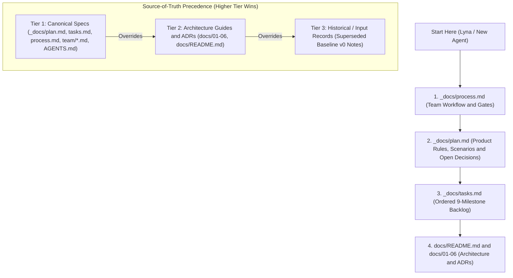
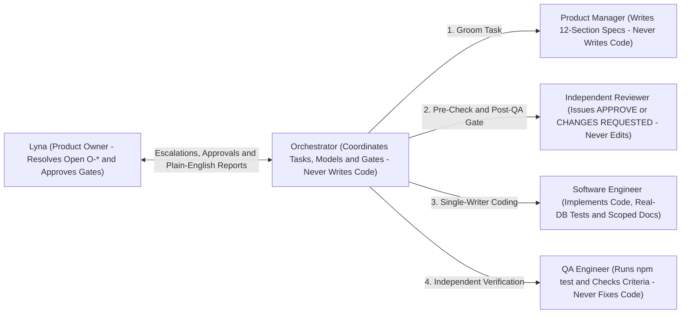
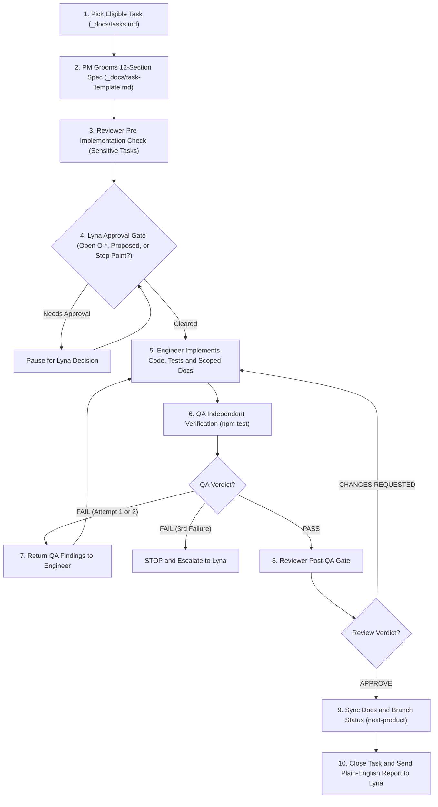

# Development Process

This document describes how Blendinar specification, engineering, testing, review, and release work are organized and executed.

---

## Documents

Read a document only if it exists. Do not invent the contents of missing files or create undocumented specs unless a task asks for them.

### Product & Workflow Specifications (`_docs/`)
- [`_docs/plan.md`](./plan.md) — product specification, business rules (`Confirmed`, `Delegated`, `Proposed`, `Open`, `Future`, `Unverified`, `Superseded`), acceptance checks, and milestones
- [`_docs/tasks.md`](./tasks.md) — ordered task backlog and milestone tracking
- [`_docs/process.md`](./process.md) — source-of-truth hierarchy, team roles, 10-step lifecycle, stop gates, and repository safeguards
- [`_docs/task-template.md`](./task-template.md) — 12-section template required for grooming every task
- [`_docs/testing-guidelines.md`](./testing-guidelines.md) — real-PostgreSQL testing rules, concurrency races, scoped idempotency, negative RBAC/suspension checks, and financial conservation invariants
- [`_docs/design-system.md`](./design-system.md) — UI principles, simulated-money notices, three-state balance separation, agent verification, hosted checkout trust cues, and accessibility

### Team Role Definitions (`_docs/team/`)
- [`_docs/team/orchestrator.md`](./team/orchestrator.md) — Orchestrator (coordination, dependencies, model selection, stop gates, 3-failure escalation)
- [`_docs/team/pm.md`](./team/pm.md) — Product Manager (task grooming, decision classification integrity, checkable acceptance criteria)
- [`_docs/team/software-engineer.md`](./team/software-engineer.md) — Software Engineer (implementation, tests, scoped doc/diagram updates, plain-English reporting)
- [`_docs/team/qa-engineer.md`](./team/qa-engineer.md) — QA Engineer (independent verification, challenge mode, `## QA: PASS` / `## QA: FAIL`)
- [`_docs/team/reviewer.md`](./team/reviewer.md) — Independent Reviewer (pre-implementation & post-QA gates, `## REVIEW: APPROVE` / `## REVIEW: CHANGES REQUESTED`)

### Repository & Engineering Guides
- [`AGENTS.md`](../AGENTS.md) — repository commands, non-negotiable engineering rules, and document index
- [`docs/README.md`](../docs/README.md) & [`docs/01-system-architecture.md`](../docs/01-system-architecture.md) through [`docs/06-devops-testing-and-workflow.md`](../docs/06-devops-testing-and-workflow.md) — technical architecture guides, ERDs, sequence diagrams, and ADRs

---

## Visual Guide to Our Development Process

### Diagram 1 — Where to Start Reading (Source-of-Truth Visual Map)

### Diagram 2 — The 5-Agent Team Collaboration & Responsibility Graph

### Diagram 3 — The 10-Step Task Lifecycle & 3-Failure Escalation Loop

### Diagram 4 — The 9-Milestone Roadmap & Mandatory Stop Points

```mermaid
flowchart LR
    M1["M1: Foundation and Security (Tasks 16-18)"] --> M2["M2: Identity, KYC and Suspension (Tasks 19-21)"]
    M2 --> M3["M3: Agents and Offices (Tasks 22-23)"]
    M3 --> M4["M4: Option B Cash Top-Ups (Tasks 24-26)"]
    M4 --> SP1["STOP POINT 1: Lyna Review and Demo (Top-Ups)"]
    SP1 --> M5["M5: Merchant Onboarding and Checkout (Tasks 12/27-28)"]
    M5 --> M6["M6: Payments and Merchant Fees (Tasks 29, 8)"]
    M6 --> SP2["STOP POINT 2: Lyna Review and Demo (Payments and Fees)"]
    SP2 --> M7["M7: Daily CCP Payouts (Task 30)"]
    M7 --> SP3["STOP POINT 3: Lyna Review and Demo (CCP Payouts)"]
    SP3 --> M8["M8: Customer Cash Refunds (Tasks 31-32)"]
    M8 --> SP4["STOP POINT 4: Lyna Review and Demo (Cash Refunds)"]
    SP4 --> M9["M9: Admin, Conservation, Portals and Demo Store (Tasks 33-35, 13-14)"]
    M9 --> SP5["STOP POINT 5: Lyna Review per Major Frontend Portal"]
```

---

## Source-of-Truth Hierarchy

When documents disagree or raise questions, apply this strict precedence order:

1. **Tier 1 — Canonical Product & Workflow Specs:** `_docs/plan.md`, `_docs/tasks.md`, `_docs/process.md`, `_docs/task-template.md`, `_docs/testing-guidelines.md`, `_docs/design-system.md`, `_docs/team/*.md`, and `AGENTS.md`.
2. **Tier 2 — Architecture Guides & ADRs:** `docs/01-system-architecture.md` through `docs/06-devops-testing-and-workflow.md` and `docs/README.md`.
3. **Tier 3 — Historical / Input Decision Records:** earlier interview notes, superseded historical rules explicitly marked in `_docs/plan.md`, and Cohort Baseline v0 deliverables.

Lower tiers never override higher tiers. Superseded rules are preserved cleanly with `[Superseded by ...]` annotations rather than deleted. Conflicts or unresolved `Open` decisions must be escalated to Lyna, never silently guessed.

---

## Team Roles (5-Agent Workflow)

1. **Orchestrator (`_docs/team/orchestrator.md`):** Selects tasks, prevents concurrent conflicting file edits, assigns models, enforces Lyna approval gates and milestone stop points, and enforces the 3-failure QA escalation rule. Never replaces PM, Engineer, QA, or Reviewer.
2. **Product Manager (`_docs/team/pm.md`):** Grooms tasks into `_docs/task-template.md` with plain-English summaries, numerical scenarios, checkable criteria, out-of-scope links, and strict decision classifications. Writes zero code.
3. **Software Engineer (`_docs/team/software-engineer.md`):** Implements one groomed task inside `Constraints`, writes automated real-DB tests, updates relevant `docs/*.md` & Mermaid diagrams in scope, and reports results in plain English. Never closes tasks or invents unresolved product rules.
4. **QA Engineer (`_docs/team/qa-engineer.md`):** Independently verifies running code, database state, and full `npm test` execution against acceptance criteria and `_docs/testing-guidelines.md`. Never edits code or docs; issues only `## QA: PASS` or `## QA: FAIL`.
5. **Reviewer (`_docs/team/reviewer.md`):** Performs pre-implementation and post-QA checks on sensitive tasks (money movement, financial invariants, ledger/schema, auth/KYC/suspension/RBAC, merchant payment APIs, ADRs, `_docs/plan.md`, security docs). Never edits another agent's work; issues only `## REVIEW: APPROVE` or `## REVIEW: CHANGES REQUESTED`.

---

## How Work Is Organized (Core Habits)

1. **One Task at a Time:** Work is tracked in `_docs/tasks.md` and mirrored in GitHub Issues. Focus on one groomed task cleanly from selection through closure.
2. **Check Context First:** Before starting a task, read `AGENTS.md`, `_docs/plan.md`, and relevant guides (`_docs/testing-guidelines.md`, `_docs/design-system.md`, `docs/*.md`).
3. **Implement & Test Against Real PostgreSQL:** Write implementation alongside automated tests proving acceptance checks in `_docs/plan.md`.
4. **Verify Before Finishing:** Run `npm test` (`vitest run --no-file-parallelism`) to confirm the entire suite passes with zero regressions before QA and review.

---

## 10-Step Task Lifecycle

1. **Pick Task:** Orchestrator selects the next open, unblocked task from `_docs/tasks.md` / GitHub Issues whose dependencies are satisfied.
2. **PM Grooming:** PM rewrites/grooms the task using all 12 sections of `_docs/task-template.md`, verifying `_docs/plan.md` & ADR alignment and listing any `Open` (`O-*`) or unapproved `Proposed` items.
3. **Pre-Implementation Review (Sensitive Tasks):** Reviewer validates the groomed spec against `_docs/plan.md`, ADRs, `Constraints`, and financial/security completeness before coding starts.
4. **Lyna Approval Gate:** If the task touches an `Open` (`O-*`) decision, unapproved `Proposed` rule, schema/ADR change, dependency request, or follows a Milestone Stop Point, Orchestrator pauses and obtains Lyna's explicit approval.
5. **Implementation & Scoped Docs:** Software Engineer implements strictly within `Constraints`, writes real-DB tests, updates required `docs/*.md` and Mermaid diagrams in scope, and posts a plain-English report (keeping the task open).
6. **QA Verification:** QA Engineer runs `npm test` and independently tests every acceptance criterion and edge/concurrency/conservation rule, issuing `## QA: PASS` or `## QA: FAIL`.
7. **Failure Loop & 3-Failure Escalation Rule:** On `## QA: FAIL`, route exact QA findings back to Step 5. **If QA fails 3 rounds on the same task, stop retrying and escalate to Lyna** with root cause analysis and options.
8. **Post-QA Review:** On `## QA: PASS`, Reviewer verifies code, tests, constraints, invariants, and docs against `_docs/plan.md` and ADRs (mandatory for financial, ledger/schema, auth/RBAC, merchant API, and ADR/doc-sensitive tasks), issuing `## REVIEW: APPROVE` or `## REVIEW: CHANGES REQUESTED` (if changes requested, route back to Step 5/6).
9. **Docs & Status Sync:** Orchestrator verifies `_docs/tasks.md`, docs, and approved branch commits are synchronized cleanly.
10. **Closure & Plain-English Report:** Orchestrator closes the task/issue **only after** `## QA: PASS` (and `## REVIEW: APPROVE` where required), delivers a concise plain-English report to Lyna, and enforces any Milestone Stop Point before starting the next milestone.

---

## Mandatory Milestone Stop Points

Work **must pause for Lyna's review, demo check, and explicit go-ahead** upon completing each of the following milestones:

1. **Customer Top-Ups (Option B):** Agent cash collection, customer pending view, admin hand-in confirmation, and shortage/discrepancy handling.
2. **Merchant Payments:** Merchant onboarding/verification, hosted checkout display, payment confirmation, and configurable merchant fee deduction.
3. **Merchant Payouts:** Daily simulated CCP payout batch preparation, admin review, and settlement.
4. **Customer Refunds:** Immediate unused-balance lock and agent physical cash payout.
5. **Each Major Frontend Area:** Customer portal, Agent portal, Merchant portal, Hosted Checkout, and Admin dashboard.

---

## Non-Negotiable Repository Safeguards

- **Branch Protection:** Never push directly to `main` or modify the submitted Cohort Baseline v0 history on `main`. Perform Blendinar development on an approved feature/product branch (e.g., `next-product`).
- **Forward-Only Migrations:** Always create new migrations via `npx drizzle-kit generate` and apply via `npx drizzle-kit migrate`. **Never edit or delete previously committed migration files** in `drizzle/`.
- **Dependency Control:** Never add or upgrade packages in `package.json` without Lyna's explicit approval.
- **No Secrets, Default Passwords, or PII:** Never write hardcoded default admin passwords, hardcoded admin phone credentials, JWT secrets, API keys, or real personal data in docs, code, or git commits. Admin seeding must read environment-configured credentials.
- **Simulated-Money Notice:** Keep the clear *"100% fake/simulated DZD"* disclaimer intact in documentation and all frontend portals.
- **Honest Verification:** Never report `npm test` as passing unless executed after the final edit with all tests observed passing; never delete or relax tests just to achieve a pass.

---

## Model Selection Strategy

- **Match Capability to Risk:** Route financial invariants, Option B top-ups, payment/fee math, daily CCP payouts, cash refunds, row-level locking/concurrency, schema/migrations, auth/KYC/suspension/RBAC, architectural reviews, and QA challenge verification to high-reasoning models.
- **Focused Handoffs:** Provide each subagent with the exact groomed task, relevant `_docs/plan.md` rules, `Constraints`, and target file paths rather than unnecessary repository-wide dumps.
- **No Economizing on Safety:** Never downgrade to lightweight/low-reasoning models for financial logic, security, auth, concurrency, or architecture gates.
