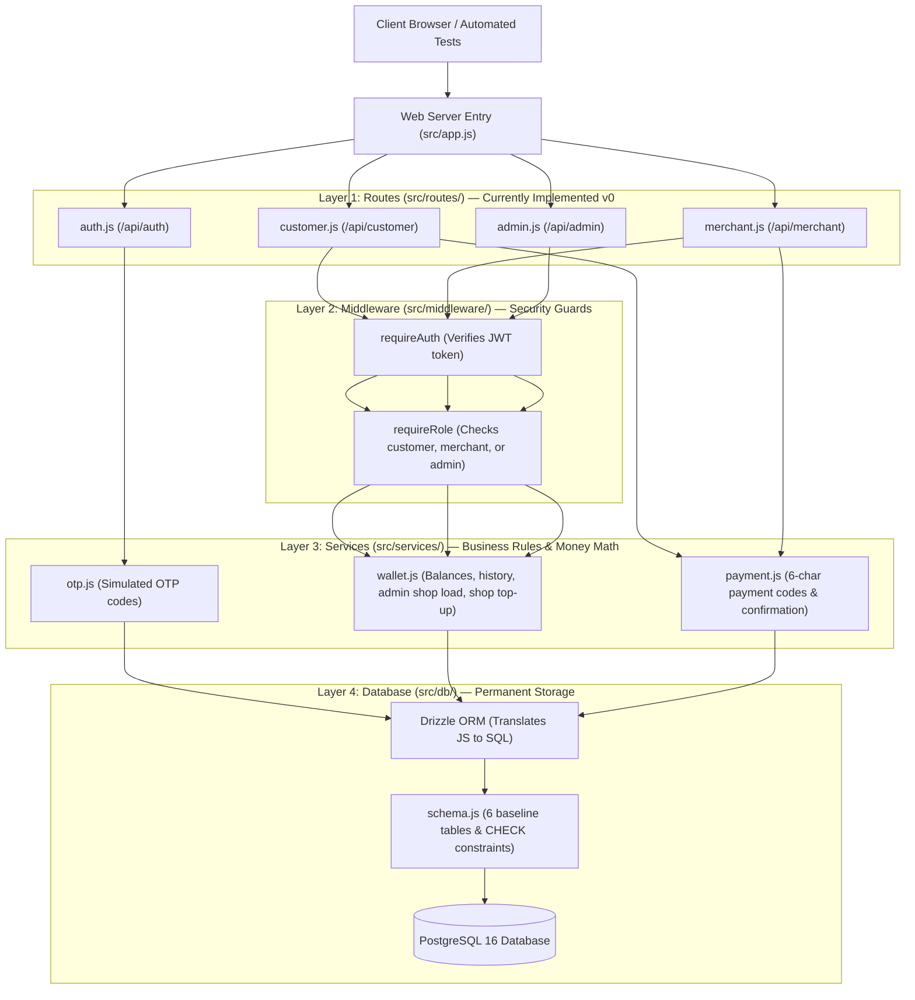
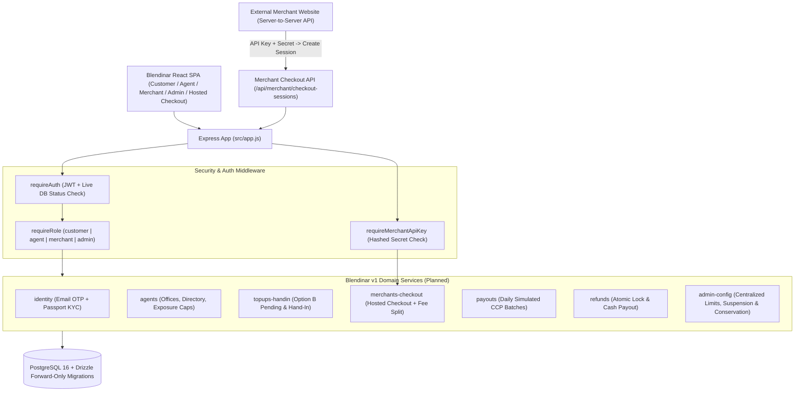
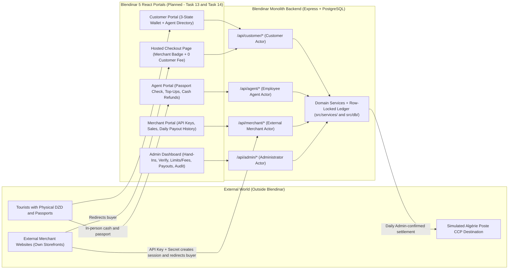

# 01 — System Architecture & Layered Design

## 1. The Big Picture: A "Layered Monolith" (Current Cohort Baseline v0)

This codebase is structured as a **Modular Layered Monolith**:
* **Monolith** means the entire backend runs inside **one single Node.js program** rather than separate microservices.
* **Layered** means code is split cleanly into **4 stacked layers**, where each layer has one responsibility.

Keeping everything in one Express + PostgreSQL application lets money movements update multiple rows inside a single **ACID database transaction** (an all-or-nothing step) so digital balances never get out of sync.

### What Each Layer Does Today (`src/`)
1. **Routes (`src/routes/`):** Receive HTTP requests, extract parameters/headers, delegate work to Services, and map errors to clean HTTP status codes (`200`, `201`, `400`, `401`, `403`, `404`, `409`).
2. **Middleware (`src/middleware/auth.js`):** Security checkpoints checking signed **JWTs** (*JSON Web Tokens*) via `requireAuth` and role permissions via `requireRole`.
3. **Services (`src/services/`):** Hold all business validation, integer-centime math, row locking (`SELECT ... FOR UPDATE`), and atomic transactions (`otp.js`, `wallet.js`, `payment.js`).
4. **Database (`src/db/`):** Uses **Drizzle ORM** (*Object-Relational Mapper*) and `pg` connection pooling (`src/db/index.js`) over PostgreSQL 16 (`src/db/schema.js`).

---

## 2. Why `src/app.js` and `src/index.js` Are Separate Files

* **[`src/app.js`](../src/app.js)** configures Express middleware (`cors`, `express.json`) and mounts `/health`, `/api/health`, `/api/auth`, `/api/customer`, `/api/merchant`, and `/api/admin` **without opening a network port**.
* **[`src/index.js`](../src/index.js)** loads `.env`, wires Vite/static frontend serving, and starts listening on `PORT` (default `3000`).

### Why Split Them?
1. **In-memory automated testing:** Vitest + Supertest import `app` directly from `src/app.js` without port conflicts or Vite startup overhead.
2. **Three frontend serving modes in `src/index.js`:**
   * **`NODE_ENV=production`:** Serves static React files built into `dist/`.
   * **`NODE_ENV=test`:** Skips frontend serving completely.
   * **Development (default):** Embeds Vite middleware for instant hot reload.

---

## 3. Currently Implemented API Endpoints (Cohort Baseline v0)

| URL | Method | Access Today | Current Behavior |
| :--- | :--- | :--- | :--- |
| `/health`, `/api/health` | `GET` | Public | Returns `{"status":"ok"}`. |
| `/api/auth/register` | `POST` | Public | Registers `customer` or `merchant` by phone + password (blocks `admin`), sends simulated OTP. |
| `/api/auth/otp/:phone` | `GET` | Public (Dev/`DEMO_MODE`) | Reads latest simulated OTP; returns `404` in production unless `DEMO_MODE=true`. |
| `/api/auth/verify-otp` | `POST` | Public | Verifies 6-digit phone OTP and initializes a `0`-centime wallet. |
| `/api/auth/login` | `POST` | Public | Checks phone + password (`bcrypt`), ensures `is_verified`, returns 24h JWT. |
| `/api/customer/balance` | `GET` | `customer` | Returns `{ balanceDinars, balanceCentimes }`. |
| `/api/customer/transactions` | `GET` | `customer` | Returns customer's chronological ledger history. |
| `/api/customer/payment-requests/:code` | `GET` | `customer` | Previews shop name and amount for an active 5-min code. |
| `/api/customer/payment-requests/:code/confirm` | `POST` | `customer` | Password-confirms payment with idempotency key support. |
| `/api/merchant/payment-requests` | `POST` | `merchant` | Creates a 6-character single-use 5-minute payment code. |
| `/api/merchant/top-up` | `POST` | `merchant` | Credits customer wallet from shop balance (Cohort v0 shop-float model). |
| `/api/admin/shops/:merchantId/load` | `POST` | `admin` | Loads new simulated funds into a shop wallet. |

---

## 4. Clean Error Handling

Services attach `.statusCode` (`400`, `401`, `403`, `404`, etc.) to domain errors. Routes return `{ "error": "..." }` for known client/business errors and safely mask unexpected failures behind `500 Internal server error`.

---

## 5. Blendinar v1 Target Architecture Evolution *(Planned — Not Yet Built in `src/`)*

As [`_docs/tasks.md`](../_docs/tasks.md) Milestones 1–9 are implemented on the `next-product` branch, the layered monolith expands cleanly while keeping the same 4-layer separation:

### Key Architectural Additions in Blendinar v1
1. **4-Role & Live-Status Middleware (`src/middleware/`):**
   - `requireRole` expands to 4 roles: `customer`, `agent` (Blendinar employee), `merchant`, and `admin`.
   - `requireAuth` checks live `users.status` (`active` vs. `suspended`) in PostgreSQL so suspended users' existing tokens fail immediately (`R15`, Task 21).
   - Dedicated Merchant API authentication middleware validates external merchant `API Key + Secret` for server-to-server checkout creation (Task 28).
2. **Modular Domain Services (`src/services/`):**
   - `identity` (email-first auth, optional `NULL`-normalized phone, `DEMO_MODE` email OTP, passport KYC stages)
   - `agents` (Fixed-Location Offices / "Partner Points" vs. Individual Agents, directory, cash exposure limits)
   - `topups-handin` (fixed presets, Option B pending top-ups, Admin hand-in confirmation, shortage audit & risk review flags)
   - `merchants-checkout` (website/CCP onboarding, manual `Verified` vs. `Unverified` status, checkout session creation, Hosted Checkout payment + configurable merchant fee split)
   - `payouts` (daily simulated CCP payout batch preparation, Admin settlement confirmation, exception states)
   - `refunds` (immediate `0`-fee spendable-to-locked balance lock and Agent physical cash disbursement)
   - `admin-config` (centralized configurable limits/presets/fees, suspension controls, and Two-Part Conservation audit queries)
3. **External Merchant Integration Boundary:**
   - External merchant websites run completely outside Blendinar (`_docs/plan.md` Section 1). When a buyer clicks "Pay with Blendinar", the merchant server authenticates to Blendinar to create a 5-minute `checkout_session` (with validated `return_url` / `cancel_url`) and redirects the customer to Blendinar's Hosted Checkout UI.

### Blendinar v1 Use-Case & System Boundary Diagram *(Planned)*

