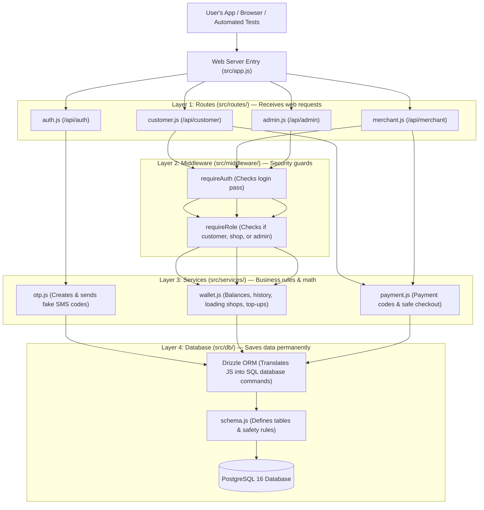

# 01 — System Architecture & Layered Design

## 1. The Big Picture: A "Layered Monolith"

This project is built as a **Modular Layered Monolith**:
* **Monolith** means the entire backend runs as **one single program** instead of being split into many separate mini-programs (**microservices**).
* **Layered** means the code inside that program is neatly divided into **4 stacked layers**, where each layer has one clear job.

Why keep it as one program? Because when you move money from Wallet A to Wallet B, both updates must happen together inside one database. Keeping everything in one program connected to one **PostgreSQL** database (a popular, rock-solid database system) makes it much easier to guarantee money never disappears.



### What Each Layer Does
1. **Routes (`src/routes/`)**: Like a receptionist. They listen for web requests (called **API endpoints**—URLs like `/api/auth/login`), read the incoming data, call the right Service, and send back a response (like `200 OK` or `400 Bad Request`).
2. **Middleware (`src/middleware/`)**: Security guards that stand in front of the Routes. Before a request reaches a route, the middleware checks if the user is logged in and has the right role.
3. **Services (`src/services/`)**: The brains of the app. All money math, balance checks, and database transactions live here. Services know nothing about web requests or URLs—they just take inputs and return results or errors.
4. **Database (`src/db/`)**: Uses **Drizzle ORM** (an **ORM**, or *Object-Relational Mapper*, is a tool that lets you write JavaScript instead of raw database language **SQL**) to talk to **PostgreSQL**.

---

## 2. Why `app.js` and `index.js` Are Separate Files

If you look in `src/`, you will see two main files: [`src/app.js`](../src/app.js) and [`src/index.js`](../src/index.js). Separating them is a classic engineering trick:

* **[`src/app.js`](../src/app.js)** sets up all the routes and rules, **but does not start listening on a network port** (like port `3000`).
* **[`src/index.js`](../src/index.js)** loads secret settings from `.env`, attaches the React webpage, and finally starts the server on port `3000`.

### Why do engineers split them?
1. **Faster, cleaner automated tests:** Testing tools (**Vitest** and **Supertest**) can load `app.js` directly in memory and test every URL without actually opening port `3000` on your computer.
2. **Three ways to serve the frontend webpage in `src/index.js`:**
   * **Production mode (`NODE_ENV=production`):** Serves the pre-built, optimized webpage files from the `dist/` folder.
   * **Test mode (`NODE_ENV=test`):** Skips loading the webpage completely so tests run fast.
   * **Development mode (default):** Starts **Vite** (a fast frontend build tool) inside Express so developers get instant screen refreshes while editing React code.

---

## 3. All Web Addresses (API Endpoints) in the App

An **API** (*Application Programming Interface*) is the set of URLs a frontend or mobile app uses to talk to the backend server.

| URL | Action | Who Can Use It? | What It Does |
| :--- | :--- | :--- | :--- |
| `/health` or `/api/health` | `GET` (Read) | Anyone | Returns `{"status":"ok"}` to prove the server is alive. |
| `/api/auth/register` | `POST` (Create) | Anyone | Signs up a new `customer` or `merchant` (blocks `admin`) and creates a 6-digit verification code. |
| `/api/auth/otp/:phone` | `GET` (Read) | Anyone (Dev/Demo only) | Shows the fake SMS code for testing. Hidden in real production. |
| `/api/auth/verify-otp` | `POST` (Send) | Anyone | Checks the 6-digit code, marks the user verified, and creates their 0 DA wallet. |
| `/api/auth/login` | `POST` (Send) | Anyone | Checks phone + password and gives back a **JWT** (a digital login pass). |
| `/api/customer/balance` | `GET` (Read) | Customer only | Shows the customer's current wallet balance. |
| `/api/customer/transactions` | `GET` (Read) | Customer only | Shows the customer's personal money history. |
| `/api/customer/payment-requests/:code` | `GET` (Read) | Customer only | Looks up a shop's payment code so the customer can see the shop name and price first. |
| `/api/customer/payment-requests/:code/confirm` | `POST` (Send) | Customer only | Customer enters their password to actually pay the shop. |
| `/api/merchant/payment-requests` | `POST` (Create) | Merchant (Shop) only | Creates a 6-character payment code that expires in 5 minutes. |
| `/api/merchant/top-up` | `POST` (Send) | Merchant (Shop) only | Moves money from the shop's wallet to a customer's wallet (when the customer pays cash). |
| `/api/admin/shops/:merchantId/load` | `POST` (Send) | Admin only | Adds new digital money into a shop's wallet. |

---

## 4. How Errors Are Handled Cleanly

Inside `src/services/`, when something goes wrong (like "Insufficient customer balance" or "Payment code expired"), the service creates a normal JavaScript error and attaches an HTTP status number (`err.statusCode = 400`, `401`, `403`, or `404`).

The route file catches that error and sends back a clean JSON message like:
```json
{ "error": "Insufficient customer balance" }
```
If something unexpected crashes (like the database disconnecting), the route hides the messy details and safely returns `500 Internal server error`.
