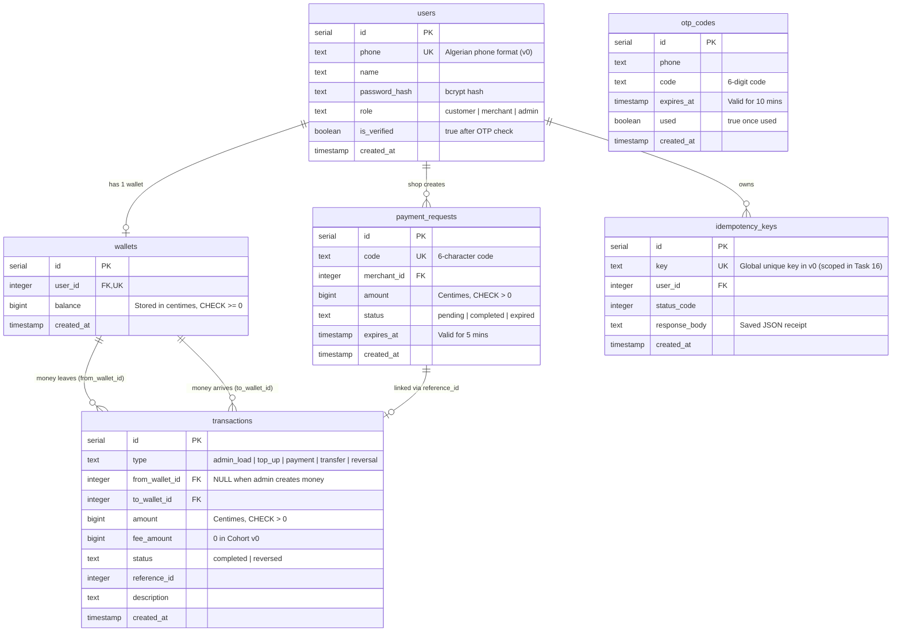
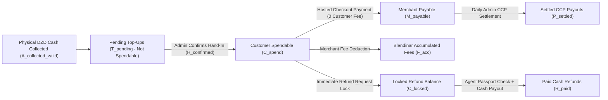

# 02 — Data Model, Ledger Design & Financial Invariants

## 1. Currently Implemented Database Tables (Cohort Baseline v0)

The current schema in [`src/db/schema.js`](../src/db/schema.js) defines **6 PostgreSQL tables**:

* **PK (Primary Key):** Unique ID number identifying each row.
* **FK (Foreign Key):** Column pointing to a parent row in another table.
* **UK (Unique Key):** Uniqueness rule blocking duplicate values.

---

## 2. Three Golden Rules for Financial Data

### Rule 1: Store Money as Whole Centimes (`bigint`), Never Decimals
* **How it works:** Users enter whole Dinars (e.g., `5000` DA). The backend multiplies by `100` and persists `500000` centimes as a whole `bigint` integer.
* **Why:** Floating-point arithmetic introduces binary rounding drift (`0.1 + 0.2 !== 0.3`). Integer centimes guarantee exact totals while supporting future fee calculations.
* **Overflow Guard Improvement (Task 16):** Baseline `src/services/wallet.js` and `src/services/payment.js` currently validate `amountDinars <= Number.MAX_SAFE_INTEGER` before `* 100`. Under Blendinar (**Task 16**), all endpoints tighten this guard to `amountDinars <= Math.floor(Number.MAX_SAFE_INTEGER / 100)` so `dinars * 100` can never exceed `Number.MAX_SAFE_INTEGER`.

### Rule 2: Let PostgreSQL Enforce Safety (`CHECK` Constraints)
1. `wallets`: `CHECK (balance >= 0)` — Balances can never drop below zero.
2. `transactions`: `CHECK (amount > 0)` — Zero or negative money movements are impossible.
3. `payment_requests`: `CHECK (amount > 0)` — Payment requests must always be positive.

### Rule 3: Append-Only Ledger (`transactions`)
* Rows in `transactions` are **only ever inserted** (`INSERT`), never updated (`UPDATE`) or deleted (`DELETE`).
* Corrections or future reversals append a new offsetting row.

---

## 3. Baseline Conservation of Money (Cohort v0)

In Cohort Baseline v0, total wallet balances equal the total injected by Admins via `admin_load`:

$$\sum \text{All Wallet Balances} \;=\; \sum \text{Admin Shop Loads}$$

Verified in [`tests/payment-concurrency.test.js`](../tests/payment-concurrency.test.js).

---

## 4. Fast History Lookups (Avoiding N+1 Queries)

`getCustomerTransactions` in [`src/services/wallet.js`](../src/services/wallet.js) loads the user's transactions in one query, gathers unique counterparty wallet IDs, and fetches all counterparty display data in one `inArray` batch query rather than looping N separate SQL queries.

---

## 5. Blendinar v1 Data Model Evolution & Two-Part Conservation *(Planned — Not Yet Built in `src/`)*

### Forward-Only Migrations Rule
All Blendinar schema changes **must** be generated as new forward-only migration files via `npx drizzle-kit generate` and applied via `npx drizzle-kit migrate`. **Never edit or delete** previously committed files in [`drizzle/`](../drizzle/) (`0000_colossal_mother_askani.sql` through `0003_wakeful_agent_zero.sql`).

### Planned Blendinar v1 Schema Extensions (`_docs/plan.md` & `_docs/tasks.md`)
*(Note: `O-07` and `O-08` remain **`Open`** pending Lyna's choice, and Section 5.6 awaits formal sign-off; `O-01`–`O-06`, **`O-06b`**, `O-09`, `O-10`, `O-11`, and `O-12` are resolved.)*

| Table / Area | Planned Blendinar v1 Design | Resolved / Remaining Open Notes |
| :--- | :--- | :--- |
| **`users` & `passport_verifications`** | `email` (`NOT NULL UNIQUE` lowercase), optional nullable `phone` (`NULL`-normalized, `phone_verified` for backup recovery OTP per `O-01`), `role` (`customer \| agent \| merchant \| admin`), `status` (`active \| suspended`), `email_verified`, `passport_verified`, plus `passport_verifications` storing unique `passport_hash` (`SHA-256(issuing_country, passport_number)`), `masked_hint`, `issuing_country`, `expires_at`, `verified_by_agent_id`, `rejection_reason`, and `verification_status` (`prechecked_pending_agent \| verified \| passport_rejected \| pending_admin_review`) — **2-step hybrid MRZ pre-scan + Agent physical double-check at first top-up with zero raw passport scan photos**. | `O-01` (`Confirmed` recovery), `O-02` (`Confirmed` 2-step hybrid MRZ + Agent physical check), `O-03` (`Confirmed` Read-Only suspension). |
| **`offices` & `agent_profiles`** | Fixed-Location Offices ("Partner Points") vs. Individual Agents, verification codes, directory location/hours/contact, active status, Fixed-Office `refund_petty_float_balance` (`O-09`), and `cash_exposure_limit` (`50,000 DZD` Individual / `250,000 DZD` Fixed Office — **NOT** a prepaid float). | `O-04` (`Delegated` resolved), `O-09` (`Confirmed` Fixed-Office petty float `<= 20,000 DZD`). |
| **`cash_topups` & `cash_hand_ins`** | Fixed-preset top-ups (`[1k, 2k, 5k, 10k, 20k]` DZD; `pending_hand_in`, `confirmed`, `shortage_hold`, `disputed`), batch hand-in tracking (`expected_amount`, `received_amount`, `shortage_amount`), informational risk flags. Short batches hold **all** linked top-ups in `shortage_hold` (`0` ambiguous releases) until Admin reconciles. | `O-04` (`Delegated`), `O-05` (`Confirmed`). |
| **`merchant_profiles` & `merchant_subscriptions`** | `merchant_profiles`: required `website_url` (`http`/`https`), `category`, `ccp_account_details`, optional `instagram_handle`, manual `verification_status` (`unverified \| verified`), API key + hashed secret key. **`merchant_subscriptions`** (`Stream 1`): separate B2B monthly subscription (`monthly_fee_centimes` defaulting to `2,000 DZD/month`, `status` [`active \| past_due \| canceled`], `current_period_start`, `current_period_end`, `confirmed_by_admin_id`) sitting completely outside customer wallet funds (`Section 5.6`). If `past_due`, creating new Hosted Checkout sessions is blocked (`403`) while existing `merchant_payable_balance` still settles via daily CCP payouts. | **`Open O-07`** (unverified vs. verified merchant transaction caps); **`O-06b`** (`Confirmed` two-stream separation; `Delegated` resolved monthly cadence `2,000 DZD/month`). |
| **`checkout_sessions`** | External merchant checkout sessions with `amount` centimes, 5-min `expires_at`, validated `return_url` / `cancel_url`, verification badge snapshot, `pending \| completed \| expired`. Creation requires active `merchant_subscriptions.status = 'active'` (`403` when `past_due`). | `O-06` (`Confirmed` `2%` / `200` bps Stream 2 transaction fee); `O-06b` (`Confirmed`/`Delegated` active-subscription check). |
| **`wallets` / Account Buckets** | Explicit separation of customer **`spendable_balance`**, **`locked_refund_balance`**, merchant **`merchant_payable_balance`**, and **`platform_fee_account`** (`Blendinar Accumulated Transaction Fees` from Stream 2 `2%` fees), all `bigint` centimes with `CHECK >= 0`. | `O-06` & `O-06b` (`Confirmed` Stream 2 separation from B2B subscriptions). |
| **`payout_batches`** | Daily simulated CCP settlements (`prepared`, `settled`, `failed`, `reversed`, `disputed`, `delayed`) keyed cleanly by merchant + cutoff window. Already-earned `merchant_payable_balance` always settles normally even if `merchant_subscriptions` is `past_due` (never confiscated, `CHECK >= 0`). | **`Open O-08`** (cutoff timezone, threshold, trigger mode); `O-06b` (`Confirmed` payable isolation). |
| **`refund_requests`** | Customer `0`-fee pre-departure cash refunds (`locked_refund \| scheduled_next_day_pickup \| ready_for_pickup \| paid \| cancelled \| expired \| disputed`) with `office_id`, `cash_source_type` (`office_petty_float \| admin_scheduled_funding`), self-cancel before payout, and **72-hour auto-expiry** returning funds to Spendable Balance. Walk-in petty float serves `<= 20,000 DZD` at Fixed Offices; `> 20,000 DZD` or low float schedules next-day pickup. | `O-10` (`Confirmed`), **`O-09` (`Confirmed` Hybrid Option 4)**. |
| **`notifications` (`Proposed` UX)** | In-app notification bell/feed rows (`type`, `title`, `message`, `reference_type`, `reference_id`, `is_read`) + `DEMO_MODE` simulated email logs for top-up confirmation/shortage alerts, `O-02` Step 2 KYC decisions, checkout receipts, `O-09` refund pickup scheduling & **`ready_for_pickup` at `[Fixed Office]`**, **48h/24h pre-72h expiry reminders**, Agent `80%` cash cap warnings, **Merchant Subscription renewal reminders / `past_due` alerts (`O-06b`)**, and Admin queue badges. | **`Proposed`** UX specification (`_docs/plan.md` Section 6.10). |
| **`idempotency_keys`** | Composite uniqueness `(user_id, endpoint, key)` + `request_hash` (Task 16), checked **after** auth/suspension/password checks. | — |

### Target Blendinar v1 Entity-Relationship Diagram *(Planned — Pending `O-07` and `O-08` Decisions)*

> **Note:** The ERD below represents the **planned Blendinar v1 target schema** (`_docs/plan.md` & `_docs/tasks.md`), not tables already present in `src/db/schema.js` today. Unverified merchant caps (`O-07`) and daily payout cutoff defaults (`O-08`) remain **`Open`** pending Lyna's decision before forward-only migration generation (while `O-06b` Two-Stream Merchant Revenue and `O-09` Hybrid Option 4 refund fields are resolved).

```mermaid
erDiagram
    users ||--o| wallets : "owns wallet buckets"
    users ||--o| passport_verifications : "2-step MRZ pre-scan + Agent check"
    users ||--o| agent_profiles : "staffed as employee agent"
    offices ||--o{ agent_profiles : "assigns fixed-office agents"
    users ||--o| merchant_profiles : "operates external website"
    users ||--o{ otp_codes : "receives email or recovery OTP"
    users ||--o{ notifications : "receives in-app alerts"
    users ||--o{ idempotency_keys : "scoped by user_id and endpoint"

    agent_profiles ||--o{ cash_topups : "collects preset cash"
    users ||--o{ cash_topups : "customer pending top-ups"
    cash_hand_ins ||--o{ cash_topups : "batches for admin confirmation"
    agent_profiles ||--o{ cash_hand_ins : "submits physical cash"

    merchant_profiles ||--o{ merchant_subscriptions : "pays monthly B2B subscription"
    merchant_profiles ||--o{ checkout_sessions : "creates hosted checkout"
    checkout_sessions ||--o| transactions : "settles via reference_id"
    merchant_profiles ||--o{ payout_batches : "receives daily simulated CCP payout"

    users ||--o{ refund_requests : "locks unused spendable balance"
    offices ||--o{ refund_requests : "fulfills walk-in or next-day pickup"
    agent_profiles ||--o{ refund_requests : "checks passport and pays cash"

    wallets ||--o{ transactions : "debits from_wallet_id"
    wallets ||--o{ transactions : "credits to_wallet_id"

    users {
        serial id PK
        text email UK "Required unique lowercase"
        text phone UK "Optional NULL-normalized"
        boolean phone_verified "Enables backup recovery OTP per O-01"
        text name
        text password_hash "bcrypt hash"
        text role "customer | agent | merchant | admin"
        text status "active | suspended (Read-Only GET)"
        boolean email_verified
        boolean passport_verified "Stage 2 two-step MRZ + Agent check (O-02)"
        timestamp created_at
    }

    passport_verifications {
        serial id PK
        integer user_id FK,UK
        integer verified_by_agent_id FK "Step 2 physical double-check (O-02)"
        text passport_hash UK "SHA-256 of country + passport_number"
        text masked_hint "No raw photo stored"
        text issuing_country
        text verification_status "prechecked_pending_agent | verified | passport_rejected | pending_admin_review"
        text rejection_reason "Required on Step 2 reject"
        timestamp expires_at
        timestamp created_at
    }

    otp_codes {
        serial id PK
        integer user_id FK
        text target "Email or verified recovery phone"
        text purpose "register | recovery"
        text code "6-digit simulated OTP"
        timestamp expires_at
        boolean used
        timestamp created_at
    }

    offices {
        serial id PK
        text name
        text location_address
        text opening_hours
        text contact_info
        bigint refund_petty_float_balance "Fixed-office refund float (O-09)"
        boolean is_active
        timestamp created_at
    }

    agent_profiles {
        serial id PK
        integer user_id FK,UK
        integer office_id FK "NULL for individual agent"
        text agent_type "fixed_office | individual"
        text verification_code UK
        bigint cash_exposure_limit "50k Individual / 250k Office (O-04)"
        bigint current_cash_exposure "Centimes unconfirmed"
        boolean is_active
        timestamp created_at
    }

    cash_topups {
        serial id PK
        integer customer_id FK
        integer agent_id FK
        integer hand_in_id FK
        bigint amount "Preset centimes [1k..20k]"
        text status "pending_hand_in | confirmed | shortage_hold | disputed"
        timestamp created_at
    }

    cash_hand_ins {
        serial id PK
        integer agent_id FK
        integer confirmed_by_admin_id FK
        bigint expected_amount "Centimes"
        bigint received_amount "Centimes"
        bigint shortage_amount "Centimes (O-05 batch hold)"
        text status "submitted | confirmed | shortage_hold | disputed"
        timestamp created_at
    }

    merchant_profiles {
        serial id PK
        integer user_id FK,UK
        text business_name
        text website_url "Required external URL"
        text category
        text instagram_handle "Optional"
        text ccp_account_details
        text verification_status "unverified | verified"
        text api_key UK
        text api_secret_hash "Hashed at rest"
        timestamp created_at
    }

    merchant_subscriptions {
        serial id PK
        integer merchant_id FK
        bigint monthly_fee_centimes "2,000 DZD/month configurable default (O-06b)"
        text status "active | past_due | canceled"
        timestamp current_period_start
        timestamp current_period_end
        integer confirmed_by_admin_id FK
    }

    checkout_sessions {
        serial id PK
        text session_id UK
        integer merchant_id FK
        bigint amount "Centimes"
        text return_url
        text cancel_url
        text status "pending | completed | expired"
        timestamp expires_at
        timestamp created_at
    }

    wallets {
        serial id PK
        integer user_id FK,UK
        bigint spendable_balance "Centimes, CHECK >= 0"
        bigint locked_refund_balance "Centimes, CHECK >= 0"
        bigint merchant_payable_balance "Centimes, CHECK >= 0"
        bigint platform_fee_account "Blendinar Accumulated Transaction Fees, CHECK >= 0"
        timestamp created_at
    }

    transactions {
        serial id PK
        text type "topup_release | checkout_payment | merchant_fee | ccp_payout | refund_lock | refund_payout"
        integer from_wallet_id FK
        integer to_wallet_id FK
        bigint amount "Centimes, CHECK > 0"
        bigint fee_amount "Centimes (2% default)"
        text status "completed"
        integer reference_id
        text description
        timestamp created_at
    }

    payout_batches {
        serial id PK
        integer merchant_id FK
        text cutoff_window_key UK
        bigint gross_amount "Centimes"
        bigint fee_amount "Centimes"
        bigint net_amount "Centimes"
        text ccp_snapshot
        text status "prepared | settled | failed | reversed | disputed | delayed"
        timestamp created_at
    }

    refund_requests {
        serial id PK
        integer customer_id FK
        integer office_id FK "Fixed Office location (O-09 Confirmed)"
        integer paid_by_agent_id FK
        text pickup_code UK
        bigint amount "Centimes, CHECK > 0"
        text cash_source_type "office_petty_float | admin_scheduled_funding"
        text cash_source_ref "Petty float or scheduled treasury batch (O-09)"
        text status "locked_refund | scheduled_next_day_pickup | ready_for_pickup | paid | cancelled | expired | disputed"
        timestamp expires_at "72h auto-expiry (O-10)"
        timestamp created_at
    }

    notifications {
        serial id PK
        integer user_id FK
        text type "topup | kyc | checkout | refund | expiry_reminder | cap_warning | payout | admin_queue"
        text title
        text message
        text reference_type
        integer reference_id
        boolean is_read
        timestamp created_at
    }

    idempotency_keys {
        serial id PK
        integer user_id FK
        text endpoint
        text key
        text request_hash
        integer status_code
        text response_body
        timestamp created_at
    }
```

### Proposed Two-Part Financial Conservation Invariant (`Proposed — Awaiting Lyna's Approval`)

Matches [`_docs/plan.md`](../_docs/plan.md) Section 5.6 identically (all values in integer centimes `bigint`). **Scope Boundary (`O-06b Confirmed`):** Separate **Stream 1 B2B merchant platform subscriptions (`merchant_subscriptions`)** sit completely outside these customer-funds conservation equations (`H_confirmed`), keeping Part 1 and Part 2 conservation exact (`CHECK >= 0` on all wallet buckets, and subscriptions never deduct from `merchant_payable_balance`).

1. **Part 1 — Digital Value Conservation:**
   $$C_{\text{spend}} + C_{\text{locked}} + M_{\text{payable}} + F_{\text{acc}} + R_{\text{paid}} + P_{\text{settled}} = H_{\text{confirmed}}$$
2. **Part 2 — Top-Up Cash Custody Conservation:**
   $$A_{\text{collected\_valid}} = T_{\text{pending}} + H_{\text{confirmed}}$$
3. **Unified Reconciliation Identity:**
   $$C_{\text{spend}} + C_{\text{locked}} + M_{\text{payable}} + F_{\text{acc}} + R_{\text{paid}} + P_{\text{settled}} + T_{\text{pending}} = A_{\text{collected\_valid}}$$

#### Symbol Definitions
- $C_{\text{spend}}$ = sum of all customer Spendable Balances
- $C_{\text{locked}}$ = sum of all active customer Locked Refund Balances
- $M_{\text{payable}}$ = sum of all unpaid Merchant Payable Balances
- $F_{\text{acc}}$ = total Blendinar Accumulated Fees from completed payments
- $R_{\text{paid}}$ = total physical cash refunds marked `paid` to customers
- $P_{\text{settled}}$ = total daily merchant CCP payouts marked `settled`
- $H_{\text{confirmed}}$ = total customer top-up value released via Admin-confirmed cash hand-ins
- $T_{\text{pending}}$ = total top-up amounts still `pending_hand_in` / `shortage_hold` / `disputed` awaiting confirmation
- $A_{\text{collected\_valid}}$ = total valid cash top-up amounts collected and recorded by Agents (excluding invalid/voided receipts)

#### Worked 7-Step Numerical Trace (Amounts Shown in Whole DZD; Stored as `× 100` Centimes)
*(Uses the `Confirmed` default `2%` (`200` bps) merchant fee — `120 DZD` on a `6,000 DZD` payment.)*

| Step | Event | $C_{\text{spend}}$ | $C_{\text{locked}}$ | $M_{\text{payable}}$ | $F_{\text{acc}}$ | $R_{\text{paid}}$ | $P_{\text{settled}}$ | $H_{\text{confirmed}}$ | $T_{\text{pending}}$ | $A_{\text{collected\_valid}}$ | Part 1 Check | Part 2 Check |
| :--- | :--- | :---: | :---: | :---: | :---: | :---: | :---: | :---: | :---: | :---: | :---: | :---: |
| **0** | Initial empty system | 0 | 0 | 0 | 0 | 0 | 0 | **0** | 0 | **0** | `0 = 0` | `0 = 0 + 0` |
| **1** | Agent records `10,000` DZD cash top-up (pending) | 0 | 0 | 0 | 0 | 0 | 0 | **0** | 10,000 | **10,000** | `0 = 0` | `10,000 = 10,000 + 0` |
| **2** | Admin confirms `10,000` DZD cash hand-in | 10,000 | 0 | 0 | 0 | 0 | 0 | **10,000** | 0 | **10,000** | `10,000 = 10,000` | `10,000 = 0 + 10,000` |
| **3** | Customer pays `6,000` DZD (`0` cust fee, `120` placeholder fee) | 4,000 | 0 | 5,880 | 120 | 0 | 0 | **10,000** | 0 | **10,000** | `10,000 = 10,000` | `10,000 = 0 + 10,000` |
| **4** | Admin settles `5,880` DZD daily CCP payout to Merchant | 4,000 | 0 | 0 | 120 | 0 | 5,880 | **10,000** | 0 | **10,000** | `10,000 = 10,000` | `10,000 = 0 + 10,000` |
| **5** | Customer locks remaining `4,000` DZD for cash refund | 0 | 4,000 | 0 | 120 | 0 | 5,880 | **10,000** | 0 | **10,000** | `10,000 = 10,000` | `10,000 = 0 + 10,000` |
| **6** | Agent verifies passport & pays `4,000` DZD cash refund | 0 | 0 | 0 | 120 | 4,000 | 5,880 | **10,000** | 0 | **10,000** | `10,000 = 10,000` | `10,000 = 0 + 10,000` |

