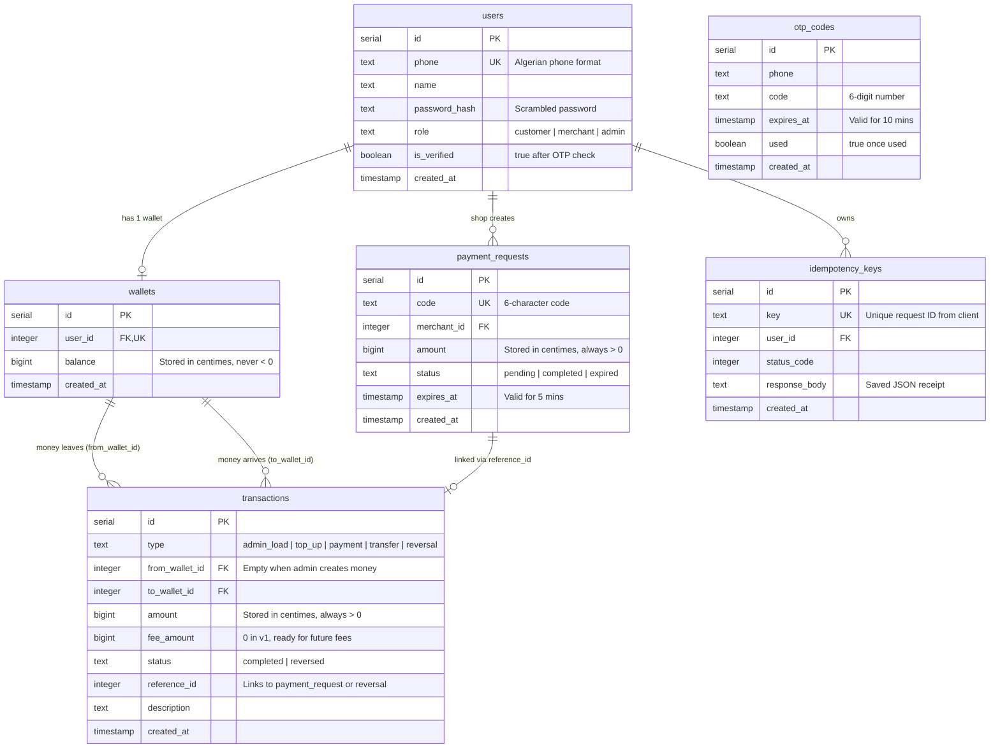

# 02 — Data Model, Ledger Design & Financial Invariants

## 1. How the Database Tables Connect

The database schema (the blueprint of all tables and columns, stored in [`src/db/schema.js`](../src/db/schema.js)) has **6 tables**.

* **PK (Primary Key):** A unique ID number for each row in a table (like a national ID number).
* **FK (Foreign Key):** A column that points to a row in another table, linking them together.
* **UK (Unique Key):** A rule that says no two rows can have the same value (for example, two users cannot share the same phone number).

---

## 2. Three Golden Rules for Financial Data

### Rule 1: Store Money as Whole Centimes (`bigint`), Never Decimals
* **How it works:** Users type whole Dinars (like `1000` DA). Before saving to the database, the app multiplies by `100` and stores `100000` centimes as a **whole integer** (`bigint` in PostgreSQL).
* **Why:** Computers are famously bad at decimal math. In JavaScript, `0.1 + 0.2` equals `0.30000000000000004`. Over thousands of transactions, tiny rounding errors add up to missing money. Storing whole centimes makes math 100% exact, while still leaving room for cents/fees later.

### Rule 2: Let the Database Enforce Safety (`CHECK` Constraints)
A **CHECK constraint** is a hard rule built directly into the database itself. Even if a programmer makes a mistake in JavaScript, PostgreSQL will flat-out refuse to save invalid data:
1. `wallets`: `CHECK (balance >= 0)` — A wallet balance can **never** become negative.
2. `transactions`: `CHECK (amount > 0)` — Every money movement must be a positive number (zero or negative transfers are blocked).
3. `payment_requests`: `CHECK (amount > 0)` — A shop cannot request 0 DA or a negative price.

### Rule 3: Never Edit or Delete History (Append-Only Ledger)
A **ledger** is the permanent record book of every money movement (`transactions` table).
* **Append-only** means you can **only add new rows**. You are never allowed to edit (`UPDATE`) or delete (`DELETE`) an old transaction.
* If someone makes a mistake in the future, you don't erase the old line—you add a *new* offsetting transaction that moves the money back (a **reversal**).
* **Future-proofing:** Even though version 1 has no fees and no reversals yet, the table already includes `fee_amount`, `status` (`completed` / `reversed`), `reference_id`, and `type` values (`transfer`, `reversal`) so new features can be added later without redesigning the database.

---

## 3. The "Conservation of Money" Rule

Because this is a closed system, **money cannot appear out of thin air or vanish**:

$$\text{Sum of ALL Wallet Balances} \;=\; \text{Sum of ALL Admin Loads}$$

* **Creating money (`admin_load`):** Only an Admin can add new money to the system (`from_wallet_id` is empty/`null`, `to_wallet_id` is the shop's wallet).
* **Moving money (`top_up` and `payment`):** Every other action takes `X` centimes out of one wallet and puts `X` centimes into another wallet. The total money across the whole platform stays **exactly the same**.

Automated tests in [`tests/payment-concurrency.test.js`](../tests/payment-concurrency.test.js) verify this exact math after running dozens of operations.

---

## 4. Fast History Lookups (Avoiding the N+1 Problem)

When a customer asks for their transaction history (`getCustomerTransactions` in [`src/services/wallet.js`](../src/services/wallet.js)), the app needs to show **who** they paid or received money from (the shop's or person's name and phone number).

* **The slow way (N+1 queries):** Loop through 50 transactions and ask the database 50 separate times: *"Who owns wallet #12?"*
* **The smart way used here:**
  1. Fetch all transactions for the customer's wallet in **1 query**.
  2. Collect all unique other wallet IDs into a list.
  3. Ask the database for all those users' names and phones in **1 single batch query** (`inArray`), then match them up in memory.
