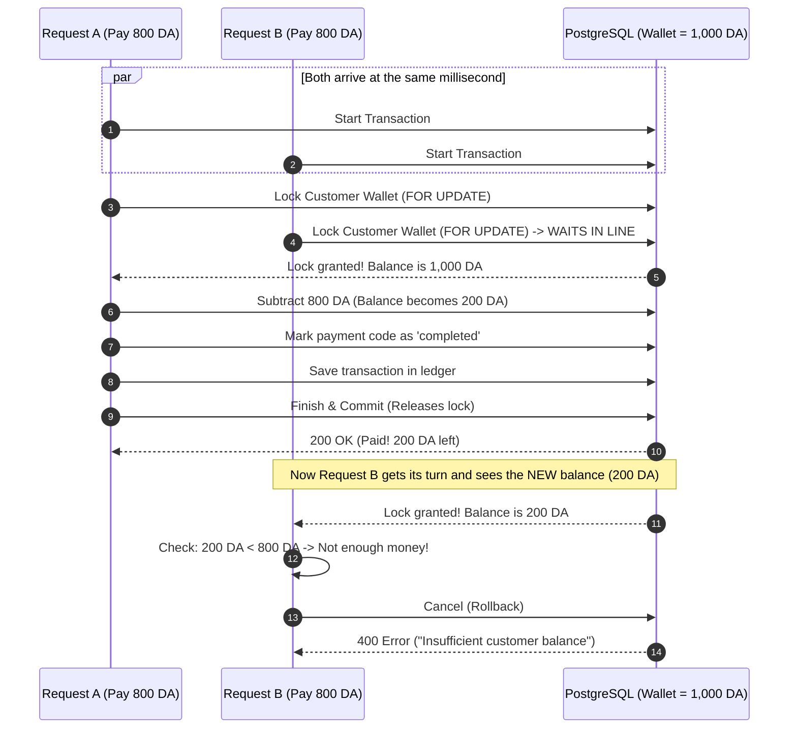
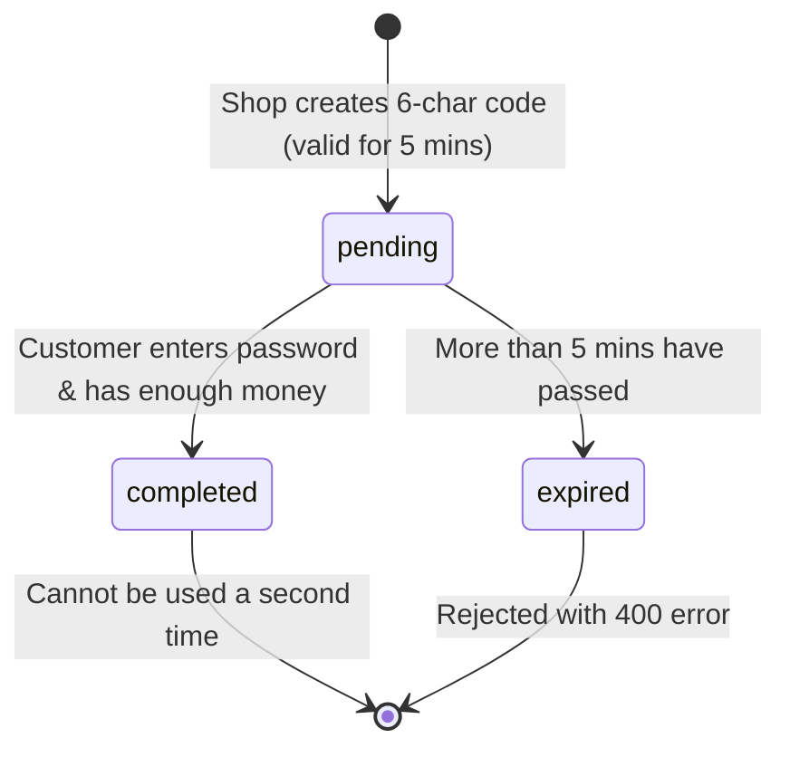

# 03 — Concurrency Control, Deadlock Prevention & Idempotency

One of the hardest problems in money software is **concurrency**—what happens when two things happen at the exact same millisecond. This guide explains the three safety shields built into the app.

---

## 1. Stopping "Double Spending" with Row Locks

Imagine a customer has **1,000 DA** in their wallet and tries to pay **800 DA** twice at the exact same millisecond (for example, tapping "Pay" on two phones at once).

Without protection, both requests look at the database at the same time, both see `1,000 DA`, both think *"Awesome, 1,000 >= 800!"*, and both subtract `800 DA`. That bug is called a **race condition** (two operations racing each other and breaking the rules).

### How This App Solves It: Pessimistic Row-Level Locking (`SELECT ... FOR UPDATE`)
* **Transaction (`db.transaction`):** A group of database steps that must **all succeed together or all cancel together** (like an all-or-nothing bundle).
* **Pessimistic Row-Level Lock (`.for('update')`):** Telling PostgreSQL: *"Freeze this specific wallet row right now. Nobody else is allowed to read or edit it until my transaction finishes."*



Because Request B has to wait in line, it sees the updated `200 DA` balance and is safely rejected.

---

## 2. Preventing Traffic Jams (**Deadlocks**)

A **deadlock** happens when two transactions freeze each other forever:
* Transaction 1 locks **Wallet A** and waits for **Wallet B**.
* Transaction 2 locks **Wallet B** and waits for **Wallet A**.
* Neither can move, so the database has to kill one of them.

### The Fix: Deterministic Lock Ordering
In [`src/services/wallet.js`](../src/services/wallet.js) and [`src/services/payment.js`](../src/services/payment.js), whenever two wallets are involved, the code **sorts their ID numbers from smallest to largest** before locking them:

```javascript
// Always lock the wallet with the smaller ID number first
const walletIdsInOrder = [customerWallet.id, merchantWallet.id].sort((a, b) => a - b);
```

If Wallet #3 and Wallet #8 are involved, **every** transaction always locks #3 first, then #8. A circular wait is mathematically impossible.

---

## 3. Single-Use Payment Codes & State Machine

A **state machine** is a rulebook that lists every allowed status an item can have and how it can move from one status to another. In [`src/services/payment.js`](../src/services/payment.js), a payment code has 3 possible statuses:



* **Lock-Before-Mutate:** Inside `confirmPaymentRequest`, the database locks the `payment_requests` row *first* (`FOR UPDATE`) before checking if it is still `pending`. That way, two people cannot redeem the same code at the same time.
* **Lazy Expiration:** Instead of running a background timer every second to expire old codes, the app simply checks the clock (`now > expiresAt`) whenever someone looks up or confirms a code, and marks it `expired` right then.
* **Human-Friendly Codes:** `generateCode()` picks 6 random characters from `ABCDEFGHJKLMNPQRSTUVWXYZ23456789` (skipping confusing look-alike characters `I`, `O`, `0`, `1`).

---

## 4. Safe Retries with Idempotency Keys

**Idempotency** means: *if you send the exact same request twice (for example, because your phone's Wi-Fi blinked and retried), the server runs it **only once** and gives you back the exact same receipt.*

### How It Works ([`src/services/payment.js`](../src/services/payment.js))
1. **Client sends a unique ID:** The app looks for a unique tag (an **Idempotency Key**) in the request header (`Idempotency-Key` or `X-Idempotency-Key`) or body (`idempotencyKey` or `requestId`).
2. **Check if already done:** Before charging anything, `confirmPaymentRequest` checks the `idempotency_keys` table. If that key is already saved for this user, it immediately returns the saved JSON receipt—no second charge!
3. **Save the receipt inside the transaction:** When a payment succeeds for the first time, the receipt is saved into `idempotency_keys` inside the **same** database transaction as the wallet update.

### Two Small Things a Senior Engineer Would Improve Later
* **Key uniqueness:** Right now, `idempotency_keys.key` is unique across the *whole table* rather than per user (`(user_id, key)`). If two different users accidentally used the same generic key like `"pay-1"`, the second user's key wouldn't be saved (though their payment still works).
* **Exact-millisecond duplicate key:** Because the `idempotency_keys` lookup happens right *before* the database transaction starts, two identical-key requests arriving at the exact same millisecond could race past the lookup, and the second one would hit `"Payment code already used"` instead of returning the cached receipt. Checking inside the transaction or re-reading on a duplicate-key error (`23505`) would close that tiny window.
