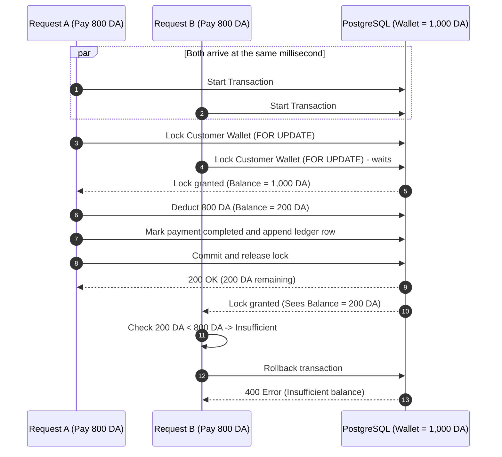
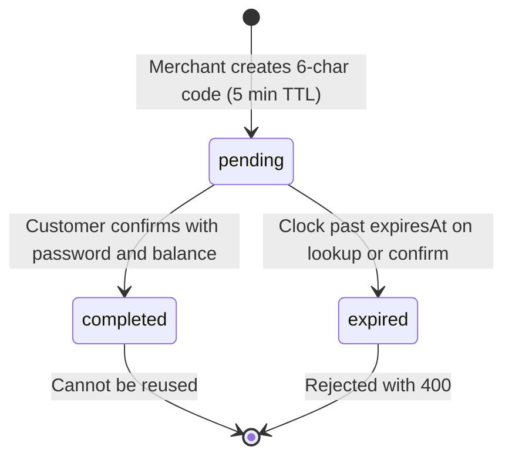
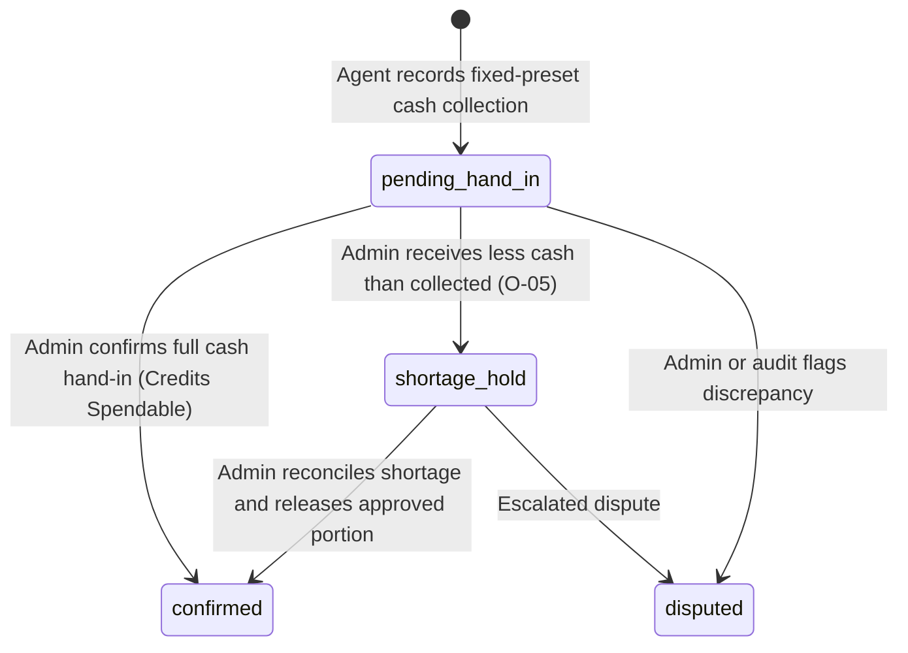
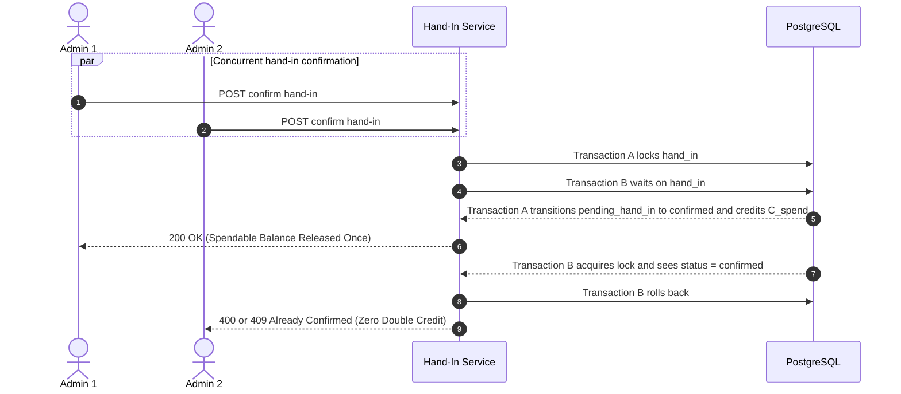
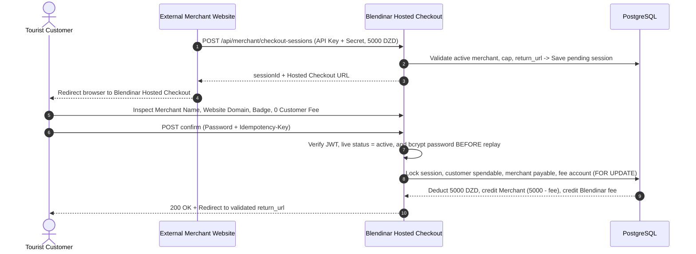
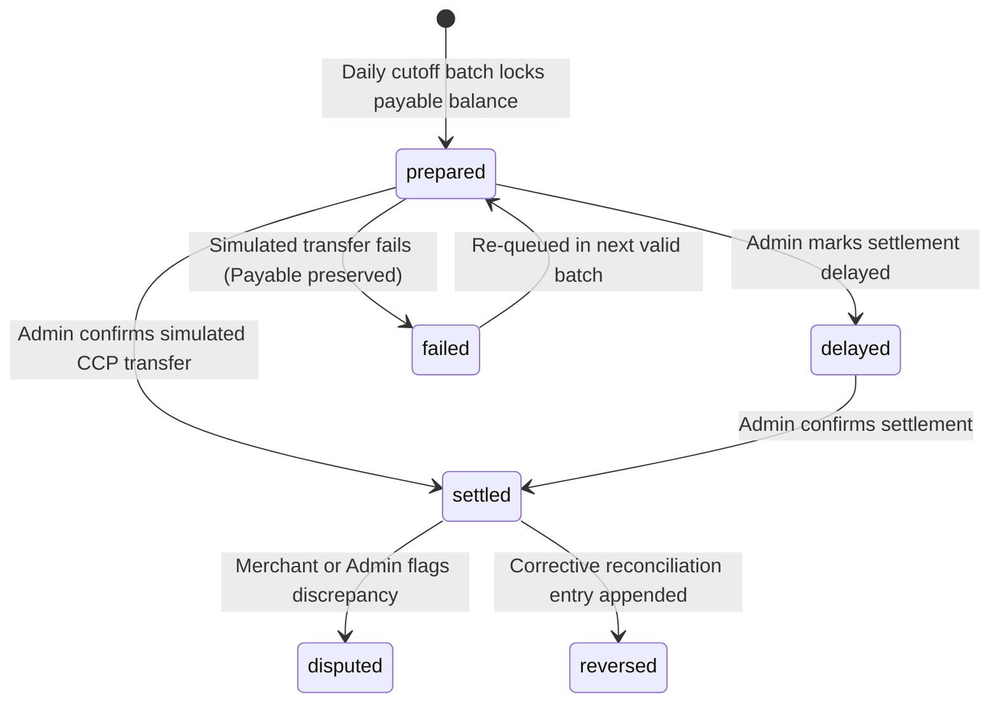

# 03 — Concurrency Control, Deadlock Prevention & Idempotency

One of the hardest problems in financial software is **concurrency**—what happens when two requests hit the server at the exact same millisecond. This guide explains the concurrency shields built into Cohort Baseline v0 and the upgraded state machines and race protections planned for Blendinar v1.

---

## 1. Stopping "Double Spending" with Row Locks (Implemented Today)

If a customer has **1,000 DA** and two **800 DA** payment requests arrive simultaneously, without database locking both requests could read `1,000 DA`, both pass the check, and both subtract `800 DA`. That bug is a **race condition**.

### Solution: Pessimistic Row-Level Locking (`SELECT ... FOR UPDATE`)
* **Transaction (`db.transaction`):** An all-or-nothing database bundle.
* **Row-Level Lock (`.for('update')`):** Tells PostgreSQL: *"Lock this exact row now; make concurrent transactions wait until mine commits or rolls back."*



---

## 2. Deadlock Prevention via Deterministic Lock Ordering (Implemented Today)

A **deadlock** occurs when Transaction 1 holds Wallet A and waits for Wallet B while Transaction 2 holds Wallet B and waits for Wallet A.

Both [`src/services/wallet.js`](../src/services/wallet.js) and [`src/services/payment.js`](../src/services/payment.js) prevent deadlocks by sorting wallet IDs from smallest to largest before calling `.for('update')`:

```javascript
const walletIdsInOrder = [customerWallet.id, merchantWallet.id].sort((a, b) => a - b);
```

Every Blendinar v1 multi-row transaction extends this exact ascending lock-ordering pattern across wallets, top-ups, hand-in batches, checkout sessions, payout rows, and refund requests.

---

## 3. Baseline Single-Use Payment Codes & State Machine (Cohort v0)

In [`src/services/payment.js`](../src/services/payment.js), Cohort v0 payment codes use **Lock-Before-Mutate** (`FOR UPDATE` on `payment_requests`), **Lazy Expiration** (`now > expiresAt`), and human-friendly 6-character codes:



---

## 4. Idempotency Keys: Verified Baseline Behavior & Task 16 Fixes

**Idempotency** ensures that if a client retries the exact same request (e.g., mobile network drop), the financial mutation runs **at most once** and returns the original receipt.

### Three Verified Findings in Cohort Baseline v0 (`src/db/schema.js` & `src/services/payment.js`)
Inspecting the current baseline implementation reveals three concrete limitations that **Task 16** in [`_docs/tasks.md`](../_docs/tasks.md) explicitly fixes:
1. **Global `key` Uniqueness Collision:** `idempotency_keys.key` in [`src/db/schema.js`](../src/db/schema.js) has a global `.unique()` index rather than composite `(user_id, endpoint, key)` scoping, so two different users sending the same generic key string collide on insert.
2. **Pre-Transaction TOCTOU Race Window:** In `confirmPaymentRequest` ([`src/services/payment.js`](../src/services/payment.js)), the `idempotency_keys` lookup executes *before* `db.transaction(...)` starts, allowing two identical-key requests arriving at the same millisecond to race past the read check before the first inserts its key.
3. **Idempotency Lookup Runs Before Password Check:** In `confirmPaymentRequest` today, the cached `idempotency_keys` lookup executes at the top of the function *before* `bcrypt.compare(password, ...)`. In Blendinar (**Task 16** & `R12-B`), **authentication, live account suspension check, and password verification MUST execute BEFORE returning any cached idempotent response**, and payload mismatches (`request_hash`) must be rejected (`409`/`422`).

---

## 5. Blendinar v1 Concurrency Sequences & State Machines *(Planned in `_docs/tasks.md`)*

### 5.1 Option B Top-Up & Admin Hand-In State Machine + Double-Confirm Protection





### 5.2 External Merchant Website & Blendinar Hosted Checkout Sequence



### 5.3 Daily Merchant CCP Payout State Machine & Double-Run Cutoff Guard



- Concurrent cutoff preparation or Admin settlement calls lock `(merchant_id, cutoff_window)` and the `merchant_payable` row (`FOR UPDATE`), ensuring a daily payout batch can settle **at most once**.

### 5.4 Customer Pre-Departure Refund Races (Payment vs. Refund & Cancel vs. Payout)

```mermaid
sequenceDiagram
    autonumber
    actor Customer as Tourist
    actor Agent as Blendinar Agent
    participant API as Refund & Checkout Services
    participant DB as PostgreSQL

    par Payment vs Refund Lock Race (3000 DZD Spendable)
        Customer->>API: Confirm 3000 DZD Hosted Checkout
        Customer->>API: Request 3000 DZD Cash Refund Lock
    end
    API->>DB: Lock customer wallet row (FOR UPDATE)
    Note over API,DB: First transaction claims 3000 DZD; second sees 0 Spendable and rejects 400

    Note over Customer,DB: Later at Fixed-Location Office
    par Cancel vs Agent Payout Race
        Customer->>API: Cancel Refund Request (if allowed per O-10)
        Agent->>API: Verify Passport and Mark Refund Paid
    end
    API->>DB: Lock refund_request row + wallet row (FOR UPDATE)
    Note over API,DB: First updates status to paid (or cancelled); second fails cleanly
```
