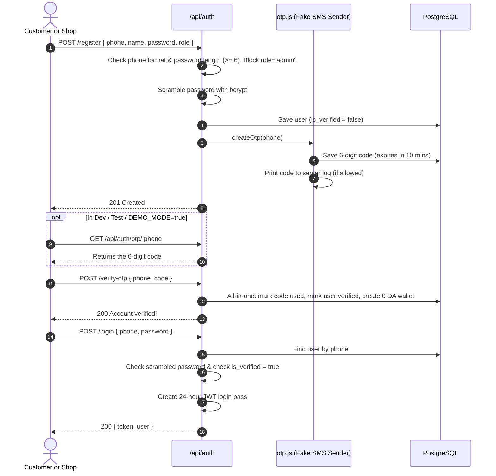

# 04 — Security, Authentication, Simulated OTP & RBAC

This guide explains how the app knows **who you are** (**Authentication**) and **what you are allowed to do** (**Authorization / RBAC**).

---

## 1. Sign-Up, Verification & Login Step-by-Step



---

## 2. Fake SMS Codes (Simulated OTP) & `DEMO_MODE`

**OTP** (*One-Time Password*) is the 6-digit code sent to verify a phone number. Sending real SMS text messages costs money and makes automated testing difficult.

To keep things simple and replaceable (Rule R7 in [`_docs/plan.md`](../_docs/plan.md)):
* **One replaceable function:** All OTP sending goes through `sendOtp()` in [`src/services/otp.js`](../src/services/otp.js). To add a real SMS provider later, you only change that one function.
* **Safety switch (`isOtpExposed()`):**
  ```javascript
  export const isOtpExposed = () =>
    process.env.NODE_ENV !== 'production' || process.env.DEMO_MODE === 'true';
  ```
  * During local development, automated tests, or when `DEMO_MODE=true` is turned on (such as in `docker-compose.yml` for reviewers), the 6-digit code is printed to the server logs and readable at `GET /api/auth/otp/:phone`.
  * In real production (without `DEMO_MODE=true`), `GET /api/auth/otp/:phone` pretends the page doesn't exist (`404 Not found`) so strangers can't steal OTP codes.
* **Re-try friendly:** If someone registers with a phone number but never finishes entering their OTP, registering again with that same unverified phone updates their info and sends a fresh OTP instead of blocking them.

---

## 3. Password Protection & Login Passes (JWT)

* **Password Hashing (`bcryptjs`):** Passwords are never saved in plain text. Before saving, `bcrypt` scrambles the password (with a cost factor of `10`) so even if someone steals the database, they cannot read the passwords.
* **Double-Check on Payments:** Even when a customer is already logged in, `confirmPaymentRequest` asks for their raw password again and checks it with `bcrypt.compare` before moving money.
* **JWT (*JSON Web Token*):** When you log in, the server gives you a signed digital pass (**JWT**) valid for `24h`. It contains `{ id, phone, name, role }` and is signed with `JWT_SECRET` so nobody can fake or edit their role.

---

## 4. Permissions & Role Checks (RBAC)

**RBAC** (*Role-Based Access Control*) means every user has a role (`customer`, `merchant`, or `admin`), and each role can only touch its own area.

In [`src/middleware/auth.js`](../src/middleware/auth.js), three security guards enforce this:

1. **`requireAuth`**: Reads the `Authorization: Bearer <token>` header from the request. If the pass is missing, expired, or tampered with, it blocks the request with `401 Unauthorized`.
2. **`requireRole(...roles)`**: Checks if the user's role in the JWT matches the route (e.g., only `admin` can call `/api/admin/*`). Otherwise, it blocks with `403 Forbidden`.
3. **`requireSelfOrAdmin`**: A helper guard that lets a user access a resource only if they are an `admin` or if the requested `userId` matches their own ID.
4. **No trusting user-supplied IDs:** Customer routes like `/api/customer/balance` never ask *"Which user's balance do you want?"* in the URL—they always use `req.user.id` from the verified login pass, so one customer can never peek at another customer's money.
5. **No self-made Admins:** `POST /api/auth/register` blocks anyone trying to sign up with `role: 'admin'`. Admins can only be created by running the server script [`src/scripts/seed-admin.js`](../src/scripts/seed-admin.js).
6. **Test-only switches locked in production:** The secret `_testFailureAfterBalanceUpdate` flag used by tests to simulate crashes is automatically forced to `false` whenever `NODE_ENV === 'production'`.
