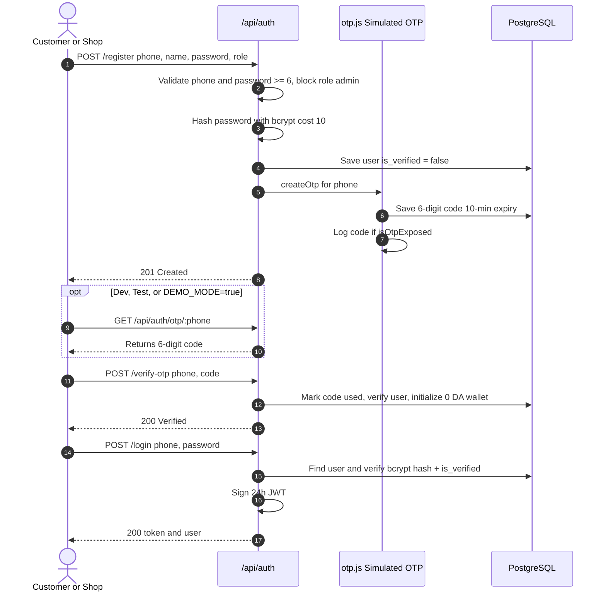
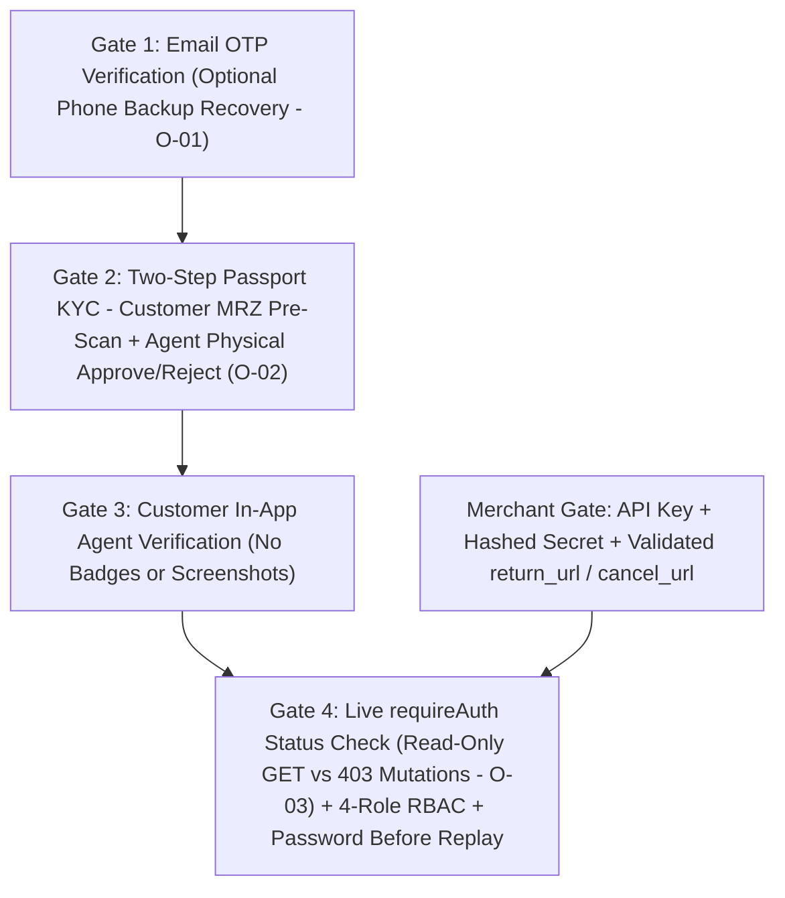

# 04 — Security, Authentication, Simulated OTP & RBAC

This guide explains how the platform verifies **who you are** (**Authentication**) and **what you are allowed to do** (**Authorization / RBAC**), covering both what runs in Cohort Baseline v0 today and the planned Blendinar v1 security architecture.

---

## 1. Current Baseline Sign-Up, Verification & Login (Cohort v0 in `src/`)



---

## 2. Simulated OTP & `DEMO_MODE` Safety Switch (Implemented Today)

An **OTP** (*One-Time Password*) is a 6-digit verification code. Sending real SMS or emails costs money, leaks PII in public tests, and breaks deterministic automated tests.

In [`src/services/otp.js`](../src/services/otp.js):
* **Single Replaceable Function (`sendOtp`):** All OTP dispatch runs behind one function so a real provider can replace it cleanly later.
* **Exposure Guard (`isOtpExposed`):**
  ```javascript
  export const isOtpExposed = () =>
    process.env.NODE_ENV !== 'production' || process.env.DEMO_MODE === 'true';
  ```
  * In local development, Vitest runs, or `DEMO_MODE=true`, codes are printed to server logs and readable via `GET /api/auth/otp/:phone` (verified by [`tests/otp-demo-mode.test.js`](../tests/otp-demo-mode.test.js)).
  * In production without `DEMO_MODE=true`, `GET /api/auth/otp/:phone` returns `404 Not found` and logs nothing.

---

## 3. Password Protection & JWTs (Implemented Today + Task 18 Hardening)

* **Password Hashing (`bcryptjs`):** Stored hashed (cost factor `10`), never plaintext.
* **Re-Confirmation on Payments:** Even with a valid JWT, `confirmPaymentRequest` verifies the customer's password again via `bcrypt.compare` before debiting funds. *(Note: **Task 16** moves this password check strictly ahead of any cached idempotency replay.)*
* **JWTs (`src/middleware/auth.js`):** `generateToken` issues 24-hour tokens signed with `getJwtSecret()`.
  * **Planned Hardening (Task 18):** Today `src/middleware/auth.js` defines `DEFAULT_JWT_SECRET` as a local dev fallback when `JWT_SECRET` is unset; Task 18 enforces failing loudly in `NODE_ENV === 'production'` if `JWT_SECRET` is missing.

---

## 4. Permissions & Role Checks (Cohort Baseline v0)

**RBAC** (*Role-Based Access Control*) restricts routes by user role in [`src/middleware/auth.js`](../src/middleware/auth.js):
1. **`requireAuth`**: Validates `Authorization: Bearer <token>`, returning `401` if missing, malformed, tampered, or expired.
2. **`requireRole(...roles)`**: Checks `req.user.role` against allowed roles (`customer`, `merchant`, `admin` in Cohort v0), returning `403` on mismatch.
3. **`requireSelfOrAdmin`**: Defined in `src/middleware/auth.js` as a reusable guard for parameterized `:userId` routes (currently routes read `req.user.id` directly from the verified JWT rather than trusting client-supplied IDs).
4. **No Self-Registered Admins:** `POST /api/auth/register` rejects `role: 'admin'` with `403`. Admins are created solely by [`src/scripts/seed-admin.js`](../src/scripts/seed-admin.js).
5. **Production Fault-Injection Lock-Off:** `_testFailureAfterBalanceUpdate` is forced `false` whenever `NODE_ENV === 'production'`.

---

## 5. Blendinar v1 Security, Authentication & Trust Model *(Planned in `_docs/plan.md` & `_docs/tasks.md`)*

### 5.1 Email-Required Registration + Simulated Email OTP; Optional Phone Backup Recovery (`R7-B`, `O-01 Confirmed`, Task 19)
- Tourists and foreigners without an Algerian SIM card register and verify using **email + password** alone (**Confirmed**).
- **Phone is strictly optional:** Empty phone inputs normalize to `NULL` so multiple phone-less tourists never trigger unique-constraint conflicts. Email is used for account access and communication (Blendinar makes no claim that email is inherently more secure than SMS).
- **Backup Account Recovery (`O-01 Confirmed`):** If a customer optionally adds and verifies a phone number, they can request a 6-digit simulated recovery OTP to that phone (via `sendOtp` in `DEMO_MODE`) to recover account access or reset their password if they lose email access.

### 5.2 4-Stage Two-Step Hybrid Passport-Only Verification (`R7-C`, `O-02 Confirmed`, Task 20)
Blendinar v1 accepts **passports only** (real third-party camera OCR APIs and national IDs are **Future**, and real-world legal sufficiency remains **Unverified**). Security and privacy boundaries separate 4 distinct stages while keeping physical verification genuine without turning employee Agents into manual KYC data-entry guards:
1. **Stage 1 — Email OTP Verification:** Establishes verified login (`email_verified = true`, `0` Spendable Balance).
2. **Stage 2 — Two-Step Hybrid Passport Verification (`O-02 Confirmed`):**
   - **Step 1 (Customer In-App ICAO MRZ Pre-Scan):** Customer submits passport details / simulated 2-line **ICAO MRZ** in-app before their first top-up. The verifier parses MRZ, checks mathematical check digits, validates expiry and name match, enforces `1` account per passport via a unique **SHA-256 hash of `(issuing_country, passport_number)`**, stores masked hint/country/expiry (**never storing raw passport scan photos**), and sets status to **`prechecked_pending_agent`** (anomalies route to `pending_admin_review`).
   - **Step 2 (Agent Physical Double-Check at First Top-Up):** When the customer arrives for their first cash top-up, the Agent Portal displays the pre-checked passport details side-by-side (**zero manual passport typing by the Agent**). The Agent checks the physical passport against the traveler and clicks **Approve** (`passport_verified = true`) or **Reject** (`passport_rejected`, with mandatory reason).
3. **Stage 3 — Cash Top-Up Authorization:** Only customers approved in Step 2 (`passport_verified = true`) can complete a cash top-up with an Agent.
4. **Stage 4 — Real Camera OCR APIs:** Explicitly **Future**.

### 5.3 Customer-Facing In-App Agent Verification (`R8-B`, Task 23)
Physical badges, uniforms, or chat screenshots are **never** treated as security proof against impersonation. Inside their **own logged-in Blendinar account**, customers verify:
- Registered Agent's name, role type (`Fixed-Location Office / Partner Point` vs. `Individual Agent`), and verification code.
- Any `pending_hand_in` top-up recorded under that verified agent.

### 5.4 4-Role RBAC & Live Account Suspension with Read-Only Mode (`R2-B`, `R15`, `O-03 Confirmed`, Tasks 21–22)
- `requireRole` expands to 4 roles (`customer`, `agent`, `merchant`, `admin`). Public `/api/auth/register` blocks self-registration of both `agent` and `admin` (`403`).
- **`requireAuth` Live DB Check & Read-Only Mode (`O-03 Confirmed`):** Every authenticated request checks live `users.status` (`active` vs. `suspended`) in PostgreSQL. Suspended customers **can log in in Read-Only Mode** (`GET` profile, separated 3 balances, transaction history, and suspension reason/appeal notice) so it is transparent their funds are preserved, while all financial or state-changing mutations (`POST` top-ups, payments, refunds, profile edits) fail immediately with **`403 Account suspended`**. In-flight pending top-ups and locked refunds stay held for Admin review, and existing balances/history are never erased.

### 5.5 External Merchant API Keys & Redirect Safety (`R9-B`, Task 28)
- Registered merchants receive an API key and a secret key stored **hashed at rest** (shown once on creation/rotation).
- Checkout session creation validates `return_url` and `cancel_url` strictly (`http:`/`https:`, blocking `javascript:` XSS schemes and open-redirect abuse).
- Hosted Checkout displays the merchant's registered domain and manual Admin verification badge (`Verified Merchant` vs. `Unverified Merchant — lower transaction limits apply`).

### 5.6 Blendinar v1 Email Auth, Two-Step Passport KYC & Live Suspension Flow *(Planned)*

```mermaid
sequenceDiagram
    autonumber
    actor Tourist as Tourist Customer
    participant AuthAPI as Blendinar Auth API
    participant OTP as Simulated OTP (DEMO_MODE)
    participant KYC as In-App ICAO MRZ Verifier
    actor Agent as Employee Agent
    participant AuthMW as requireAuth (Live DB Check)
    participant DB as PostgreSQL

    Tourist->>AuthAPI: POST /register (email, name, password, phone optional)
    AuthAPI->>DB: Normalize blank phone to NULL -> Save user (email_verified = false)
    AuthAPI->>OTP: sendOtp(email, 6-digit code)
    Tourist->>AuthAPI: POST /verify-otp (email, code)
    AuthAPI->>DB: Mark email_verified = true and create 0 DZD wallet
    opt Optional verified phone backup recovery (O-01 Confirmed)
        Tourist->>AuthAPI: Request recovery OTP on verified phone via sendOtp
    end

    Note over Tourist,KYC: Stage 2 Step 1 - Customer in-app ICAO MRZ pre-scan (O-02 Confirmed)
    Tourist->>KYC: Submit 2-line ICAO MRZ in-app (no raw photo stored)
    KYC->>DB: Check digits, expiry, name match + unique SHA-256(country, number) -> prechecked_pending_agent

    Note over Tourist,Agent: Stage 2 Step 2 - Agent physical passport double-check at first top-up
    Agent->>DB: View pre-checked summary side-by-side (zero manual Agent typing)
    alt Physical passport matches traveler
        Agent->>DB: Click Approve -> passport_verified = true (Stage 3 top-up enabled)
    else Mismatch, expired, or suspected fraud
        Agent->>DB: Click Reject with mandatory reason -> passport_rejected (Admin review)
    end

    Tourist->>AuthMW: Authenticated Request with JWT
    AuthMW->>DB: Check live users.status (active vs suspended)
    alt users.status == active
        AuthMW-->>Tourist: Full read and financial mutation access
    else users.status == suspended (O-03 Confirmed)
        AuthMW-->>Tourist: Read-Only GET allowed (Balances intact); mutations rejected 403 Account Suspended
    end
```


