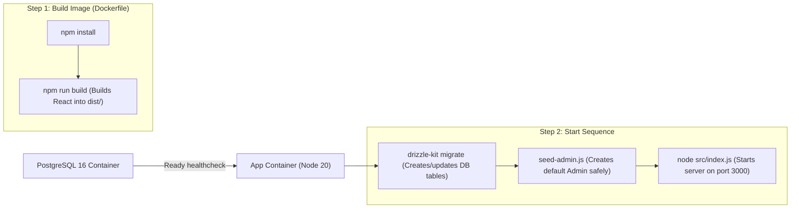
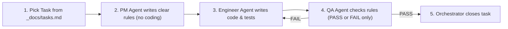

# 06 — DevOps, Testing Strategy & Agentic Engineering Workflow

## 1. Automated Testing: Proving Everything Against a Real Database

Instead of faking the database in tests (**mocking**), all **9 test files (133 tests)** in [`tests/`](../tests/) talk to a **real PostgreSQL 16 database** using **Vitest** (the test runner) and **Supertest** (a tool that sends test HTTP requests to `app.js`).

| Test File | What It Proves |
| :--- | :--- |
| `health.test.js` | The server boots up and responds `{"status":"ok"}`. |
| `auth-register.test.js` | Phone format rules, blocking duplicate phones, OTP creation & verification. |
| `otp-demo-mode.test.js` | Fake OTPs are hidden in production unless `DEMO_MODE=true`. |
| `auth-login.test.js` | Password checking, blocking unverified users, and issuing JWT login passes. |
| `rbac.test.js` | Customers, shops, and admins cannot access each other's private endpoints (`401`/`403`). |
| `wallet-ledger.test.js` | 0 DA wallet creation, centime math, and private transaction history. |
| `admin-load.test.js` | Admin loading money into a shop, plus **crash-rollback proof**. |
| `merchant-topup.test.js` | Shop crediting a customer, rejecting insufficient shop funds, blocking self-top-up. |
| `payment.test.js` & `payment-concurrency.test.js` | 5-min payment codes, password checks, double-click safety (**idempotency**), two simultaneous 800 DA payments on a 1,000 DA wallet, and total money conservation. |

### Crash-Simulation Testing (**Fault Injection**)
How do you prove that if the server crashes halfway through a payment, the customer doesn't lose money?
* In non-production mode, `wallet.js` and `payment.js` accept a hidden test flag: `_testFailureAfterBalanceUpdate: true`.
* When turned on, the code updates the wallet balance and then **deliberately throws a fake crash** right before saving the transaction history.
* The test checks the database afterward and proves PostgreSQL automatically undid (**rolled back**) the balance change.

---

## 2. One-Command Startup with Docker

**Docker** packages the app and its database into isolated boxes (**containers**) so it runs the exact same way on every computer. [`docker-compose.yml`](../docker-compose.yml) and [`Dockerfile`](../Dockerfile) start everything with one command (`docker compose up --build`):

* **Idempotent Admin Seeding ([`src/scripts/seed-admin.js`](../src/scripts/seed-admin.js)):** "Idempotent" here means you can run this script 100 times and it will create the default Admin (`0555000000` / `Admin1234!`) only once without crashing on duplicates.

---

## 3. Automatic Quality Checks (**CI / Continuous Integration**)

**CI** (*Continuous Integration*) is an automated robot that tests your code every time you upload changes to GitHub. In [`.github/workflows/ci.yml`](../.github/workflows/ci.yml), on every push or pull request to `main`, GitHub:
1. Starts a fresh PostgreSQL 16 database.
2. Installs packages (`npm ci`).
3. Applies database table migrations (`npx drizzle-kit migrate`).
4. Runs all 133 tests (`npm test`).
5. Verifies the React frontend builds cleanly (`npm run build`).

---

## 4. How AI Agents Built This Project ([`_docs/process.md`](../_docs/process.md))

The codebase was built using a structured AI team workflow where each AI role had strict boundaries:

---

## 5. What Is Left for Later ("M5 Later" Roadmap)

The core backend, concurrency safety, Docker setup, and CI pipeline are complete. These items are intentionally saved for a future version:
1. **Spending Limits (Task 8):** 50,000 DA max per payment, 100,000 DA/day, 200,000 DA max customer wallet balance.
2. **Customer-to-Customer Transfers (Task 10):** Sending money by phone number with recipient name preview (`type: 'transfer'` is already in `schema.js`).
3. **Admin Reversals / Refunds (Task 11):** Offsetting transactions (`type: 'reversal'`, `status: 'reversed'`, `referenceId` are already in `schema.js`).
4. **Shop Approval & Shop History (Task 12):** Letting admins approve shops before they can operate.
5. **50-Request Stress Test & Transfer Idempotency (Task 9 remaining).**
6. **Full React Screens (Tasks 13–14):** Replacing the starter page in [`src/client/App.jsx`](../src/client/App.jsx) with full Customer, Shop, and Admin dashboards.
7. **Live Public Website (Task 15 remaining):** Deploying the `Dockerfile` to Render (step-by-step instructions are in [`README.md`](../README.md)).
