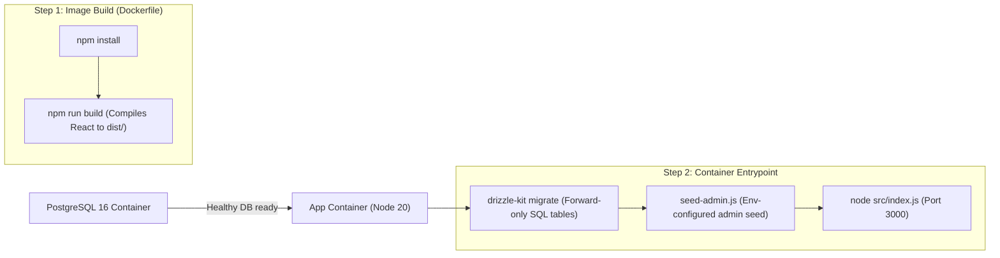
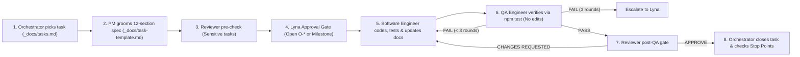

# 06 — DevOps, Testing Strategy & Agentic Engineering Workflow

## 1. Automated Testing: Proving Everything Against Real PostgreSQL

Rather than mocking the database, Blendinar runs all **10 test files** in [`tests/`](../tests/) (**148 automated tests** on `next-product` after Task 16; **137 tests** in Cohort Baseline v0 on `main`) against a **real PostgreSQL 16 database** via **Vitest** and **Supertest** (`npm test` -> `vitest run --no-file-parallelism`).

| Test File | Verified Baseline (`main`) | What It Proves Today (Cohort Baseline v0 + Task 16 on `next-product`) |
| :--- | :---: | :--- |
| `tests/health.test.js` | 2 | Server boots cleanly and `/health` + `/api/health` respond `{"status":"ok"}`. |
| `tests/auth-register.test.js` | 16 | Phone format rules, duplicate blocking, simulated OTP creation & verification. |
| `tests/otp-demo-mode.test.js` | 4 | `isOtpExposed()` hides simulated OTP logs and HTTP endpoint in production unless `DEMO_MODE=true`. |
| `tests/auth-login.test.js` | 6 | `bcrypt` password verification, unverified user blocking, and JWT issuance. |
| `tests/rbac.test.js` | 15 | Missing/invalid token `401` and role/resource isolation `403` across `customer`, `merchant`, and `admin`. |
| `tests/wallet-ledger.test.js` | 18 | Zero-balance initialization, centime math, and private chronological customer ledger. |
| `tests/admin-load.test.js` | 23 | Admin loading funds into a shop, input boundaries, and crash-rollback proof (`+1` `MAX_SAFE_DINARS` overflow guard on `next-product` = 24). |
| `tests/merchant-topup.test.js` | 27 | Shop crediting customer wallet, insufficient shop funds rejection, self-top-up block, and rollback proof (`+1` `MAX_SAFE_DINARS` overflow guard on `next-product` = 28). |
| `tests/payment.test.js` | 23 | 5-min payment codes, password checks, expiration, invalid states, and rollback proof (`+1` `MAX_SAFE_DINARS` overflow guard on `next-product` = 24). |
| `tests/payment-concurrency.test.js` | 3 | Payment idempotency replay, dual simultaneous `800 DA` payments on `1,000 DA` balance, and baseline conservation (`+8` Task 16 scoped idempotency, password-before-replay, `409` mismatch & advisory-lock race tests on `next-product` = 11). |
| **Total Verified Tests** | **137 (`main`) / 148 (`next-product`)** | **10 test files passing with `--no-file-parallelism` (`_docs/testing-guidelines.md`)** |

### Crash-Simulation Testing (**Fault Injection**)
To prove mid-transaction failures never leave half-finished money movements:
* Non-production routes pass `_testFailureAfterBalanceUpdate` into [`src/services/wallet.js`](../src/services/wallet.js) and [`src/services/payment.js`](../src/services/payment.js).
* In production (`NODE_ENV === 'production'`), routes force `_testFailureAfterBalanceUpdate` to `false`.
* When triggered in tests, PostgreSQL automatically rolls back balance updates so balances and ledger rows remain untouched.

---

## 2. One-Command Startup with Docker (`docker-compose.yml` & `Dockerfile`)

**Docker** packages Node.js, built React assets, and PostgreSQL 16 into reproducible containers started via `docker compose up --build`:

* **Idempotent Admin Seeding ([`src/scripts/seed-admin.js`](../src/scripts/seed-admin.js)):** Safe to run repeatedly on container boot without duplicating the admin account.
* **Credential Safety (Hardened in Task 18):** Never publish hardcoded admin passwords or phone numbers in documentation or templates. Configure initial admin credentials through environment variables (`ADMIN_PHONE` / `ADMIN_EMAIL`, `ADMIN_PASSWORD`, `ADMIN_NAME` in `.env` or secret store).

---

## 3. Continuous Integration (`.github/workflows/ci.yml`)

GitHub Actions runs on pushes and pull requests to both **`main`** and **`next-product`**:
1. Starts PostgreSQL 16 with healthchecks.
2. Runs `npm ci`.
3. Applies migrations (`npx drizzle-kit migrate`).
4. Runs the full real-DB suite (`npm test` — **10 test files / 148 automated tests** on `next-product` after Task 16; **137 tests** in Cohort Baseline v0 on `main`).
5. Verifies the Vite production frontend build (`npm run build`).

---

## 4. Blendinar 5-Agent Engineering Workflow ([`_docs/process.md`](../_docs/process.md))

Blendinar uses a structured **5-agent team** with strict role boundaries, pre/post review gates, Lyna approval gates, a **3-failure QA escalation rule**, and **Milestone Stop Points**:

---

## 5. Current Baseline vs. Blendinar v1 Roadmap

The Cohort Baseline v0 backend, concurrency proof, Docker packaging, and CI pipeline on `main` are verified (**10 test files, 137 tests**). On **`next-product`**, **Task 16** (scoped `(user_id, endpoint, key)` idempotency, payload hashing, auth-before-replay, `pg_advisory_xact_lock`, and `MAX_SAFE_DINARS` overflow guard — bringing `npm test` to **10 test files, 148 automated tests**) and **Task 17** (`main` + `next-product` CI coverage) are implemented; remaining Blendinar v1 work continues across **9 milestones** documented in [`_docs/plan.md`](../_docs/plan.md) and [`_docs/tasks.md`](../_docs/tasks.md):
1. **M1:** Scoped idempotency `(user_id, endpoint, key)` + auth-before-replay + overflow guard (`Task 16`, **Done**), `next-product` CI (`Task 17`), and secret/seed hardening & simulated-money branding (`Task 18`).
2. **M2:** Email-first auth + simulated email OTP + optional phone (`Task 19`), passport-only KYC stages (`Task 20`), and live account suspension preserving balances (`Task 21`).
3. **M3:** Employee `agent` role, Fixed-Location Offices vs. Individual Agents, Cash Exposure Limits (`Task 22`), and customer Agent Directory + in-app verification (`Task 23`).
4. **M4 (`[Stop Point]`):** Option B fixed-preset pending top-ups (`Task 24`), Admin hand-in release (`Task 25`), and shortage/discrepancy audit flags (`Task 26`).
5. **M5:** External merchant website/CCP onboarding & manual verification (`Task 12 / Task 27`), API keys & Hosted Checkout session backend (`Task 28`).
6. **M6 (`[Stop Point]`):** Hosted Checkout payment with configurable merchant fee & `0` customer fee (`Task 29`) and centralized limits (`Task 8`).
7. **M7 (`[Stop Point]`):** Daily Merchant CCP Payout batches, Admin simulated settlement & exception states (`Task 30`).
8. **M8 (`[Stop Point]`):** Pre-departure customer cash refund locks (`Task 31`) and Agent passport check & cash disbursement (`Task 32`).
9. **M9 (`[Stop Points per Frontend Area]`):** Admin config/conservation APIs (`Task 33`), 50-request stress & two-part conservation suite (`Task 34`), Customer/Hosted Checkout UI (`Task 13`), Agent/Merchant/Admin portals (`Task 14`), and demonstration external store integration (`Task 35`).

*(Deferred to **Future**: P2P transfers `R10` subject to `O-11`, Admin reversals `R11`, public URL deployment, real bank/CCP/SMS/email/OCR APIs, Arabic/French UI. The **AI Milestone** is explicitly **Dropped**.)*
