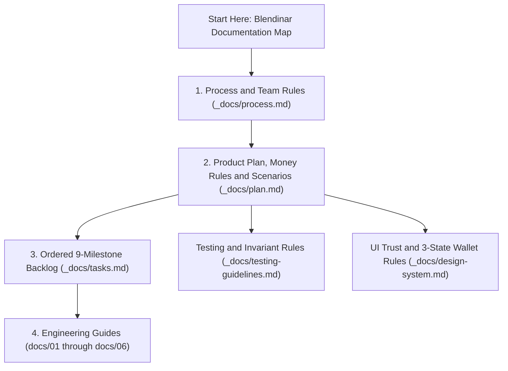

# Blendinar — Engineering & Architecture Documentation Suite

Welcome to the documentation for **Blendinar** (`project1-dtc`), our **Simulated Digital Wallet and Online Merchant Payment Platform**.

These guides explain how the codebase works from the inside out—including the big-picture design, database rules, how the app stays safe when two people click "Pay" at the exact same millisecond, and how the Cohort Baseline v0 implementation is evolving into Blendinar v1.

Whenever a technical term is used, **a plain-English definition is given right next to it** so you never have to guess what it means.

> **Important Simulated-Money & Regulatory Notice:**
> **All money in Blendinar is 100% fake and simulated** (Algerian Dinars, DZD). Cash collections, cash hand-ins, daily CCP payouts, and customer cash refunds exist solely for educational and portfolio demonstration—never real banking or payment processing. Legal, central-bank, anti-money laundering (AML), and data-protection obligations are marked **Unverified** in [`_docs/plan.md`](../_docs/plan.md).

---

## How to Read & Understand the Project (Visual Onboarding Map)

---

## Cohort Baseline v0 (Built Today) vs. Blendinar v1 (Target Scope)

```mermaid
flowchart LR
    subgraph Baseline ["Cohort Baseline v0 (Implemented in src/ Today)"]
        B1["3 Roles: customer, merchant, admin"]
        B2["Phone Registration + Simulated SMS OTP"]
        B3["Shop-Float Cash Top-Ups (Admin Loads Shop)"]
        B4["6-Char 5-Min Payment Codes (0 Fees)"]
        B5["10 Test Files / 137 Passing Real-DB Tests"]
        B6["React Starter Card Only (src/client/App.jsx)"]
    end

    subgraph Target ["Blendinar v1 Target (Milestones 1-9 in _docs/tasks.md)"]
        T1["4 Roles: customer, employee agent, merchant, admin"]
        T2["Email Auth + Simulated Email OTP (Phone Optional)"]
        T3["Passport-Only KYC + Option B Agent Hand-Ins"]
        T4["External Merchant Hosted Checkout + Configurable Fees"]
        T5["Daily Simulated CCP Payouts + Cash Refunds (0 Fee)"]
        T6["Full React Portals + Live Account Suspension Check"]
    end

    Baseline -->|"Evolves via Gated Milestones on next-product"| Target
```

---

## What Each Guide Covers

| Guide | What You Will Learn |
| :--- | :--- |
| **[01 — System Architecture](./01-system-architecture.md)** | How the backend is organized into 4 layers, why `app.js` and `index.js` are separated, current Cohort v0 API endpoints, and Blendinar v1's planned 4-role + external merchant architecture. |
| **[02 — Data Model & Ledger](./02-data-model-and-ledger.md)** | How database tables connect, why money is stored as whole cents (**centimes**) instead of decimals, why transaction history is append-only, and Blendinar's planned tables & Two-Part Conservation Invariant. |
| **[03 — Concurrency & Idempotency](./03-concurrency-and-idempotency.md)** | How PostgreSQL row locks stop **double spending**, verified idempotency findings slated for Task 16, and Blendinar v1 concurrency sequences for Option B top-ups, hosted checkout, CCP payouts, and refunds. |
| **[04 — Security, Auth & RBAC](./04-security-auth-and-rbac.md)** | How sign-up, simulated **OTP** (`DEMO_MODE`), password **hashing**, **JWT** passes, and **RBAC** work today, plus Blendinar's planned email-first auth, passport KYC stages, agent verification, and live suspension enforcement. |
| **[05 — Design Patterns & ADRs](./05-design-patterns-and-adrs.md)** | Reusable coding patterns and Architectural Decision Records (**ADR-001** through **ADR-012**) explaining both historical Cohort v0 decisions and Blendinar v1 choices. |
| **[06 — DevOps, Testing & Workflow](./06-devops-testing-and-workflow.md)** | How **10 real-DB test files (137 tests)** prove safety, one-command **Docker** startup, **CI** checks, and the **5-agent workflow** (`Orchestrator`, `PM`, `Software Engineer`, `QA Engineer`, `Reviewer`). |

---

## How Blendinar Works in Plain English (Target Blendinar v1 Flow)

Blendinar is built for **tourists and foreigners in Algeria** (who lack BaridiMob or CCP accounts) to pay online on external merchant websites using physical Algerian Dinars, and cash out unused funds before departing.

> **Current Codebase Note:** The diagram below illustrates the **Target Blendinar v1 Flow** specified in [`_docs/plan.md`](../_docs/plan.md) and scheduled in [`_docs/tasks.md`](../_docs/tasks.md). Currently, `src/` runs **Cohort Baseline v0** (3 roles, phone OTP, shop-float cash top-ups loaded by Admin, and 6-character payment codes).

```mermaid
flowchart LR
    Customer["Customer (Email Auth + Passport Check)"] -->|"1. Hands physical DZD cash"| Agent["Blendinar Employee Agent (Office or Individual)"]
    Agent -->|"2. Records fixed preset -> Pending (Not Yet Spendable)"| PendingTopUp["Pending Top-Up Record"]
    Agent -->|"3. Hands in physical cash"| Admin["Administrator"]
    Admin -->|"4. Confirms hand-in (Option B)"| Spendable["Customer Spendable Balance"]
    MerchantSite["External Merchant Website"] -->|"5. Creates Hosted Checkout Session"| HostedCheckout["Blendinar Hosted Checkout (0 Customer Fee)"]
    Spendable -->|"6. Customer confirms with password"| HostedCheckout
    HostedCheckout -->|"7. Gross minus Merchant Fee"| MerchantPayable["Merchant Payable Balance"]
    HostedCheckout -->|"8. Platform Fee"| FeeAcct["Blendinar Accumulated Fees"]
    MerchantPayable -->|"9. Daily Batch + Admin Confirm"| CCPPayout["Simulated Merchant CCP Payout"]
    Spendable -->|"10. Lock Unused Balance -> Cash Pickup"| RefundCash["Pre-Departure Cash Refund (0 Fee)"]
```

1. **Pending Cash Top-Up (`Option B`):** A tourist gives cash to a Blendinar employee Agent, creating a **Pending Top-Up** that stays **not yet spendable** until an Administrator confirms the Agent's physical cash hand-in.
2. **Hosted Checkout & Merchant Fees:** Merchants keep their own external websites and embed a Blendinar button leading to Blendinar's Hosted Checkout (`0 DZD` customer fee; configurable merchant fee deducted into Blendinar Accumulated Fees).
3. **Daily CCP Payouts & Pre-Departure Refunds:** Admins settle daily Merchant Payable Balances via simulated CCP transfers, and tourists can immediately lock leftover Spendable Balance for a `0 DZD`-fee physical cash refund via an authorized Agent before leaving Algeria.

---

## What Is Built in Code Today vs. Planned Blendinar v1 Scope

| Capability | Verified Status Today | Where to Find It |
| :--- | :--- | :--- |
| Express app split & `/health` check | **Built (Cohort Baseline v0)** | [`src/app.js`](../src/app.js), [`src/index.js`](../src/index.js) |
| PostgreSQL 16 + Drizzle ORM schema & 4 migrations | **Built (Cohort Baseline v0)** | [`src/db/schema.js`](../src/db/schema.js), [`drizzle/`](../drizzle/) |
| Phone registration, simulated SMS OTP (`DEMO_MODE`), JWT & 3-role RBAC | **Built (Cohort Baseline v0)** | [`src/routes/auth.js`](../src/routes/auth.js), [`src/services/otp.js`](../src/services/otp.js), [`src/middleware/auth.js`](../src/middleware/auth.js) |
| Admin shop load, shop-float top-up, 6-char 5-min payment codes, baseline concurrency & idempotency | **Built (Cohort Baseline v0)** | [`src/services/wallet.js`](../src/services/wallet.js), [`src/services/payment.js`](../src/services/payment.js) |
| Real-PostgreSQL automated test suite (**10 test files / 137 tests**) | **Built & Verified (Cohort Baseline v0)** | [`tests/`](../tests/) (`npm test`) |
| Docker Compose packaging & `main` branch GitHub Actions CI | **Built (Cohort Baseline v0)** | [`Dockerfile`](../Dockerfile), [`docker-compose.yml`](../docker-compose.yml), [`.github/workflows/ci.yml`](../.github/workflows/ci.yml) |
| React frontend (`React 19`, `Vite 6`, `Tailwind CSS 4`) | **Starter placeholder card only** | [`src/client/App.jsx`](../src/client/App.jsx) |
| Scoped `(user_id, endpoint, key)` idempotency, email OTP + optional phone, passport KYC, live suspension, `agent` role, Option B hand-ins, external merchant hosted checkout + fees, daily CCP payouts, customer cash refunds, centralized limits, and full React portals | **Planned Blendinar v1 (Grooming & Milestones 1–9)** | [`_docs/plan.md`](../_docs/plan.md), [`_docs/tasks.md`](../_docs/tasks.md) |
