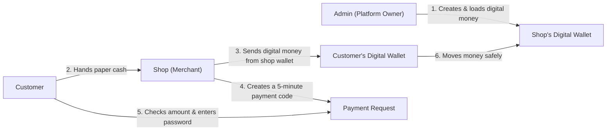

# Engineering & Architecture Documentation Suite

Welcome to the documentation for the **Digital Wallet & Merchant Payment Platform** (`project1-dtc`).

These guides explain how the whole project works from the inside out—including the big-picture design, database rules, how the app stays safe when two people click "Pay" at the exact same time, and why the original developer made each choice.

Whenever a technical term is used, **a plain-English definition is given right next to it** so you never have to guess what it means.

> **Important Note:** All money in this app is **100% fake** (simulated Algerian Dinars, DZD). It is a learning and portfolio project, not a real bank.

---

## What Each Guide Covers

| Guide | What You Will Learn |
| :--- | :--- |
| **[01 — System Architecture](./01-system-architecture.md)** | How the code is organized into layers, why the app is split into `app.js` and `index.js`, and all the web addresses (**API endpoints**) the app exposes. |
| **[02 — Data Model & Ledger](./02-data-model-and-ledger.md)** | How the database tables connect, why money is stored as whole cents (**centimes**) instead of decimals, and why transaction history can never be edited. |
| **[03 — Concurrency & Idempotency](./03-concurrency-and-idempotency.md)** | How the app stops people from spending the same money twice (**race conditions**) and safely handles duplicate button clicks (**idempotency**). |
| **[04 — Security, Auth & RBAC](./04-security-auth-and-rbac.md)** | How sign-up, fake SMS codes (**OTP**), password scrambling (**hashing**), login passes (**JWT**), and user permissions (**RBAC**) work. |
| **[05 — Design Patterns & ADRs](./05-design-patterns-and-adrs.md)** | The reusable coding recipes (**design patterns**) and the 7 big engineering decisions (**ADRs**) the developer made before writing code. |
| **[06 — DevOps, Testing & Workflow](./06-devops-testing-and-workflow.md)** | How automated tests prove the app works, how **Docker** runs everything in one command, and how AI agents helped build the project. |

---

## How the App Works in Plain English

Imagine a neighborhood where people mostly use paper cash, not bank cards. This app lets them turn paper cash into digital money on their phone:

1. **Admin loads a shop:** The platform owner (Admin) puts digital money into a trusted local shop's account. This is the **only** way new money enters the app.
2. **Customer deposits cash:** A customer walks into the shop, hands over paper cash (say, 3,000 DA), and the shop sends 3,000 DA from its own app balance to the customer's app wallet.
3. **Customer pays a shop:** When buying something, the shop generates a short 6-character code. The customer types that code into their phone, checks the shop name and price, and types their password to pay.

---

## What Is Built Right Now vs. What Is Planned for Later

The project has 15 planned tasks (listed in [`_docs/tasks.md`](../_docs/tasks.md) and [`_docs/plan.md`](../_docs/plan.md)). Here is what actually works in the code today:

| Feature | Status | Where to Find It in the Code |
| :--- | :--- | :--- |
| Web server, health check & webpage loader | **Built** | [`src/app.js`](../src/app.js), [`src/index.js`](../src/index.js) |
| Database tables & setup scripts (**migrations**) | **Built** | [`src/db/schema.js`](../src/db/schema.js), [`drizzle/`](../drizzle/) |
| Sign-up & fake SMS verification code (**OTP**) | **Built** | [`src/routes/auth.js`](../src/routes/auth.js), [`src/services/otp.js`](../src/services/otp.js) |
| Login passes (**JWT**) & permission checks (**RBAC**) | **Built** | [`src/middleware/auth.js`](../src/middleware/auth.js), [`src/scripts/seed-admin.js`](../src/scripts/seed-admin.js) |
| Customer balance & transaction history (**ledger**) | **Built** | [`src/routes/customer.js`](../src/routes/customer.js), [`src/services/wallet.js`](../src/services/wallet.js) |
| Admin loading money into a shop | **Built** | [`src/routes/admin.js`](../src/routes/admin.js), [`src/services/wallet.js`](../src/services/wallet.js) |
| Shop adding cash to a customer's wallet | **Built** | [`src/routes/merchant.js`](../src/routes/merchant.js), [`src/services/wallet.js`](../src/services/wallet.js) |
| 5-minute payment codes & password confirmation | **Built** | [`src/services/payment.js`](../src/services/payment.js) |
| Double-click protection & simultaneous payment safety | **Built** | [`src/services/payment.js`](../src/services/payment.js), [`tests/payment-concurrency.test.js`](../tests/payment-concurrency.test.js) |
| One-command **Docker** setup & automatic **CI** checks | **Built** | [`Dockerfile`](../Dockerfile), [`docker-compose.yml`](../docker-compose.yml), [`.github/workflows/ci.yml`](../.github/workflows/ci.yml) |
| Visual screens (**React frontend**) | **Starter page only** | [`src/client/App.jsx`](../src/client/App.jsx) |
| Customer-to-customer transfers, spending limits, refunds (**reversals**), shop approval, live website hosting | **Planned for Later** | Some database fields are already prepared in [`src/db/schema.js`](../src/db/schema.js) |
